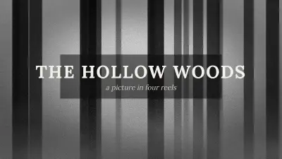

<!-- Generated by tools/gallery.mjs from showcase.yaml and build.json; do not edit. -->
# Black & White Film Look

[Film](../README.md) › [Effects & Color](../README.md#effects--color) · `color` `black-white` `film-grain` `vignette` `demo-footage`

A misty forest turned into a grainy black-and-white film frame with extra contrast and a soft vignette, under a serif title.



<sub>Animated preview: 0–3 s, 24 frames rendered by Kition Film. Still: [thumb.png](thumb.png)</sub>

| | |
|---|---|
| Document | [black-white-film-look.kfilm](black-white-film-look.kfilm) (18 KB) |
| Contents | 1920 × 1080 @ 24 fps; 12.0 s; 2 video clips; 7 effects |
| Features | `film.effects.basics`, `film.graphics.text-basics` |
| Built by | `kition-film` @ `27c94b23fd`: 16 commands in 23 ms |

## About

Four stacked effects make the look: Black & White drops the colour, Brightness & Contrast
deepens the trunks, Noise adds monochrome grain and Vignette darkens the corners. The title
card is set in Lora, a serif from kition-fonts, in the spirit of an old picture's opening.

## Checks

- `inspect.sequence.video.0.items.0.effects`: `{"count":7}`
- `inspect.sequence.video.0.items.0.effects.0.effect`: `"black_white"`
- `inspect.sequence.video.0.items.0.effects.1.params.contrast.value`: `25`
- `inspect.sequence.video.0.items.0.effects.2.params.amount.value`: `30`
- `inspect.sequence.video.0.items.0.effects.2.params.color.value`: `false`
- `inspect.sequence.video.0.items.0.effects.3`: `{"effect":"vignette","params":{"amount":{"value":-45}}}`
- `inspect.sequence.video.1.items.0.effects.4.params`: `{"font":{"value":"Lora"},"font_style":{"value":"Bold"}}`
- `inspect.sequence.video.1.items.0.effects.5.params`: `{"font":{"value":"Lora"},"font_style":{"value":"Italic"}}`
- diagnostics: none (the kit's check finds nothing wrong)
- the saved document opens again; the thumbnail matches `thumb.png` within the `render` tolerance

## Steps

<details><summary>16 commands (from <a href="showcase.yaml">showcase.yaml</a>, after the <code>demo-footage</code> prelude)</summary>

```yaml
- command: file.newSequence
  params:
    name: Hollow Woods
    width: 1920
    height: 1080
    fps: 24
    video: 2
    audio: 1
- command: timeline.place
  params:
    item: 9
    track: V1
    seconds: 0
    audio: false
  as: forest
- command: effects.apply
  params:
    clips:
      - $forest.clips.0
    effect: black_white
- command: effects.apply
  params:
    clips:
      - $forest.clips.0
    effect: brightness_contrast
- command: effects.setParam
  params:
    clip: $forest.clips.0
    effect: brightness_contrast
    param: contrast
    value: 25
- command: effects.apply
  params:
    clips:
      - $forest.clips.0
    effect: noise
- command: effects.setParam
  params:
    clip: $forest.clips.0
    effect: noise
    param: amount
    value: 30
- command: effects.setParam
  params:
    clip: $forest.clips.0
    effect: noise
    param: color
    value: false
- command: effects.apply
  params:
    clips:
      - $forest.clips.0
    effect: vignette
- command: effects.setParam
  params:
    clip: $forest.clips.0
    effect: vignette
    param: amount
    value: -45
- command: graphics.newRectangle
  params:
    position:
      - 960
      - 520
    size:
      - 1100
      - 300
    seconds: 12
    track: 1
    time: 0
  as: title
- command: graphics.set
  params:
    clip: $title.clip
    props:
      fill_color: "#0d0d0d"
      opacity: 78
- command: graphics.newText
  params:
    clip: $title.clip
    text: THE HOLLOW WOODS
    position:
      - 960
      - 530
    size: 120
    font: Lora
- command: graphics.set
  params:
    clip: $title.clip
    props:
      font_style: Bold
      align: center
      tracking: 60
      fill_color: "#f4f1ea"
- command: graphics.newText
  params:
    clip: $title.clip
    text: a picture in four reels
    position:
      - 960
      - 610
    size: 48
    font: Lora
- command: graphics.set
  params:
    clip: $title.clip
    props:
      font_style: Italic
      align: center
      fill_color: "#cfcac0"
```

</details>
