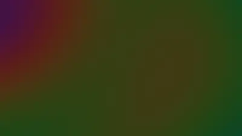

<!-- Generated by tools/gallery.mjs from showcase.yaml and build.json; do not edit. -->
# Channel Intro Logo Sting

[Film](../README.md) › [Titles & Graphics](../README.md#titles--graphics) · `titles` `logo` `shapes` `keyframes` `demo-footage`

A hexagon mark spins into place and a wordmark tightens its tracking for a channel intro.



<sub>Animated preview: 0–2.5 s, 30 frames rendered by Kition Film. Still: [thumb.png](thumb.png)</sub>

| | |
|---|---|
| Document | [channel-intro-logo-sting.kfilm](channel-intro-logo-sting.kfilm) (24 KB) |
| Contents | 1280 × 720 @ 30 fps; 10.0 s; 2 video clips; 6 effects; 5 animated effects |
| Features | `film.graphics.titles`, `film.effects.keyframes` |
| Built by | `kition-film` @ `27c94b23fd`: 31 commands in 188 ms |

## About

A two-second sting for a fictional maker channel, built from shape layers only: an outlined
hexagon (fill off, centered 14 px stroke), a pink hexagon core turned 30° and a white dot. The
mark spins in from -180° while it scales up, the core counter-rotates a beat later, and the
wordmark arrives with its tracking keyframed from 900 down to 120, the classic tightening
letterspace move, before the strapline fades in. The neon footage shows through a dark shade.

## Checks

- `results.list.layers`: `{"count":6}`
- `results.list.layers.1`: `{"name":"Hex","kind":"Polygon"}`
- `results.list.layers.2`: `{"name":"Core","kind":"Polygon"}`
- `results.list.layers.4`: `{"name":"Wordmark","text":"LOOPHOUSE"}`
- `inspect.sequence.video.1.items.0.effects.4.params.rotation.keyframes`: `[{"time":0,"value":-180},{"time":228614400000,"value":0}]`
- `inspect.sequence.video.1.items.0.effects.4.params.scale.keyframes`: `[{"time":0,"value":0},{"time":228614400000,"value":100}]`
- `inspect.sequence.video.1.items.0.effects.5.params.rotation.keyframes`: `[{"time":50803200000,"value":210},{"time":279417600000,"value":30}]`
- `inspect.sequence.video.1.items.0.effects.7.params.tracking.keyframes`: `[{"time":152409600000,"value":900},{"time":406425600000,"value":120}]`
- `inspect.sequence.video.1.items.0.effects.8.params.opacity.keyframes`: `[{"time":355622400000,"value":0},{"time":482630400000,"value":100}]`
- diagnostics: none (the kit's check finds nothing wrong)
- the saved document opens again; the thumbnail matches `thumb.png` within the `render` tolerance

## Steps

<details><summary>31 commands (from <a href="showcase.yaml">showcase.yaml</a>, after the <code>demo-footage</code> prelude)</summary>

```yaml
- command: file.newSequence
  params:
    name: Loophouse Intro
    width: 1280
    height: 720
    fps: 30
    video: 2
    audio: 1
  as: sequence
- command: timeline.place
  params:
    item: 10
    track: V1
    seconds: 0
    audio: false
  as: footage
- command: graphics.newRectangle
  params:
    position:
      - 640
      - 360
    size:
      - 1280
      - 720
    seconds: 4
    track: 1
    time: 0
  as: sting
- command: graphics.set
  params:
    clip: $sting.clip
    layer: 0
    props:
      name: Shade
      fill_color: "#0a0a14"
      opacity: 90
- command: graphics.newPolygon
  params:
    clip: $sting.clip
    position:
      - 640
      - 300
    size:
      - 200
      - 200
    sides: 6
- command: graphics.set
  params:
    clip: $sting.clip
    layer: 1
    props:
      name: Hex
      fill: false
      stroke: true
      stroke_color: "#38e8c6"
      stroke_width: 14
      stroke_type: Center
- command: graphics.newPolygon
  params:
    clip: $sting.clip
    position:
      - 640
      - 300
    size:
      - 112
      - 112
    sides: 6
- command: graphics.set
  params:
    clip: $sting.clip
    layer: 2
    props:
      name: Core
      fill_color: "#ff4f9a"
      rotation: 30
- command: graphics.newEllipse
  params:
    clip: $sting.clip
    position:
      - 640
      - 300
    size:
      - 36
      - 36
- command: graphics.set
  params:
    clip: $sting.clip
    layer: 3
    props:
      name: Dot
      fill_color: "#ffffff"
- command: graphics.newText
  params:
    clip: $sting.clip
    text: LOOPHOUSE
    position:
      - 640
      - 500
    size: 72
    fontStyle: Bold
- command: graphics.set
  params:
    clip: $sting.clip
    layer: 4
    props:
      name: Wordmark
      align: center
      tracking: 120
      fill_color: "#ffffff"
- command: graphics.newText
  params:
    clip: $sting.clip
    text: MAKE  ·  BREAK  ·  REPEAT
    position:
      - 640
      - 548
    size: 20
- command: graphics.set
  params:
    clip: $sting.clip
    layer: 5
    props:
      name: Strapline
      align: center
      tracking: 400
      fill_color: "#38e8c6"
- command: effects.setParam
  params:
    clip: $sting.clip
    effect: 4
    param: rotation
    value: -180
    seconds: 0
- command: effects.setParam
  params:
    clip: $sting.clip
    effect: 4
    param: rotation
    value: 0
    seconds: 0.9
- command: effects.setParam
  params:
    clip: $sting.clip
    effect: 4
    param: scale
    value: 0
    seconds: 0
- command: effects.setParam
  params:
    clip: $sting.clip
    effect: 4
    param: scale
    value: 100
    seconds: 0.9
- command: effects.setParam
  params:
    clip: $sting.clip
    effect: 5
    param: rotation
    value: 210
    seconds: 0.2
- command: effects.setParam
  params:
    clip: $sting.clip
    effect: 5
    param: rotation
    value: 30
    seconds: 1.1
- command: effects.setParam
  params:
    clip: $sting.clip
    effect: 5
    param: scale
    value: 0
    seconds: 0.2
- command: effects.setParam
  params:
    clip: $sting.clip
    effect: 5
    param: scale
    value: 100
    seconds: 1.1
- command: effects.setParam
  params:
    clip: $sting.clip
    effect: 6
    param: scale
    value: 0
    seconds: 0.9
- command: effects.setParam
  params:
    clip: $sting.clip
    effect: 6
    param: scale
    value: 100
    seconds: 1.2
- command: effects.setParam
  params:
    clip: $sting.clip
    effect: 7
    param: tracking
    value: 900
    seconds: 0.6
- command: effects.setParam
  params:
    clip: $sting.clip
    effect: 7
    param: tracking
    value: 120
    seconds: 1.6
- command: effects.setParam
  params:
    clip: $sting.clip
    effect: 7
    param: opacity
    value: 0
    seconds: 0.6
- command: effects.setParam
  params:
    clip: $sting.clip
    effect: 7
    param: opacity
    value: 100
    seconds: 1.1
- command: effects.setParam
  params:
    clip: $sting.clip
    effect: 8
    param: opacity
    value: 0
    seconds: 1.4
- command: effects.setParam
  params:
    clip: $sting.clip
    effect: 8
    param: opacity
    value: 100
    seconds: 1.9
- command: graphics.list
  params:
    clip: $sting.clip
  as: list
```

</details>
