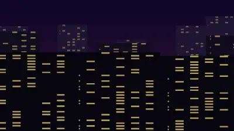

<!-- Generated by tools/gallery.mjs from showcase.yaml and build.json; do not edit. -->
# Chapter Break Dip to Black

[Film](../README.md) › [Transitions](../README.md#transitions) · `transitions` `dip-to-black` `titles` `opacity` `demo-footage`

A documentary leaves the city at night through a two-second dip to black and comes up on the dunes under its chapter title.



<sub>Animated preview: 4.5–8 s, 35 frames rendered by Kition Film. Still: [thumb.png](thumb.png)</sub>

| | |
|---|---|
| Document | [chapter-break-dip-to-black.kfilm](chapter-break-dip-to-black.kfilm) (18 KB) |
| Contents | 1280 × 720 @ 24 fps; 12.0 s; 3 video clips; 2 audio clips; 2 effects; 1 animated effect; 1 transition |
| Features | `film.transitions.basics`, `film.graphics.text-basics`, `film.effects.keyframes` |
| Built by | `kition-film` @ `27c94b23fd`: 12 commands in 29 ms |

## About

The cut from the night drive to the desert sits at 6 s, and a Dip to Black 48 frames long is
centred on it: the city fades to black over the first second and the dunes fade up over the
second. The chapter card on Video 2 fades in while the picture is black, so the title is already
there when the new scene arrives. The thumbnail is 0.2 s after the cut, with the desert still
coming up out of black.

## Checks

- `inspect.sequence.video.0.items`: `{"count":2}`
- `inspect.sequence.video.0.transitions`: `{"count":1}`
- `inspect.sequence.video.0.transitions.0.effect`: `"dip_to_black"`
- `inspect.sequence.video.0.transitions.0.duration`: `508032000000`
- `inspect.sequence.video.0.transitions.0.start`: `1270080000000`
- `inspect.sequence.video.1.items`: `{"count":1}`
- `inspect.sequence.video.1.items.0.effects.1.params.opacity.keyframes`: `[{"time":1397088000000,"mediaTime":0,"value":0},{"time":1574899200000,"value":100},{"time":2387750400000,"value":100},{"time":2540160000000,"value":0}]`
- `results.dip.transition`: `{"exists":true}`
- diagnostics: none (the kit's check finds nothing wrong)
- the saved document opens again; the thumbnail matches `thumb.png` within the `render` tolerance

## Steps

<details><summary>12 commands (from <a href="showcase.yaml">showcase.yaml</a>, after the <code>demo-footage</code> prelude)</summary>

```yaml
- command: file.newSequence
  params:
    name: Part Two
    width: 1280
    height: 720
    fps: 24
    video: 2
    audio: 1
  as: sequence
- command: timeline.place
  params:
    item: 7
    track: V1
    seconds: 0
    duration: 1524096000000
  as: city
- command: timeline.place
  params:
    item: 8
    track: V1
    seconds: 6
    sourceIn: 508032000000
    duration: 1524096000000
  as: desert
- command: sequence.applyVideoTransition
  params:
    clip: $desert.clips.0
    edge: in
    effect: dip_to_black
    frames: 48
  as: dip
- command: graphics.newText
  params:
    text: PART TWO
    position:
      - 640
      - 318
    size: 30
    seconds: 4.5
    track: 1
    time: 1397088000000
  as: card
- command: graphics.set
  params:
    clip: $card.clip
    props:
      font_style: Bold
      align: center
      tracking: 400
      fill_color: "#e8d3b0"
- command: graphics.newText
  params:
    clip: $card.clip
    text: The Dunes
    position:
      - 640
      - 410
    size: 92
  as: headline
- command: graphics.set
  params:
    clip: $card.clip
    layer: $headline.layer
    props:
      font_style: Bold
      align: center
      tracking: 20
      fill_color: "#fffaf0"
      shadow: true
- command: effects.setParam
  params:
    clip: $card.clip
    effect: opacity
    param: opacity
    value: 0
    seconds: 5.5
- command: effects.setParam
  params:
    clip: $card.clip
    effect: opacity
    param: opacity
    value: 100
    seconds: 6.2
- command: effects.setParam
  params:
    clip: $card.clip
    effect: opacity
    param: opacity
    value: 100
    seconds: 9.4
- command: effects.setParam
  params:
    clip: $card.clip
    effect: opacity
    param: opacity
    value: 0
    seconds: 10
```

</details>
