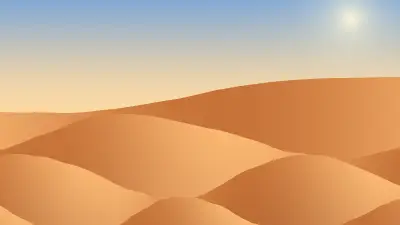

<!-- Generated by tools/gallery.mjs from showcase.yaml and build.json; do not edit. -->
# Cinematic Letterbox Title

[Film](../README.md) › [Formats & Social](../README.md#formats--social) · `letterbox` `widescreen` `titles` `keyframes` `demo-footage`

Black bars crop a 16:9 frame to 2.39:1 for a widescreen film title over the dunes.



<sub>Animated preview: 0–3 s, 30 frames rendered by Kition Film. Still: [thumb.png](thumb.png)</sub>

| | |
|---|---|
| Document | [cinematic-letterbox-title.kfilm](cinematic-letterbox-title.kfilm) (21 KB) |
| Contents | 1280 × 720 @ 24 fps; 15.0 s; 3 video clips; 4 effects; 4 animated effects |
| Features | `film.graphics.titles`, `film.effects.keyframes` |
| Built by | `kition-film` @ `27c94b23fd`: 19 commands in 31 ms |

## About

A 16:9 sequence becomes a 2.39:1 picture with two black shape layers, 92 px each, on the top
track. Their layer positions are keyframed so the bars slide in from the frame edges over the
first second, like a projector's masking closing in; then the widely tracked title fades in
over the dunes while the footage pushes in slowly.

## Checks

- `results.list.layers`: `{"count":2}`
- `results.list.layers.0`: `{"name":"Title","text":"THE LONG CROSSING"}`
- `results.list.layers.0.quad.0.0`: `{"min":0}`
- `results.list.layers.0.quad.2.0`: `{"max":1280}`
- `inspect.sequence.video.0.items.0.effects.0.params.scale.keyframes`: `[{"time":0,"value":100},{"time":2032128000000,"value":108}]`
- `inspect.sequence.video.2.items.0.effects.3.params.size.value`: `[1280,92]`
- `inspect.sequence.video.2.items.0.effects.3.params.position.keyframes`: `[{"time":0,"value":[640,-46]},{"time":254016000000,"value":[640,46]}]`
- `inspect.sequence.video.2.items.0.effects.4.params.position.keyframes`: `[{"time":0,"value":[640,766]},{"time":254016000000,"value":[640,674]}]`
- `inspect.sequence.video.1.items.0.effects.1.params.opacity.keyframes`: `[{"time":254016000000,"value":0},{"time":635040000000,"value":100}]`
- diagnostics: none (the kit's check finds nothing wrong)
- the saved document opens again; the thumbnail matches `thumb.png` within the `render` tolerance

## Steps

<details><summary>19 commands (from <a href="showcase.yaml">showcase.yaml</a>, after the <code>demo-footage</code> prelude)</summary>

```yaml
- command: file.newSequence
  params:
    name: The Long Crossing
    width: 1280
    height: 720
    fps: 24
    video: 3
    audio: 1
  as: sequence
- command: timeline.place
  params:
    item: 8
    track: V1
    seconds: 0
    audio: false
  as: footage
- command: effects.setParam
  params:
    clip: $footage.clips.0
    effect: motion
    param: scale
    value: 100
    seconds: 0
- command: effects.setParam
  params:
    clip: $footage.clips.0
    effect: motion
    param: scale
    value: 108
    seconds: 8
- command: graphics.newText
  params:
    text: THE LONG CROSSING
    position:
      - 640
      - 372
    size: 64
    fontStyle: Medium
    seconds: 8
    track: 1
    time: 0
  as: title
- command: graphics.set
  params:
    clip: $title.clip
    layer: 0
    props:
      name: Title
      align: center
      tracking: 320
      fill_color: "#fff6ea"
      shadow: true
      shadow_color: "#3a1a05"
      shadow_opacity: 70
      shadow_blur: 50
      shadow_size: 8
      shadow_distance: 0
- command: graphics.newText
  params:
    clip: $title.clip
    text: A JOURNEY ON FOOT ACROSS THE RED SANDS
    position:
      - 640
      - 422
    size: 20
- command: graphics.set
  params:
    clip: $title.clip
    layer: 1
    props:
      name: Tagline
      align: center
      tracking: 360
      fill_color: "#fff1dc"
      shadow: true
      shadow_color: "#3a1a05"
      shadow_opacity: 70
      shadow_blur: 30
      shadow_size: 4
      shadow_distance: 0
- command: graphics.newRectangle
  params:
    position:
      - 640
      - 46
    size:
      - 1280
      - 92
    seconds: 8
    track: 2
    time: 0
  as: bars
- command: graphics.set
  params:
    clip: $bars.clip
    layer: 0
    props:
      name: Top Bar
      fill_color: "#000000"
- command: graphics.newRectangle
  params:
    clip: $bars.clip
    position:
      - 640
      - 674
    size:
      - 1280
      - 92
- command: graphics.set
  params:
    clip: $bars.clip
    layer: 1
    props:
      name: Bottom Bar
      fill_color: "#000000"
- command: effects.setParam
  params:
    clip: $bars.clip
    effect: 3
    param: position
    value:
      - 640
      - -46
    seconds: 0
- command: effects.setParam
  params:
    clip: $bars.clip
    effect: 3
    param: position
    value:
      - 640
      - 46
    seconds: 1
- command: effects.setParam
  params:
    clip: $bars.clip
    effect: 4
    param: position
    value:
      - 640
      - 766
    seconds: 0
- command: effects.setParam
  params:
    clip: $bars.clip
    effect: 4
    param: position
    value:
      - 640
      - 674
    seconds: 1
- command: effects.setParam
  params:
    clip: $title.clip
    effect: opacity
    param: opacity
    value: 0
    seconds: 1
- command: effects.setParam
  params:
    clip: $title.clip
    effect: opacity
    param: opacity
    value: 100
    seconds: 2.5
- command: graphics.list
  params:
    clip: $title.clip
  as: list
```

</details>
