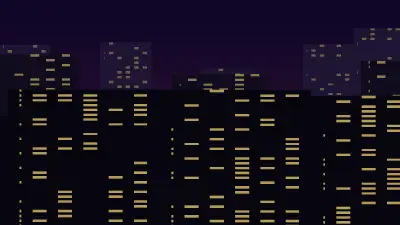

<!-- Generated by tools/gallery.mjs from showcase.yaml and build.json; do not edit. -->
# City Escape Iris Reveal

[Film](../README.md) › [Transitions](../README.md#transitions) · `transitions` `iris` `wipe` `demo-footage`

A weekend-getaway promo opens a round iris in the middle of the night traffic to reveal the sea at sunset.



<sub>Animated preview: 2.5–5.5 s, 30 frames rendered by Kition Film. Still: [thumb.png](thumb.png)</sub>

| | |
|---|---|
| Document | [city-escape-iris-reveal.kfilm](city-escape-iris-reveal.kfilm) (13 KB) |
| Contents | 1280 × 720 @ 24 fps; 8.0 s; 2 video clips; 2 audio clips; 1 transition |
| Features | `film.transitions.basics`, `film.timeline.basics` |
| Built by | `kition-film` @ `27c94b23fd`: 4 commands in 17 ms |

## About

An Iris Round 30 frames long sits on the cut at 4 s. The circle opens from the centre of the
frame with a 6 px warm border, so for the length of the transition the sunset shows through a
porthole in the city. The thumbnail is the middle of the iris.

## Checks

- `inspect.sequence.video.0.items`: `{"count":2}`
- `inspect.sequence.video.0.items.1.name`: `"Ocean_Sunset.mp4"`
- `inspect.sequence.video.0.transitions`: `{"count":1}`
- `inspect.sequence.video.0.transitions.0.effect`: `"iris_round"`
- `inspect.sequence.video.0.transitions.0.duration`: `317520000000`
- `inspect.sequence.video.0.transitions.0.params.border_width`: `{"value":6}`
- `inspect.sequence.video.0.transitions.0.params.border_color`: `{"value":"#ffd9a0"}`
- diagnostics: none (the kit's check finds nothing wrong)
- the saved document opens again; the thumbnail matches `thumb.png` within the `render` tolerance

## Steps

<details><summary>4 commands (from <a href="showcase.yaml">showcase.yaml</a>, after the <code>demo-footage</code> prelude)</summary>

```yaml
- command: file.newSequence
  params:
    name: Weekend Escape
    width: 1280
    height: 720
    fps: 24
    video: 1
    audio: 1
  as: sequence
- command: timeline.place
  params:
    item: 7
    track: V1
    seconds: 0
    sourceIn: 0
    duration: 1016064000000
  as: outgoing
- command: timeline.place
  params:
    item: 5
    track: V1
    seconds: 4
    sourceIn: 508032000000
    duration: 1016064000000
  as: incoming
- command: sequence.applyVideoTransition
  params:
    clip: $incoming.clips.0
    edge: in
    effect: iris_round
    frames: 30
    params:
      border_width: 6
      border_color: "#ffd9a0"
  as: transition
```

</details>
