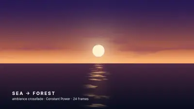

<!-- Generated by tools/gallery.mjs from showcase.yaml and build.json; do not edit. -->
# Constant Power Ambience Crossfade

[Film](../README.md) › [Audio](../README.md#audio) · `audio` `crossfade` `transitions` `ambience` `demo-footage`

Sea ambience hands over to forest ambience with a one-second Constant Power crossfade, under a matching cross dissolve.



<sub>Animated preview: 4.5–7.5 s, 24 frames rendered by Kition Film. Still: [thumb.png](thumb.png)</sub>

| | |
|---|---|
| Document | [constant-power-ambience-crossfade.kfilm](constant-power-ambience-crossfade.kfilm) (18 KB) |
| Contents | 1920 × 1080 @ 24 fps; 12.0 s; 3 video clips; 2 audio clips; 2 effects; 2 transitions |
| Features | `film.audio.basics`, `film.transitions.basics`, `film.graphics.text-basics` |
| Built by | `kition-film` @ `27c94b23fd`: 9 commands in 15 ms |

## About

Two scenes are cut back to back with their own sound: the sea from 0 to 6 s, the forest from
6 to 12 s. sequence.applyAudioTransition puts a 24-frame Constant Power crossfade on the
forest's sound at the cut, so the combined loudness holds steady through the change (a
Constant Gain fade would dip in the middle), and a cross dissolve of the same length blends the
pictures. The frame shown is the middle of both transitions.

## Checks

- `inspect.sequence.video.0.items`: `{"count":2}`
- `inspect.sequence.audio.0.items`: `{"count":2}`
- `inspect.sequence.audio.0.transitions`: `{"count":1}`
- `inspect.sequence.audio.0.transitions.0`: `{"effect":"constant_power","duration":254016000000}`
- `inspect.sequence.video.0.transitions.0`: `{"effect":"cross_dissolve","duration":254016000000}`
- diagnostics: none (the kit's check finds nothing wrong)
- the saved document opens again; the thumbnail matches `thumb.png` within the `render` tolerance

## Steps

<details><summary>9 commands (from <a href="showcase.yaml">showcase.yaml</a>, after the <code>demo-footage</code> prelude)</summary>

```yaml
- command: file.newSequence
  params:
    name: Coast To Forest
    width: 1920
    height: 1080
    fps: 24
    video: 2
    audio: 1
- command: timeline.place
  params:
    item: 5
    track: V1
    audioTrack: A1
    seconds: 0
    sourceIn: 762048000000
    duration: 1524096000000
  as: sea
- command: timeline.place
  params:
    item: 9
    track: V1
    audioTrack: A1
    seconds: 6
    sourceIn: 254016000000
    duration: 1524096000000
  as: forest
- command: sequence.applyVideoTransition
  params:
    clip: $forest.clips.0
    edge: in
    effect: cross_dissolve
    frames: 24
  as: dissolve
- command: sequence.applyAudioTransition
  params:
    clip: $forest.clips.1
    effect: constant_power
    frames: 24
  as: crossfade
- command: graphics.newText
  params:
    text: SEA → FOREST
    position:
      - 120
      - 940
    size: 44
    seconds: 12
    track: 1
    time: 0
  as: label
- command: graphics.set
  params:
    clip: $label.clip
    props:
      font_style: Bold
      tracking: 200
      fill_color: "#ffffff"
      shadow: true
- command: graphics.newText
  params:
    clip: $label.clip
    text: ambience crossfade · Constant Power · 24 frames
    position:
      - 120
      - 990
    size: 32
- command: graphics.set
  params:
    clip: $label.clip
    props:
      fill_color: "#e9f1ea"
      shadow: true
```

</details>
