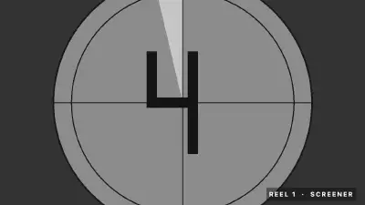

<!-- Generated by tools/gallery.mjs from showcase.yaml and build.json; do not edit. -->
# Countdown Leader Intro

[Film](../README.md) › [Titles & Graphics](../README.md#titles--graphics) · `titles` `leader` `countdown` `demo-footage`

A universal counting leader runs down to the first frame of a short film's opening title.



<sub>Animated preview: 5–9.5 s, 36 frames rendered by Kition Film. Still: [thumb.png](thumb.png)</sub>

| | |
|---|---|
| Document | [countdown-leader-intro.kfilm](countdown-leader-intro.kfilm) (18 KB) |
| Contents | 1280 × 720 @ 24 fps; 24.0 s; 4 video clips; 1 audio clip; 2 effects; 1 animated effect |
| Features | `film.file.new-items`, `film.graphics.text-basics`, `film.timeline.basics` |
| Built by | `kition-film` @ `27c94b23fd`: 9 commands in 18 ms |

## About

The demo project's Universal Counting Leader (an 8-second countdown with its sweep and sync
pop) opens the reel, with a small right-aligned REEL 1 slug on a translucent box over it. The
picture starts exactly where the leader ends, at frame 192, and the film's title fades in over
the aurora there: the frame-accurate hand-off a projectionist or a festival screener expects.

## Checks

- `results.leader.clips`: `{"count":2}`
- `inspect.sequence.video.0.items`: `{"count":2}`
- `inspect.sequence.video.0.items.0`: `{"name":"Universal Counting Leader","startFrame":0,"durationFrames":192}`
- `inspect.sequence.video.0.items.1`: `{"name":"Aurora_Timelapse.mp4","startFrame":192}`
- `inspect.sequence.video.1.items.1`: `{"name":"UNDER A POLAR SKY","startFrame":192}`
- `inspect.sequence.video.1.items.1.effects.1.params.opacity.keyframes`: `[{"time":2032128000000,"mediaTime":0,"value":0},{"time":2286144000000,"mediaTime":254016000000,"value":100}]`
- `inspect.sequence.audio.0.items.0`: `{"name":"Universal Counting Leader"}`
- diagnostics: none (the kit's check finds nothing wrong)
- the saved document opens again; the thumbnail matches `thumb.png` within the `render` tolerance

## Steps

<details><summary>9 commands (from <a href="showcase.yaml">showcase.yaml</a>, after the <code>demo-footage</code> prelude)</summary>

```yaml
- command: file.newSequence
  params:
    name: Screener Reel 1
    width: 1280
    height: 720
    fps: 24
    video: 2
    audio: 2
  as: sequence
- command: timeline.place
  params:
    item: 13
    track: V1
    seconds: 0
  as: leader
- command: timeline.place
  params:
    item: 6
    track: V1
    seconds: 8
    audio: false
  as: footage
- command: graphics.newText
  params:
    text: REEL 1  ·  SCREENER
    position:
      - 1240
      - 690
    size: 22
    fontStyle: Bold
    seconds: 8
    track: 1
    time: 0
  as: slug
- command: graphics.set
  params:
    clip: $slug.clip
    layer: 0
    props:
      align: right
      tracking: 200
      fill_color: "#ffffff"
      background: true
      background_color: "#111111"
      background_opacity: 70
      background_size: 10
- command: graphics.newText
  params:
    text: UNDER A POLAR SKY
    position:
      - 640
      - 386
    size: 64
    fontStyle: Bold
    seconds: 5
    track: 1
    frame: 192
  as: title
- command: graphics.set
  params:
    clip: $title.clip
    layer: 0
    props:
      align: center
      tracking: 240
      fill_color: "#eef6ff"
- command: effects.setParam
  params:
    clip: $title.clip
    effect: opacity
    param: opacity
    value: 0
    seconds: 8
- command: effects.setParam
  params:
    clip: $title.clip
    effect: opacity
    param: opacity
    value: 100
    seconds: 9
```

</details>
