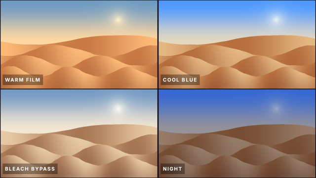

<!-- Generated by tools/gallery.mjs from showcase.yaml and build.json; do not edit. -->
# Creative Look LUT Grid

[Film](../README.md) › [Effects & Color](../README.md#effects--color) · `color` `lumetri` `lut` `split-screen` `demo-footage`

The same desert shot four times in a 2×2 grid, each with a different built-in creative look LUT, to pick a grade.



| | |
|---|---|
| Document | [creative-look-lut-grid.kfilm](creative-look-lut-grid.kfilm) (32 KB) |
| Contents | 1920 × 1080 @ 24 fps; 10.0 s; 5 video clips; 8 effects |
| Features | `film.color.lumetri`, `film.effects.basics`, `film.graphics.text-basics` |
| Built by | `kition-film` @ `27c94b23fd`: 29 commands in 28 ms |

## About

A look test a colourist sends before grading a whole film. Four copies of the dunes are
scaled to just under 50 % and moved into the quadrants; each gets a Lumetri Color effect whose
Creative Look is one of the kit's built-in LUTs (lumetri.setLook with a builtin: id): Warm
Film, Cool Blue, Bleach Bypass and Night. One graphic clip holds the four labels.

## Checks

- `inspect.sequence.video.0.items.0.effects.0.params.look_lut.value`: `{"contains":"look-warm-film"}`
- `inspect.sequence.video.0.items.0.effects.1.params`: `{"scale":{"value":49.6}}`
- `inspect.sequence.video.1.items.0.effects.0.params.look_lut.value`: `{"contains":"look-cool-blue"}`
- `inspect.sequence.video.1.items.0.effects.1.params`: `{"scale":{"value":49.6}}`
- `inspect.sequence.video.2.items.0.effects.0.params.look_lut.value`: `{"contains":"look-bleach-bypass"}`
- `inspect.sequence.video.2.items.0.effects.1.params`: `{"scale":{"value":49.6}}`
- `inspect.sequence.video.3.items.0.effects.0.params.look_lut.value`: `{"contains":"look-night"}`
- `inspect.sequence.video.3.items.0.effects.1.params`: `{"scale":{"value":49.6}}`
- `inspect.sequence.video.4.items.0.effects`: `{"count":7}`
- diagnostics: none (the kit's check finds nothing wrong)
- the saved document opens again; the thumbnail matches `thumb.png` within the `render` tolerance

## Steps

<details><summary>29 commands (from <a href="showcase.yaml">showcase.yaml</a>, after the <code>demo-footage</code> prelude)</summary>

```yaml
- command: file.newSequence
  params:
    name: Look Test
    width: 1920
    height: 1080
    fps: 24
    video: 5
    audio: 1
- command: timeline.place
  params:
    item: 8
    track: V1
    seconds: 0
    duration: 2540160000000
    audio: false
  as: q1
- command: effects.setParam
  params:
    clip: $q1.clips.0
    effect: motion
    param: scale
    value: 49.6
- command: effects.setParam
  params:
    clip: $q1.clips.0
    effect: motion
    param: position
    value:
      - 480
      - 270
- command: effects.apply
  params:
    clips:
      - $q1.clips.0
    effect: lumetri
- command: lumetri.setLook
  params:
    clip: $q1.clips.0
    lut: builtin:look-warm-film
- command: timeline.place
  params:
    item: 8
    track: V2
    seconds: 0
    duration: 2540160000000
    audio: false
  as: q2
- command: effects.setParam
  params:
    clip: $q2.clips.0
    effect: motion
    param: scale
    value: 49.6
- command: effects.setParam
  params:
    clip: $q2.clips.0
    effect: motion
    param: position
    value:
      - 1440
      - 270
- command: effects.apply
  params:
    clips:
      - $q2.clips.0
    effect: lumetri
- command: lumetri.setLook
  params:
    clip: $q2.clips.0
    lut: builtin:look-cool-blue
- command: timeline.place
  params:
    item: 8
    track: V3
    seconds: 0
    duration: 2540160000000
    audio: false
  as: q3
- command: effects.setParam
  params:
    clip: $q3.clips.0
    effect: motion
    param: scale
    value: 49.6
- command: effects.setParam
  params:
    clip: $q3.clips.0
    effect: motion
    param: position
    value:
      - 480
      - 810
- command: effects.apply
  params:
    clips:
      - $q3.clips.0
    effect: lumetri
- command: lumetri.setLook
  params:
    clip: $q3.clips.0
    lut: builtin:look-bleach-bypass
- command: timeline.place
  params:
    item: 8
    track: V4
    seconds: 0
    duration: 2540160000000
    audio: false
  as: q4
- command: effects.setParam
  params:
    clip: $q4.clips.0
    effect: motion
    param: scale
    value: 49.6
- command: effects.setParam
  params:
    clip: $q4.clips.0
    effect: motion
    param: position
    value:
      - 1440
      - 810
- command: effects.apply
  params:
    clips:
      - $q4.clips.0
    effect: lumetri
- command: lumetri.setLook
  params:
    clip: $q4.clips.0
    lut: builtin:look-night
- command: graphics.newText
  params:
    text: WARM FILM
    position:
      - 30
      - 495
    size: 30
    seconds: 10
    track: 4
    time: 0
  as: labels
- command: graphics.set
  params:
    clip: $labels.clip
    props:
      font_style: Bold
      tracking: 150
      fill_color: "#ffffff"
      background: true
      background_color: "#000000"
      background_opacity: 60
      background_size: 14
- command: graphics.newText
  params:
    clip: $labels.clip
    text: COOL BLUE
    position:
      - 990
      - 495
    size: 30
- command: graphics.set
  params:
    clip: $labels.clip
    props:
      font_style: Bold
      tracking: 150
      fill_color: "#ffffff"
      background: true
      background_color: "#000000"
      background_opacity: 60
      background_size: 14
- command: graphics.newText
  params:
    clip: $labels.clip
    text: BLEACH BYPASS
    position:
      - 30
      - 1035
    size: 30
- command: graphics.set
  params:
    clip: $labels.clip
    props:
      font_style: Bold
      tracking: 150
      fill_color: "#ffffff"
      background: true
      background_color: "#000000"
      background_opacity: 60
      background_size: 14
- command: graphics.newText
  params:
    clip: $labels.clip
    text: NIGHT
    position:
      - 990
      - 1035
    size: 30
- command: graphics.set
  params:
    clip: $labels.clip
    props:
      font_style: Bold
      tracking: 150
      fill_color: "#ffffff"
      background: true
      background_color: "#000000"
      background_opacity: 60
      background_size: 14
```

</details>
