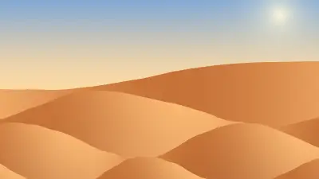

<!-- Generated by tools/gallery.mjs from showcase.yaml and build.json; do not edit. -->
# Desert Narration Subtitles

[Film](../README.md) › [Markers & Captions](../README.md#markers--captions) · `captions` `subtitles` `narration` `demo-footage`

A nature documentary's narration is subtitled line by line on an English caption track with a boxed, broadcast-style look.



<sub>Animated preview: 0–12 s, 48 frames rendered by Kition Film. Still: [thumb.png](thumb.png)</sub>

| | |
|---|---|
| Document | [desert-narration-subtitles.kfilm](desert-narration-subtitles.kfilm) (12 KB) |
| Contents | 1280 × 720 @ 24 fps; 12.0 s; 1 video clip; 1 audio clip |
| Features | `film.captions.edit` |
| Built by | `kition-film` @ `27c94b23fd`: 9 commands in 13 ms |

## About

A Subtitle caption track named English carries four timed lines of narration over the dunes,
each held for its own length with short breaks between them. The track style sets the size,
white text on a translucent black box and a slightly higher bottom margin; every caption on the
track shares it. Captions are burned into the render, so the thumbnail shows the second line.

## Checks

- `results.list.tracks`: `{"count":1}`
- `results.list.tracks.0`: `{"name":"English","language":"en","format":"Subtitle"}`
- `results.list.tracks.0.captions`: `{"count":4}`
- `results.list.tracks.0.captions.1`: `{"text":"The wind moves each dune a few metres a year,","in":"00:00:03:09"}`
- `results.list.tracks.0.captions.3`: `{"in":"00:00:09:06","out":"00:00:11:18","end":2984688000000}`
- `results.list.tracks.0.style`: `{"background":true,"backgroundColor":"#000000b3","size":46}`
- diagnostics: none (the kit's check finds nothing wrong)
- the saved document opens again; the thumbnail matches `thumb.png` within the `render` tolerance

## Steps

<details><summary>9 commands (from <a href="showcase.yaml">showcase.yaml</a>, after the <code>demo-footage</code> prelude)</summary>

```yaml
- command: file.newSequence
  params:
    name: Sand Sea
    width: 1280
    height: 720
    fps: 24
    video: 1
    audio: 1
  as: sequence
- command: timeline.place
  params:
    item: 8
    track: V1
    seconds: 0
    duration: 3048192000000
  as: dunes
- command: captions.newTrack
  params:
    format: Subtitle
    name: English
    language: en
  as: track
- command: captions.setStyle
  params:
    track: C1
    size: 46
    color: "#ffffff"
    background: true
    backgroundColor: "#000000b3"
    margin: 0.09
    lineSpacing: 1.3
- command: captions.add
  params:
    text: Nothing out here stands still for long.
    seconds: 0.5
    durationSeconds: 2.5
- command: captions.add
  params:
    text: The wind moves each dune a few metres a year,
    seconds: 3.375
    durationSeconds: 2.75
- command: captions.add
  params:
    text: grain by grain, from one face to the other.
    seconds: 6.25
    durationSeconds: 2.625
- command: captions.add
  params:
    text: By morning, last night's tracks are gone.
    seconds: 9.25
    durationSeconds: 2.5
- command: captions.list
  params:
    track: C1
  as: list
```

</details>
