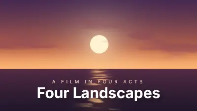

<!-- Generated by tools/gallery.mjs from showcase.yaml and build.json; do not edit. -->
# Documentary Chapter Markers

[Film](../README.md) › [Markers & Captions](../README.md#markers--captions) · `markers` `chapters` `in-out` `review` `titles` `demo-footage`

A landscape documentary's review cut carries chapter markers for each act, colour-coded notes, a range marker and In/Out points for export.



<sub>Animated preview: 0–16 s, 48 frames rendered by Kition Film. Still: [thumb.png](thumb.png)</sub>

| | |
|---|---|
| Document | [documentary-chapter-markers.kfilm](documentary-chapter-markers.kfilm) (21 KB) |
| Contents | 1280 × 720 @ 24 fps; 16.0 s; 5 video clips; 4 audio clips; 2 effects; 8 markers |
| Features | `film.markers.basics`, `film.markers.in-out`, `film.graphics.text-basics` |
| Built by | `kition-film` @ `27c94b23fd`: 19 commands in 20 ms |

## About

Four acts of four seconds each, one landscape per act. A chapter marker at the start of every act
names it, so an exported file gets chapter stops. Review notes are comment markers in their own
colours (red for picture, cerulean for sound, orange for graphics), the stretch that needs music is
a three-second range marker, and In and Out points mark the first three acts as the part sent for
review. The thumbnail is the opening title over the first act.

## Checks

- `inspect.sequence.markers`: `{"count":8}`
- `inspect.sequence.markers.0`: `{"kind":"Chapter","name":"1. Sea","start":0}`
- `inspect.sequence.markers.-1`: `{"kind":"Chapter","name":"4. Sky","start":3048192000000}`
- `inspect.sequence.markers.1`: `{"kind":"Comment","name":"Title too long","color":"Orange"}`
- `inspect.sequence.markers.3`: `{"kind":"Comment","name":"Horizon tilt","color":"Red","comment":"Level the dunes shot"}`
- `inspect.sequence.in`: `0`
- `inspect.sequence.out`: `3037608000000`
- `inspect.sequence.markers`: `{"any":{"name":"Needs music","color":"Purple","duration":762048000000}}`
- `inspect.sequence.video.0.items`: `{"count":4}`
- diagnostics: none (the kit's check finds nothing wrong)
- the saved document opens again; the thumbnail matches `thumb.png` within the `render` tolerance

## Steps

<details><summary>19 commands (from <a href="showcase.yaml">showcase.yaml</a>, after the <code>demo-footage</code> prelude)</summary>

```yaml
- command: file.newSequence
  params:
    name: Four Landscapes Review
    width: 1280
    height: 720
    fps: 24
    video: 2
    audio: 1
  as: sequence
- command: timeline.place
  params:
    item: 5
    track: V1
    seconds: 0
    sourceIn: 508032000000
    duration: 1016064000000
  as: sea
- command: timeline.place
  params:
    item: 8
    track: V1
    seconds: 4
    sourceIn: 254016000000
    duration: 1016064000000
  as: sand
- command: timeline.place
  params:
    item: 9
    track: V1
    seconds: 8
    sourceIn: 254016000000
    duration: 1016064000000
  as: trees
- command: timeline.place
  params:
    item: 6
    track: V1
    seconds: 12
    sourceIn: 762048000000
    duration: 1016064000000
  as: sky
- command: graphics.newText
  params:
    text: A FILM IN FOUR ACTS
    position:
      - 640
      - 540
    size: 30
    seconds: 3.5
    track: 1
    time: 0
  as: title
- command: graphics.set
  params:
    clip: $title.clip
    props:
      align: center
      tracking: 500
      fill_color: "#ffe2c4"
- command: graphics.newText
  params:
    clip: $title.clip
    text: Four Landscapes
    position:
      - 640
      - 636
    size: 96
  as: headline
- command: graphics.set
  params:
    clip: $title.clip
    layer: $headline.layer
    props:
      font_style: Bold
      align: center
      fill_color: "#ffffff"
      shadow: true
- command: markers.addChapter
  params:
    seconds: 0
    name: 1. Sea
    color: Forest
  as: ch1
- command: markers.addChapter
  params:
    seconds: 4
    name: 2. Sand
    color: Forest
  as: ch2
- command: markers.addChapter
  params:
    seconds: 8
    name: 3. Trees
    color: Forest
  as: ch3
- command: markers.addChapter
  params:
    seconds: 12
    name: 4. Sky
    color: Forest
  as: ch4
- command: markers.add
  params:
    target: program
    seconds: 1.5
    name: Title too long
    comment: Hold the title one second less
    color: Orange
- command: markers.add
  params:
    target: program
    seconds: 5
    name: Horizon tilt
    comment: Level the dunes shot
    color: Red
- command: markers.add
  params:
    target: program
    seconds: 9
    name: Wind noise
    comment: Replace with room tone from the location
    color: Cerulean
- command: markers.addRange
  params:
    seconds: 10
    durationSeconds: 3
    name: Needs music
    comment: Swell into the aurora
    color: Purple
  as: music
- command: markers.markIn
  params:
    target: program
    seconds: 0
- command: markers.markOut
  params:
    target: program
    frame: 287
```

</details>
