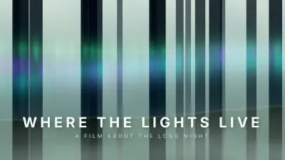

<!-- Generated by tools/gallery.mjs from showcase.yaml and build.json; do not edit. -->
# Double Exposure Screen Blend

[Film](../README.md) › [Effects & Color](../README.md#effects--color) · `blend-modes` `opacity` `double-exposure` `titles` `demo-footage`

An aurora laid over a misty forest with the Screen blend mode, making an in-camera style double exposure for a documentary title.



<sub>Animated preview: 0–3 s, 24 frames rendered by Kition Film. Still: [thumb.png](thumb.png)</sub>

| | |
|---|---|
| Document | [double-exposure-screen-blend.kfilm](double-exposure-screen-blend.kfilm) (17 KB) |
| Contents | 1920 × 1080 @ 24 fps; 12.0 s; 3 video clips; 3 effects |
| Features | `film.effects.basics`, `film.graphics.text-basics` |
| Built by | `kition-film` @ `27c94b23fd`: 12 commands in 15 ms |

## About

The forest is on V1 and the aurora on V2. The aurora's Opacity effect uses the Screen blend
mode at 85 %, so its dark sky drops away and only the light of the aurora lands on the trees,
like two exposures on one frame of film. Brightness & Contrast on the forest deepens the trunks
so the colour reads; the title sits on top.

## Checks

- `inspect.sequence.video.1.items.0.effects.1`: `{"effect":"opacity","params":{"blend":{"option":"Screen"},"opacity":{"value":85}}}`
- `inspect.sequence.video.0.items.0.effects.0`: `{"effect":"brightness_contrast","params":{"brightness":{"value":-20},"contrast":{"value":30}}}`
- `inspect.sequence.video.2.items.0.name`: `"WHERE THE LIGHTS LIVE"`
- diagnostics: none (the kit's check finds nothing wrong)
- the saved document opens again; the thumbnail matches `thumb.png` within the `render` tolerance

## Steps

<details><summary>12 commands (from <a href="showcase.yaml">showcase.yaml</a>, after the <code>demo-footage</code> prelude)</summary>

```yaml
- command: file.newSequence
  params:
    name: Lights Over The Woods
    width: 1920
    height: 1080
    fps: 24
    video: 3
    audio: 1
- command: timeline.place
  params:
    item: 9
    track: V1
    seconds: 0
    audio: false
  as: forest
- command: effects.apply
  params:
    clips:
      - $forest.clips.0
    effect: brightness_contrast
- command: effects.setParam
  params:
    clip: $forest.clips.0
    effect: brightness_contrast
    param: brightness
    value: -20
- command: effects.setParam
  params:
    clip: $forest.clips.0
    effect: brightness_contrast
    param: contrast
    value: 30
- command: timeline.place
  params:
    item: 6
    track: V2
    seconds: 0
    duration: 3048192000000
    audio: false
  as: aurora
- command: effects.setParam
  params:
    clip: $aurora.clips.0
    effect: opacity
    param: blend
    value: Screen
- command: effects.setParam
  params:
    clip: $aurora.clips.0
    effect: opacity
    param: opacity
    value: 85
- command: graphics.newText
  params:
    text: WHERE THE LIGHTS LIVE
    position:
      - 960
      - 860
    size: 96
    seconds: 12
    track: 2
    time: 0
  as: title
- command: graphics.set
  params:
    clip: $title.clip
    props:
      font_style: Bold
      align: center
      tracking: 220
      fill_color: "#f2fbf7"
      shadow: true
- command: graphics.newText
  params:
    clip: $title.clip
    text: A FILM ABOUT THE LONG NIGHT
    position:
      - 960
      - 930
    size: 34
- command: graphics.set
  params:
    clip: $title.clip
    props:
      align: center
      tracking: 400
      fill_color: "#a9f0d1"
      shadow: true
```

</details>
