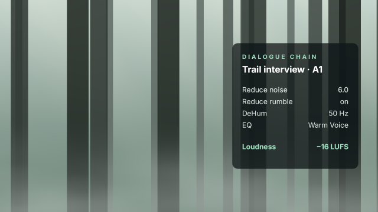

<!-- Generated by tools/gallery.mjs from showcase.yaml and build.json; do not edit. -->
# Field Interview Voice Cleanup

[Film](../README.md) › [Audio](../README.md#audio) · `audio` `essential-sound` `dialogue` `loudness` `noise-reduction` `demo-footage`

An outdoor interview's sound tagged as Dialogue and cleaned with Essential Sound repair, clarity EQ and a −16 LUFS loudness match.



| | |
|---|---|
| Document | [field-interview-voice-cleanup.kfilm](field-interview-voice-cleanup.kfilm) (39 KB) |
| Contents | 1920 × 1080 @ 24 fps; 12.0 s; 2 video clips; 1 audio clip; 13 effects |
| Features | `film.audio.basics`, `film.audio.mixing`, `film.graphics.text-basics` |
| Built by | `kition-film` @ `27c94b23fd`: 33 commands in 345 ms |

## About

The forest clip's sound stands in for an interview recorded on a trail. It is tagged Dialogue,
given the built-in Clean Up Noisy Dialogue preset, then tuned: noise reduction at 6, hum removal
at 50 Hz and the Warm Voice EQ. essentialSound.autoMatch measures the clip's loudness and sets
its gain so it reads −16 LUFS, the usual podcast and web target. Essential Sound turns these
settings into real effects on the clip: high-pass, DeNoise, DeHummer, Dynamics and Parametric
EQ. The panel on screen lists the chain.

## Checks

- `results.loudness.clips.0.targetLufs`: `-16`
- `results.loudness.clips.0.gainDb`: `{"min":0}`
- `results.sound.clips.0`: `{"type":"Dialogue","settings":{"repair":{"noise":{"on":true,"amount":6},"dehum":{"on":true},"hum_hz":50},"clarity":{"eq_preset":"Warm Voice"},"loudness":{"target_lufs":-16}}}`
- `results.sound.clips.0.effects`: `{"count":5}`
- `inspect.sequence.audio.0.items.0.effects`: `{"any":{"effect":"denoise"},"count":8}`
- `inspect.sequence.audio.0.items.0.effects.5.effect`: `"dehummer"`
- diagnostics: none (the kit's check finds nothing wrong)
- the saved document opens again; the thumbnail matches `thumb.png` within the `render` tolerance

## Steps

<details><summary>33 commands (from <a href="showcase.yaml">showcase.yaml</a>, after the <code>demo-footage</code> prelude)</summary>

```yaml
- command: file.newSequence
  params:
    name: Trail Interview
    width: 1920
    height: 1080
    fps: 24
    video: 2
    audio: 1
- command: timeline.place
  params:
    item: 9
    track: V1
    audioTrack: A1
    seconds: 0
  as: interview
- command: essentialSound.setType
  params:
    clips:
      - $interview.clips.1
    type: dialogue
- command: essentialSound.applyPreset
  params:
    clips:
      - $interview.clips.1
    preset: Clean Up Noisy Dialogue
- command: essentialSound.set
  params:
    clips:
      - $interview.clips.1
    values:
      repair.noise.on: true
      repair.noise.amount: 6
      repair.dehum.on: true
      repair.humHz: 50
      clarity.eq.on: true
      clarity.eqPreset: Warm Voice
- command: essentialSound.autoMatch
  params:
    clips:
      - $interview.clips.1
    target: -16
  as: loudness
- command: essentialSound.inspect
  params:
    clips:
      - $interview.clips.1
  as: sound
- command: graphics.newRectangle
  params:
    position:
      - 1500
      - 540
    size:
      - 640
      - 640
    seconds: 12
    track: 1
    time: 0
  as: panel
- command: graphics.set
  params:
    clip: $panel.clip
    props:
      fill_color: "#10181a"
      opacity: 92
      corner_radius: 28
- command: graphics.newText
  params:
    clip: $panel.clip
    text: DIALOGUE CHAIN
    position:
      - 1230
      - 300
    size: 30
- command: graphics.set
  params:
    clip: $panel.clip
    props:
      font_style: Bold
      tracking: 300
      fill_color: "#9fe0c0"
- command: graphics.newText
  params:
    clip: $panel.clip
    text: Trail interview · A1
    position:
      - 1230
      - 370
    size: 46
- command: graphics.set
  params:
    clip: $panel.clip
    props:
      font_style: Bold
      fill_color: "#ffffff"
- command: graphics.newText
  params:
    clip: $panel.clip
    text: Reduce noise
    position:
      - 1230
      - 470
    size: 36
- command: graphics.set
  params:
    clip: $panel.clip
    props:
      fill_color: "#dfe8e4"
- command: graphics.newText
  params:
    clip: $panel.clip
    text: "6.0"
    position:
      - 1770
      - 470
    size: 36
- command: graphics.set
  params:
    clip: $panel.clip
    props:
      align: right
      fill_color: "#dfe8e4"
- command: graphics.newText
  params:
    clip: $panel.clip
    text: Reduce rumble
    position:
      - 1230
      - 530
    size: 36
- command: graphics.set
  params:
    clip: $panel.clip
    props:
      fill_color: "#dfe8e4"
- command: graphics.newText
  params:
    clip: $panel.clip
    text: on
    position:
      - 1770
      - 530
    size: 36
- command: graphics.set
  params:
    clip: $panel.clip
    props:
      align: right
      fill_color: "#dfe8e4"
- command: graphics.newText
  params:
    clip: $panel.clip
    text: DeHum
    position:
      - 1230
      - 590
    size: 36
- command: graphics.set
  params:
    clip: $panel.clip
    props:
      fill_color: "#dfe8e4"
- command: graphics.newText
  params:
    clip: $panel.clip
    text: 50 Hz
    position:
      - 1770
      - 590
    size: 36
- command: graphics.set
  params:
    clip: $panel.clip
    props:
      align: right
      fill_color: "#dfe8e4"
- command: graphics.newText
  params:
    clip: $panel.clip
    text: EQ
    position:
      - 1230
      - 650
    size: 36
- command: graphics.set
  params:
    clip: $panel.clip
    props:
      fill_color: "#dfe8e4"
- command: graphics.newText
  params:
    clip: $panel.clip
    text: Warm Voice
    position:
      - 1770
      - 650
    size: 36
- command: graphics.set
  params:
    clip: $panel.clip
    props:
      align: right
      fill_color: "#dfe8e4"
- command: graphics.newText
  params:
    clip: $panel.clip
    text: Loudness
    position:
      - 1230
      - 760
    size: 36
- command: graphics.set
  params:
    clip: $panel.clip
    props:
      font_style: Bold
      fill_color: "#9fe0c0"
- command: graphics.newText
  params:
    clip: $panel.clip
    text: −16 LUFS
    position:
      - 1770
      - 760
    size: 36
- command: graphics.set
  params:
    clip: $panel.clip
    props:
      font_style: Bold
      align: right
      fill_color: "#9fe0c0"
```

</details>
