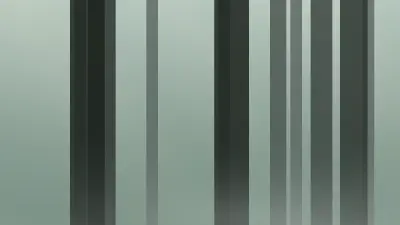

<!-- Generated by tools/gallery.mjs from showcase.yaml and build.json; do not edit. -->
# Forest Poem Title Card

[Film](../README.md) › [Titles & Graphics](../README.md#titles--graphics) · `titles` `typography` `demo-footage`

A short poem in two stanzas, a tracked heading and a red seal sit on a paper card over a misty forest.



<sub>Animated preview: 0–2.5 s, 25 frames rendered by Kition Film. Still: [thumb.png](thumb.png)</sub>

| | |
|---|---|
| Document | [forest-poem-title-card.kfilm](forest-poem-title-card.kfilm) (23 KB) |
| Contents | 1280 × 720 @ 24 fps; 12.0 s; 2 video clips; 6 effects; 1 animated effect |
| Features | `film.graphics.titles`, `film.graphics.text-basics`, `film.text.add-font` |
| Built by | `kition-film` @ `8281b2bb9e`: 17 commands in 21 ms |

## About

Our own four-line poem is set in two centred stanzas of Lora from kition-fonts, under a small
Inter heading tracked wide. A paper panel with a soft shadow keeps the dark ink readable over the
mist, and a small red seal carrying the poet's initial signs the corner, as on a hanging scroll.
The whole card fades in over the first 1.2 seconds.

## Checks

- `results.list.layers`: `{"count":6}`
- `results.list.layers.1`: `{"name":"Line One","text":"Morning mist\nwalks into the pines;"}`
- `results.list.layers.2`: `{"name":"Line Two","text":"deep in the hills\nthe birds call back."}`
- `results.list.layers.3`: `{"name":"Seal","kind":"Rectangle"}`
- `results.list.layers.5`: `{"name":"Heading","text":"IN THE PINES"}`
- `inspect.sequence.video.1.items`: `{"count":1}`
- `inspect.sequence.video.1.items.0.effects.4.params`: `{"vertical":{"value":false},"font":{"value":"Lora"}}`
- `inspect.sequence.video.1.items.0.effects.5.params`: `{"vertical":{"value":false},"font":{"value":"Lora"}}`
- `inspect.sequence.video.1.items.0.effects.7.params`: `{"vertical":{"value":false},"font":{"value":"Lora"}}`
- `inspect.sequence.video.1.items.0.effects.8.params.font.value`: `"Inter"`
- `inspect.sequence.video.1.items.0.effects.1.params.opacity.keyframes`: `[{"time":0,"value":0},{"time":304819200000,"value":100}]`
- diagnostics: none (the kit's check finds nothing wrong)
- the saved document opens again; the thumbnail matches `thumb.png` within the `render` tolerance

## Steps

<details><summary>17 commands (from <a href="showcase.yaml">showcase.yaml</a>, after the <code>demo-footage</code> prelude)</summary>

```yaml
- command: file.newSequence
  params:
    name: Mountain Verse
    width: 1280
    height: 720
    fps: 24
    video: 2
    audio: 1
  as: sequence
- command: timeline.place
  params:
    item: 9
    track: V1
    seconds: 0
    audio: false
  as: footage
- command: graphics.newRectangle
  params:
    position:
      - 960
      - 360
    size:
      - 420
      - 500
    seconds: 8
    track: 1
    time: 0
  as: verse
- command: graphics.set
  params:
    clip: $verse.clip
    layer: 0
    props:
      name: Paper
      fill_color: "#f3efe6"
      opacity: 88
      corner_radius: 6
      shadow: true
      shadow_opacity: 30
      shadow_blur: 40
      shadow_distance: 6
- command: graphics.newText
  params:
    clip: $verse.clip
    text: |-
      Morning mist
      walks into the pines;
    position:
      - 960
      - 268
    size: 42
    font: Lora
- command: graphics.set
  params:
    clip: $verse.clip
    layer: 1
    props:
      name: Line One
      align: center
      fill_color: "#1f2a26"
- command: graphics.newText
  params:
    clip: $verse.clip
    text: |-
      deep in the hills
      the birds call back.
    position:
      - 960
      - 420
    size: 42
    font: Lora
- command: graphics.set
  params:
    clip: $verse.clip
    layer: 2
    props:
      name: Line Two
      align: center
      fill_color: "#1f2a26"
- command: graphics.newRectangle
  params:
    clip: $verse.clip
    position:
      - 1110
      - 552
    size:
      - 52
      - 52
- command: graphics.set
  params:
    clip: $verse.clip
    layer: 3
    props:
      name: Seal
      fill_color: "#b8322a"
      corner_radius: 4
- command: graphics.newText
  params:
    clip: $verse.clip
    text: W
    position:
      - 1110
      - 565
    size: 36
    font: Lora
- command: graphics.set
  params:
    clip: $verse.clip
    layer: 4
    props:
      name: Seal Mark
      align: center
      fill_color: "#f8efe4"
- command: graphics.newText
  params:
    clip: $verse.clip
    text: IN THE PINES
    position:
      - 960
      - 176
    size: 20
- command: graphics.set
  params:
    clip: $verse.clip
    layer: 5
    props:
      name: Heading
      align: center
      tracking: 400
      fill_color: "#8a4a32"
- command: effects.setParam
  params:
    clip: $verse.clip
    effect: opacity
    param: opacity
    value: 0
    seconds: 0
- command: effects.setParam
  params:
    clip: $verse.clip
    effect: opacity
    param: opacity
    value: 100
    seconds: 1.2
- command: graphics.list
  params:
    clip: $verse.clip
  as: list
```

</details>
