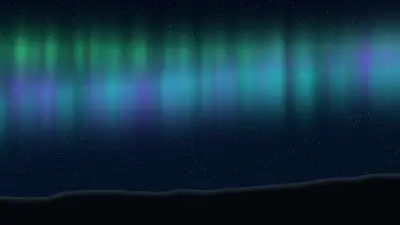

<!-- Generated by tools/gallery.mjs from showcase.yaml and build.json; do not edit. -->
# Four Camera Angle Cut

[Film](../README.md) › [Editing & Timeline](../README.md#editing--timeline) · `multicam` `live-cut` `demo-footage`

A festival recap groups four synced cameras into one multicam clip and live-cuts between the angles every two seconds.



<sub>Animated preview: 0–10 s, 40 frames rendered by Kition Film. Still: [thumb.png](thumb.png)</sub>

| | |
|---|---|
| Document | [four-camera-angle-cut.kfilm](four-camera-angle-cut.kfilm) (24 KB) |
| Contents | 1280 × 720 @ 24 fps; 10.0 s; 5 video clips; 1 audio clip |
| Features | `film.multicam.edit`, `film.clip.properties` |
| Built by | `kition-film` @ `27c94b23fd`: 10 commands in 26 ms |

## About

Four scenes stand in for four cameras that rolled together: `clip.createMulticam` lines them up
by their In points into a source sequence called Four Angles, with camera 1's audio. One clip of
it goes on Video 1, starts on camera 2, and a recording pass cuts to cameras 1, 3, 4 and back to
2 at 2 s intervals. Each switch becomes an edit, so the timeline ends with five segments of the
same multicam clip, each showing its own angle. The thumbnail is on camera 3.

## Checks

- `results.multicam.cameras`: `["Ocean_Sunset.mp4","Aurora_Timelapse.mp4","City_Night_Drive.mp4","Desert_Dunes.mp4"]`
- `results.start.angle`: `1`
- `results.cut1.angle`: `0`
- `results.cut2.angle`: `2`
- `results.cut3.angle`: `3`
- `results.cut4.angle`: `1`
- `results.recorded`: `{"cuts":4,"editPoints":4}`
- `inspect.sequence.video.0.items`: `{"count":5,"all":{"name":"Four Angles"}}`
- `inspect.sequence.video.0.items.2.start`: `1016064000000`
- `inspect.sequence.video.0.items.4.end`: `2540160000000`
- `inspect.project.root.children`: `{"any":{"name":"Four Angles","type":"Multi-Camera Source Sequence"}}`
- diagnostics: none (the kit's check finds nothing wrong)
- the saved document opens again; the thumbnail matches `thumb.png` within the `render` tolerance

## Steps

<details><summary>10 commands (from <a href="showcase.yaml">showcase.yaml</a>, after the <code>demo-footage</code> prelude)</summary>

```yaml
- command: clip.createMulticam
  params:
    items:
      - 5
      - 6
      - 7
      - 8
    name: Four Angles
    method: in
    audio: camera1
    cameraNames: clip
  as: multicam
- command: file.newSequence
  params:
    name: Festival Recap
    width: 1280
    height: 720
    fps: 24
    video: 1
    audio: 1
  as: sequence
- command: timeline.place
  params:
    item: $multicam.sequence
    track: V1
    seconds: 0
    duration: 2540160000000
  as: cams
- command: multicam.switchAngle
  params:
    camera: 2
    clips:
      - $cams.clips.0
    time: 0
  as: start
- command: multicam.recordStart
  params:
    time: 0
- command: multicam.cut
  params:
    camera: 1
    time: 508032000000
  as: cut1
- command: multicam.cut
  params:
    camera: 3
    time: 1016064000000
  as: cut2
- command: multicam.cut
  params:
    camera: 4
    time: 1524096000000
  as: cut3
- command: multicam.cut
  params:
    camera: 2
    time: 2032128000000
  as: cut4
- command: multicam.recordStop
  params:
    time: 2540160000000
  as: recorded
```

</details>
