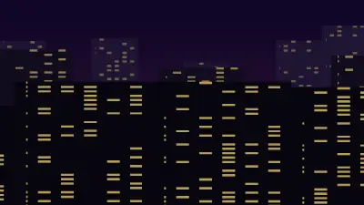

<!-- Generated by tools/gallery.mjs from showcase.yaml and build.json; do not edit. -->
# Freeze Frame Day One

[Film](../README.md) › [Editing & Timeline](../README.md#editing--timeline) · `freeze-frame` `frame-hold` `titles` `demo-footage`

A travel vlog freezes the city drive for two seconds and stamps the day's title on the held frame.



<sub>Animated preview: 1–6 s, 40 frames rendered by Kition Film. Still: [thumb.png](thumb.png)</sub>

| | |
|---|---|
| Document | [freeze-frame-day-one.kfilm](freeze-frame-day-one.kfilm) (20 KB) |
| Contents | 1280 × 720 @ 24 fps; 8.0 s; 4 video clips; 2 audio clips; 3 effects |
| Features | `film.clip.properties`, `film.graphics.text-basics` |
| Built by | `kition-film` @ `27c94b23fd`: 9 commands in 20 ms |

## About

`clip.insertFrameHoldSegment` splits the night-drive clip at 2.5 s and inserts a two-second hold
of that frame, pushing the rest of the drive later; the held segment has no sound, so the audio
of the drive simply pauses. A title on Video 2, on a dark band so it reads over the lit windows, sits exactly over the hold. The thumbnail is the
frozen frame with its title.

## Checks

- `results.hold.duration`: `508032000000`
- `inspect.sequence.video.0.items`: `{"count":3}`
- `inspect.sequence.video.0.items.0`: `{"end":635040000000,"frameHold":null}`
- `inspect.sequence.video.0.items.1`: `{"start":635040000000,"end":1143072000000,"frameHold":{"mediaTime":889056000000,"holdFilters":false}}`
- `inspect.sequence.video.0.items.2`: `{"start":1143072000000,"end":2032128000000,"sourceIn":889056000000,"frameHold":null}`
- `inspect.sequence.audio.0.items`: `{"count":2}`
- `inspect.sequence.duration`: `2032128000000`
- diagnostics: none (the kit's check finds nothing wrong)
- the saved document opens again; the thumbnail matches `thumb.png` within the `render` tolerance

## Steps

<details><summary>9 commands (from <a href="showcase.yaml">showcase.yaml</a>, after the <code>demo-footage</code> prelude)</summary>

```yaml
- command: file.newSequence
  params:
    name: Day One
    width: 1280
    height: 720
    fps: 24
    video: 2
    audio: 1
  as: sequence
- command: timeline.place
  params:
    item: 7
    track: V1
    seconds: 0
    sourceIn: 254016000000
    duration: 1524096000000
  as: drive
- command: clip.insertFrameHoldSegment
  params:
    clip: $drive.clips.0
    time: 635040000000
    seconds: 2
  as: hold
- command: graphics.newShape
  params:
    shape: rectangle
    position:
      - 640
      - 590
    size:
      - 1280
      - 260
    seconds: 2
    track: 1
    time: 635040000000
  as: card
- command: graphics.set
  params:
    clip: $card.clip
    layer: $card.layer
    props:
      fill_color: "#0b0716"
      opacity: 92
- command: graphics.newText
  params:
    clip: $card.clip
    text: DAY ONE
    position:
      - 96
      - 560
    size: 40
  as: kicker
- command: graphics.set
  params:
    clip: $card.clip
    layer: $kicker.layer
    props:
      font_style: Bold
      tracking: 400
      fill_color: "#ffd166"
- command: graphics.newText
  params:
    clip: $card.clip
    text: Into the City
    position:
      - 92
      - 650
    size: 96
  as: headline
- command: graphics.set
  params:
    clip: $card.clip
    layer: $headline.layer
    props:
      font_style: Bold
      fill_color: "#ffffff"
      shadow: true
```

</details>
