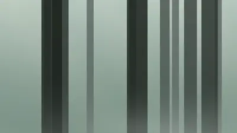

<!-- Generated by tools/gallery.mjs from showcase.yaml and build.json; do not edit. -->
# Interview Lower Third

[Film](../README.md) › [Titles & Graphics](../README.md#titles--graphics) · `titles` `lower-third` `shapes` `keyframes` `demo-footage`

A name and role lower third with an accent bar slides in over documentary footage.



<sub>Animated preview: 0–2.5 s, 25 frames rendered by Kition Film. Still: [thumb.png](thumb.png)</sub>

| | |
|---|---|
| Document | [interview-lower-third.kfilm](interview-lower-third.kfilm) (20 KB) |
| Contents | 1280 × 720 @ 24 fps; 12.0 s; 2 video clips; 4 effects; 3 animated effects |
| Features | `film.graphics.titles`, `film.graphics.text-basics`, `film.effects.keyframes` |
| Built by | `kition-film` @ `27c94b23fd`: 19 commands in 37 ms |

## About

One graphic clip holds the whole lower third: a translucent navy plate, an amber accent bar and
two text layers (a bold name and a tracked role line). The clip's Motion position and Opacity
are keyframed so the plate slides in from the left, and the role line has its own layer opacity
keyframes so it follows half a second later. It fades out again at the end of the clip.

## Checks

- `results.list.layers`: `{"count":4}`
- `results.list.layers.0`: `{"name":"Plate","kind":"Rectangle"}`
- `results.list.layers.1`: `{"name":"Accent","kind":"Rectangle"}`
- `results.list.layers.2`: `{"text":"Mara Lindqvist","kind":"text"}`
- `inspect.sequence.video.0.items`: `{"count":1}`
- `inspect.sequence.video.1.items`: `{"count":1}`
- `inspect.sequence.video.1.items.0.effects.0.params.position.keyframes`: `[{"time":0,"value":[520,360]},{"time":127008000000,"value":[640,360]}]`
- `inspect.sequence.video.1.items.0.effects.1.params.opacity.keyframes`: `[{"time":0,"value":0},{"time":127008000000,"value":100},{"time":1397088000000,"value":100},{"time":1524096000000,"value":0}]`
- `inspect.sequence.video.1.items.0.effects.6.params.opacity.keyframes`: `[{"time":127008000000,"value":0},{"time":254016000000,"value":100}]`
- diagnostics: none (the kit's check finds nothing wrong)
- the saved document opens again; the thumbnail matches `thumb.png` within the `render` tolerance

## Steps

<details><summary>19 commands (from <a href="showcase.yaml">showcase.yaml</a>, after the <code>demo-footage</code> prelude)</summary>

```yaml
- command: file.newSequence
  params:
    name: Interview
    width: 1280
    height: 720
    fps: 24
    video: 2
    audio: 1
  as: sequence
- command: timeline.place
  params:
    item: 9
    track: V1
    seconds: 0
    audio: false
  as: footage
- command: graphics.newRectangle
  params:
    position:
      - 340
      - 590
    size:
      - 520
      - 112
    seconds: 6
    track: 1
    time: 0
  as: plate
- command: graphics.set
  params:
    clip: $plate.clip
    layer: 0
    props:
      name: Plate
      fill_color: "#14202b"
      opacity: 88
- command: graphics.newRectangle
  params:
    clip: $plate.clip
    position:
      - 84
      - 590
    size:
      - 8
      - 112
- command: graphics.set
  params:
    clip: $plate.clip
    layer: 1
    props:
      name: Accent
      fill_color: "#f2a93b"
- command: graphics.newText
  params:
    clip: $plate.clip
    text: Mara Lindqvist
    position:
      - 108
      - 587
    size: 40
    fontStyle: Bold
- command: graphics.set
  params:
    clip: $plate.clip
    layer: 2
    props:
      fill_color: "#ffffff"
- command: graphics.newText
  params:
    clip: $plate.clip
    text: FIELD ECOLOGIST  ·  HIGHLAND SURVEY
    position:
      - 110
      - 625
    size: 19
- command: graphics.set
  params:
    clip: $plate.clip
    layer: 3
    props:
      fill_color: "#f2a93b"
      tracking: 80
- command: effects.setParam
  params:
    clip: $plate.clip
    effect: motion
    param: position
    value:
      - 520
      - 360
    seconds: 0
- command: effects.setParam
  params:
    clip: $plate.clip
    effect: motion
    param: position
    value:
      - 640
      - 360
    seconds: 0.5
- command: effects.setParam
  params:
    clip: $plate.clip
    effect: opacity
    param: opacity
    value: 0
    seconds: 0
- command: effects.setParam
  params:
    clip: $plate.clip
    effect: opacity
    param: opacity
    value: 100
    seconds: 0.5
- command: effects.setParam
  params:
    clip: $plate.clip
    effect: 6
    param: opacity
    value: 0
    seconds: 0.5
- command: effects.setParam
  params:
    clip: $plate.clip
    effect: 6
    param: opacity
    value: 100
    seconds: 1
- command: effects.setParam
  params:
    clip: $plate.clip
    effect: opacity
    param: opacity
    value: 100
    seconds: 5.5
- command: effects.setParam
  params:
    clip: $plate.clip
    effect: opacity
    param: opacity
    value: 0
    seconds: 6
- command: graphics.list
  params:
    clip: $plate.clip
  as: list
```

</details>
