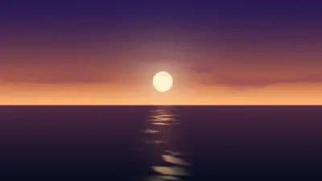

<!-- Generated by tools/gallery.mjs from showcase.yaml and build.json; do not edit. -->
# Iris-Out Ending

[Film](../README.md) › [Keyframes & Motion](../README.md#keyframes--motion) · `keyframes` `masks` `iris` `easing` `titles` `demo-footage`

The closing shot shrinks into a feathered circle around the setting sun, an animated mask expansion, before THE END fades up.



<sub>Animated preview: 0–5 s, 50 frames rendered by Kition Film. Still: [thumb.png](thumb.png)</sub>

| | |
|---|---|
| Document | [iris-out-ending.kfilm](iris-out-ending.kfilm) (15 KB) |
| Contents | 1920 × 1080 @ 24 fps; 6.0 s; 2 video clips; 1 effect; 1 animated effect |
| Features | `film.effects.keyframes`, `film.graphics.text-basics` |
| Built by | `kition-film` @ `27c94b23fd`: 14 commands in 14 ms |

## About

The old silent-film iris-out made with a mask. The sea shot has a small elliptical Opacity mask
centred on the sun; the mask's expansion (effects.setParam with `mask: 0`) is keyframed from
1200 px, which shows the whole frame, down to 0 px over three seconds, with an ease into the
last keyframe so the circle slows as it closes. A 40 px feather keeps the edge soft, and the
end card fades in once the iris has shut.

## Checks

- `results.iris`: `{"effect":1,"mask":0}`
- `results.open.masks.0`: `{"name":"Iris","feather":40,"expansion":1200}`
- `results.closing.masks.0.expansion`: `{"approx":450,"tol":5}`
- `results.closed.masks.0.expansion`: `0`
- `inspect.sequence.video.0.items.0.effects.1`: `{"effect":"opacity","masks":1}`
- `inspect.sequence.video.1.items.0`: `{"name":"THE END","startFrame":72}`
- `inspect.sequence.video.1.items.0.effects.1.params.opacity.keyframes`: `[{"time":762048000000,"mediaTime":0,"value":0},{"time":1016064000000,"mediaTime":254016000000,"value":100}]`
- diagnostics: none (the kit's check finds nothing wrong)
- the saved document opens again; the thumbnail matches `thumb.png` within the `render` tolerance

## Steps

<details><summary>14 commands (from <a href="showcase.yaml">showcase.yaml</a>, after the <code>demo-footage</code> prelude)</summary>

```yaml
- command: file.newSequence
  params:
    name: Final Shot
    width: 1920
    height: 1080
    fps: 24
    video: 2
    audio: 1
- command: timeline.place
  params:
    item: 5
    track: V1
    seconds: 0
    sourceIn: 1270080000000
    duration: 1524096000000
    audio: false
  as: sea
- command: masks.add
  params:
    clip: $sea.clips.0
    shape: ellipse
    center:
      - 974
      - 508
    size:
      - 180
      - 180
  as: iris
- command: masks.set
  params:
    clip: $sea.clips.0
    mask: 0
    name: Iris
    feather: 40
- command: effects.setParam
  params:
    clip: $sea.clips.0
    effect: opacity
    mask: 0
    param: expansion
    value: 1200
    seconds: 0.5
- command: effects.setParam
  params:
    clip: $sea.clips.0
    effect: opacity
    mask: 0
    param: expansion
    value: 0
    seconds: 3.5
- command: effects.setInterpolation
  params:
    clip: $sea.clips.0
    effect: opacity
    param: expansion
    mask: 0
    mediaTime: 2159136000000
    interpolation: easeIn
- command: masks.list
  params:
    clip: $sea.clips.0
    time: 127008000000
  as: open
- command: masks.list
  params:
    clip: $sea.clips.0
    time: 508032000000
  as: closing
- command: masks.list
  params:
    clip: $sea.clips.0
    time: 1016064000000
  as: closed
- command: graphics.newText
  params:
    text: THE END
    position:
      - 960
      - 700
    size: 72
    seconds: 3
    frame: 72
    track: 1
  as: card
- command: graphics.set
  params:
    clip: $card.clip
    props:
      align: center
      tracking: 600
      fill_color: "#f3e3c3"
- command: effects.setParam
  params:
    clip: $card.clip
    effect: opacity
    param: opacity
    value: 0
    seconds: 3
- command: effects.setParam
  params:
    clip: $card.clip
    effect: opacity
    param: opacity
    value: 100
    seconds: 4
```

</details>
