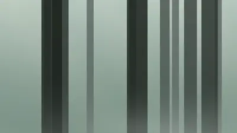

<!-- Generated by tools/gallery.mjs from showcase.yaml and build.json; do not edit. -->
# Misty Forest Dual Subtitles

[Film](../README.md) › [Markers & Captions](../README.md#markers--captions) · `captions` `subtitles` `demo-footage`

A forest travelogue carries English subtitles with a Spanish translation underneath, on two caption tracks styled to stack.



<sub>Animated preview: 0–10 s, 40 frames rendered by Kition Film. Still: [thumb.png](thumb.png)</sub>

| | |
|---|---|
| Document | [misty-forest-dual-subtitles.kfilm](misty-forest-dual-subtitles.kfilm) (13 KB) |
| Contents | 1280 × 720 @ 24 fps; 10.0 s; 1 video clip; 1 audio clip |
| Features | `film.captions.edit`, `film.text.add-font` |
| Built by | `kition-film` @ `8281b2bb9e`: 13 commands in 45 ms |

## About

Two Subtitle tracks share the same timings: English (language en) set in Lora from kition-fonts,
larger and with a dark outline, and Español (language es) in smaller Inter beneath it, its bottom
margin pulled down so the two lines stack instead of overlapping. Neither track has a box: the
outlines alone keep the lines readable over the pale mist. Lora comes in through the sample's
`fonts:` list, so the captions render the same on every machine.

## Checks

- `results.en.label`: `"C1"`
- `results.es.label`: `"C2"`
- `results.list.tracks`: `{"count":2}`
- `results.list.tracks.0`: `{"name":"English","language":"en","label":"C1"}`
- `results.list.tracks.0.style`: `{"font":"Lora","background":false}`
- `results.list.tracks.0.captions`: `{"count":3}`
- `results.list.tracks.0.captions.1`: `{"text":"These trees have stood here for three hundred years.","start":1016064000000}`
- `results.list.tracks.1`: `{"name":"Español","language":"es","label":"C2"}`
- `results.list.tracks.1.captions`: `{"count":3}`
- `results.list.tracks.1.captions.1`: `{"text":"Estos árboles llevan trescientos años aquí.","start":1016064000000}`
- diagnostics: none (the kit's check finds nothing wrong)
- the saved document opens again; the thumbnail matches `thumb.png` within the `render` tolerance

## Steps

<details><summary>13 commands (from <a href="showcase.yaml">showcase.yaml</a>, after the <code>demo-footage</code> prelude)</summary>

```yaml
- command: file.newSequence
  params:
    name: Misty Forest
    width: 1280
    height: 720
    fps: 24
    video: 1
    audio: 1
  as: sequence
- command: timeline.place
  params:
    item: 9
    track: V1
    seconds: 0
    duration: 2540160000000
  as: forest
- command: captions.newTrack
  params:
    format: Subtitle
    name: English
    language: en
  as: en
- command: captions.setStyle
  params:
    track: $en.track
    font: Lora
    size: 42
    color: "#ffffff"
    background: false
    outline: 8
    outlineColor: "#1b261f"
    margin: 0.14
- command: captions.add
  params:
    track: $en.track
    text: Morning. The mist has not lifted yet.
    seconds: 0.5
    durationSeconds: 3
- command: captions.add
  params:
    track: $en.track
    text: These trees have stood here for three hundred years.
    seconds: 4
    durationSeconds: 2.75
- command: captions.add
  params:
    track: $en.track
    text: Walk slowly, and listen to the forest.
    seconds: 7.25
    durationSeconds: 2.5
- command: captions.newTrack
  params:
    format: Subtitle
    name: Español
    language: es
  as: es
- command: captions.setStyle
  params:
    track: $es.track
    size: 32
    color: "#e8f0ea"
    background: false
    outline: 5
    outlineColor: "#1b261f"
    margin: 0.06
- command: captions.add
  params:
    track: $es.track
    text: Amanece. La niebla aún no se ha levantado.
    seconds: 0.5
    durationSeconds: 3
- command: captions.add
  params:
    track: $es.track
    text: Estos árboles llevan trescientos años aquí.
    seconds: 4
    durationSeconds: 2.75
- command: captions.add
  params:
    track: $es.track
    text: Camina despacio y escucha el bosque.
    seconds: 7.25
    durationSeconds: 2.5
- command: captions.list
  as: list
```

</details>
