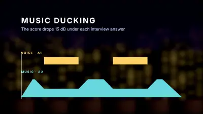

<!-- Generated by tools/gallery.mjs from showcase.yaml and build.json; do not edit. -->
# Music Ducking Under Dialogue

[Film](../README.md) › [Audio](../README.md#audio) · `audio` `ducking` `essential-sound` `music` `keyframes` `demo-footage`

A music bed that dips 15 dB whenever an interview answer plays, written by Essential Sound auto-ducking, with a diagram of the mix.



<sub>Animated preview: 0–14 s, 56 frames rendered by Kition Film. Still: [thumb.png](thumb.png)</sub>

| | |
|---|---|
| Document | [music-ducking-under-dialogue.kfilm](music-ducking-under-dialogue.kfilm) (33 KB) |
| Contents | 1920 × 1080 @ 24 fps; 14.0 s; 3 video clips; 3 audio clips; 10 effects; 2 animated effects; 2 transitions |
| Features | `film.audio.basics`, `film.audio.mixing`, `film.effects.keyframes`, `film.graphics.text-basics` |
| Built by | `kition-film` @ `27c94b23fd`: 28 commands in 197 ms |

## About

Two short clips on A1 stand in for interview answers (2–5 s and 8–11 s) and are tagged
Dialogue with essentialSound.setType. audio.bed then lays the Ambient Score under the whole
picture on A2 at −9.4 dB with fades at both ends, marks it as Music and generates ducking
against dialogue: eight Volume keyframes that pull the music down 15 dB around each answer.
The picture is a diagram of exactly that mix over the blurred city, with a moving playhead.

## Checks

- `results.tagged`: `{"clips":2,"type":"Dialogue"}`
- `results.bed.audioTrack`: `"A2"`
- `results.bed.gainDb`: `-9.4`
- `results.bed.ducking.0.regions`: `{"count":2}`
- `inspect.sequence.audio.0.items`: `{"count":2}`
- `inspect.sequence.audio.1.items.0`: `{"name":"Ambient_Score.wav","gainDb":-9.4}`
- `inspect.sequence.audio.1.items.0.effects.0.effect`: `"volume"`
- `inspect.sequence.audio.1.items.0.effects.0.params.level.keyframes`: `[{"time":{"min":254016000000,"max":508032000000},"value":0},{"time":{"min":254016000000,"max":508032000000},"value":-15},{"time":{"min":1270080000000,"max":1524096000000},"value":-15},{"time":{"min":1270080000000,"max":1524096000000},"value":0},{"time":{"min":1778112000000,"max":2032128000000},"value":0},{"time":{"min":1778112000000,"max":2032128000000},"value":-15},{"time":{"min":2794176000000,"max":3048192000000},"value":-15},{"time":{"min":2794176000000,"max":3048192000000},"value":0}]`
- `inspect.sequence.audio.1.transitions`: `{"count":2,"all":{"effect":"constant_gain"}}`
- diagnostics: none (the kit's check finds nothing wrong)
- the saved document opens again; the thumbnail matches `thumb.png` within the `render` tolerance

## Steps

<details><summary>28 commands (from <a href="showcase.yaml">showcase.yaml</a>, after the <code>demo-footage</code> prelude)</summary>

```yaml
- command: file.newSequence
  params:
    name: Interview Mix
    width: 1920
    height: 1080
    fps: 24
    video: 3
    audio: 2
- command: timeline.place
  params:
    item: 7
    track: V1
    seconds: 0
    audio: false
  as: city
- command: effects.apply
  params:
    clips:
      - $city.clips.0
    effect: gaussian_blur
- command: effects.setParam
  params:
    clip: $city.clips.0
    effect: gaussian_blur
    param: blurriness
    value: 40
- command: effects.apply
  params:
    clips:
      - $city.clips.0
    effect: brightness_contrast
- command: effects.setParam
  params:
    clip: $city.clips.0
    effect: brightness_contrast
    param: brightness
    value: -30
- command: timeline.place
  params:
    item: 9
    track: A1
    seconds: 2
    duration: 762048000000
    video: false
  as: answer1
- command: timeline.place
  params:
    item: 9
    track: A1
    seconds: 8
    duration: 762048000000
    video: false
  as: answer2
- command: essentialSound.setType
  params:
    clips:
      - $answer1.clips.0
      - $answer2.clips.0
    type: dialogue
  as: tagged
- command: audio.bed
  params:
    item: 11
    duck:
      against: dialogue
      reduceDb: -15
  as: bed
- command: graphics.newText
  params:
    text: MUSIC DUCKING
    position:
      - 200
      - 220
    size: 72
    seconds: 14
    track: 1
    time: 0
  as: diagram
- command: graphics.set
  params:
    clip: $diagram.clip
    props:
      font_style: Bold
      tracking: 120
      fill_color: "#ffffff"
- command: graphics.newText
  params:
    clip: $diagram.clip
    text: The score drops 15 dB under each interview answer
    position:
      - 200
      - 290
    size: 40
- command: graphics.set
  params:
    clip: $diagram.clip
    props:
      fill_color: "#c9d3ff"
- command: graphics.newText
  params:
    clip: $diagram.clip
    text: VOICE · A1
    position:
      - 200
      - 510
    size: 28
- command: graphics.set
  params:
    clip: $diagram.clip
    props:
      font_style: Bold
      tracking: 200
      fill_color: "#ffd166"
- command: graphics.newRectangle
  params:
    clip: $diagram.clip
    position:
      - 580
      - 575
    size:
      - 325.7
      - 70
- command: graphics.set
  params:
    clip: $diagram.clip
    props:
      fill_color: "#ffd166"
- command: graphics.newRectangle
  params:
    clip: $diagram.clip
    position:
      - 1231.4
      - 575
    size:
      - 325.7
      - 70
- command: graphics.set
  params:
    clip: $diagram.clip
    props:
      fill_color: "#ffd166"
- command: graphics.newText
  params:
    clip: $diagram.clip
    text: MUSIC · A2
    position:
      - 200
      - 690
    size: 28
- command: graphics.set
  params:
    clip: $diagram.clip
    props:
      font_style: Bold
      tracking: 200
      fill_color: "#6ee7f0"
- command: graphics.newShape
  params:
    clip: $diagram.clip
    shape: path
    points:
      - - 200
        - 920
      - - 308.6
        - 750
      - - 328.1
        - 750
      - - 415
        - 840
      - - 745
        - 840
      - - 831.9
        - 750
      - - 979.5
        - 750
      - - 1066.4
        - 840
      - - 1396.5
        - 840
      - - 1483.3
        - 750
      - - 1535.4
        - 750
      - - 1720
        - 920
- command: graphics.set
  params:
    clip: $diagram.clip
    props:
      fill_color: "#6ee7f0"
      opacity: 85
- command: graphics.newRectangle
  params:
    position:
      - 960
      - 540
    size:
      - 6
      - 440
    seconds: 14
    track: 2
    time: 0
  as: playhead
- command: graphics.set
  params:
    clip: $playhead.clip
    props:
      fill_color: "#ffffff"
- command: effects.setParam
  params:
    clip: $playhead.clip
    effect: motion
    param: position
    value:
      - 200
      - 715
    seconds: 0
- command: effects.setParam
  params:
    clip: $playhead.clip
    effect: motion
    param: position
    value:
      - 1720
      - 715
    seconds: 14
```

</details>
