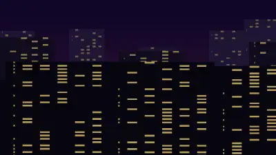

<!-- Generated by tools/gallery.mjs from showcase.yaml and build.json; do not edit. -->
# Nested Flashback Look

[Film](../README.md) › [Editing & Timeline](../README.md#editing--timeline) · `nesting` `black-white` `vignette` `titles` `demo-footage`

A short film nests its three-shot flashback and its date card into one clip, then grades the whole memory black and white in one place.



<sub>Animated preview: 1.5–10.5 s, 45 frames rendered by Kition Film. Still: [thumb.png](thumb.png)</sub>

| | |
|---|---|
| Document | [nested-flashback-look.kfilm](nested-flashback-look.kfilm) (23 KB) |
| Contents | 1280 × 720 @ 24 fps; 12.0 s; 3 video clips; 3 audio clips; 2 effects |
| Features | `film.clip.properties`, `film.sequence.manage`, `film.effects.basics` |
| Built by | `kition-film` @ `27c94b23fd`: 12 commands in 17 ms |

## About

The flashback is three shots (dunes, ocean, forest) on Video 1 and a date card on Video 2,
between two present-day shots of the city and the neon sign. Selecting the five flashback
pieces and running `clip.nest` moves them into a new sequence called Flashback 1998 and leaves
one clip of it in their place, so Black & White and a vignette are applied once, to the nested
clip, instead of to every shot. The thumbnail is inside the flashback.

## Checks

- `inspect.sequence.video.0.items`: `{"count":3}`
- `inspect.sequence.video.0.items.1`: `{"name":"Flashback 1998","start":762048000000,"end":2286144000000}`
- `inspect.sequence.video.0.items.1.effects`: `{"count":5,"any":{"effect":"black_white"}}`
- `inspect.sequence.video.0.items.1.effects.0.effect`: `"black_white"`
- `inspect.sequence.video.0.items.1.effects.1.effect`: `"vignette"`
- `inspect.sequence.video.1.items`: `{"count":0}`
- `inspect.project.root.children`: `{"any":{"name":"Flashback 1998","type":"Sequence"}}`
- diagnostics: none (the kit's check finds nothing wrong)
- the saved document opens again; the thumbnail matches `thumb.png` within the `render` tolerance

## Steps

<details><summary>12 commands (from <a href="showcase.yaml">showcase.yaml</a>, after the <code>demo-footage</code> prelude)</summary>

```yaml
- command: file.newSequence
  params:
    name: The Return
    width: 1280
    height: 720
    fps: 24
    video: 2
    audio: 1
  as: sequence
- command: timeline.place
  params:
    item: 7
    track: V1
    seconds: 0
    sourceIn: 254016000000
    duration: 762048000000
  as: city
- command: timeline.place
  params:
    item: 8
    track: V1
    seconds: 3
    sourceIn: 254016000000
    duration: 508032000000
  as: dunes
- command: timeline.place
  params:
    item: 5
    track: V1
    seconds: 5
    sourceIn: 1016064000000
    duration: 508032000000
  as: ocean
- command: timeline.place
  params:
    item: 9
    track: V1
    seconds: 7
    sourceIn: 254016000000
    duration: 508032000000
  as: forest
- command: timeline.place
  params:
    item: 10
    track: V1
    seconds: 9
    duration: 762048000000
  as: neon
- command: graphics.newText
  params:
    text: SUMMER 1998
    position:
      - 1184
      - 640
    size: 44
    seconds: 6
    track: 1
    time: 762048000000
  as: date
- command: graphics.set
  params:
    clip: $date.clip
    props:
      font_style: Bold
      align: right
      tracking: 300
      fill_color: "#ffffff"
      shadow: true
- command: timeline.select
  params:
    clips:
      - $dunes.clips.0
      - $ocean.clips.0
      - $forest.clips.0
      - $date.clip
- command: clip.nest
  params:
    name: Flashback 1998
  as: nest
- command: effects.apply
  params:
    clips:
      - $nest.clips.0
    effect: black_white
- command: effects.apply
  params:
    clips:
      - $nest.clips.0
    effect: vignette
```

</details>
