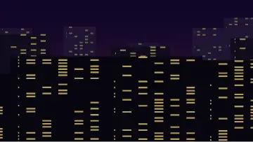

<!-- Generated by tools/gallery.mjs from showcase.yaml and build.json; do not edit. -->
# Night Drive Speed Ramp

[Film](../README.md) › [Editing & Timeline](../README.md#editing--timeline) · `speed` `slow-motion` `razor` `time-interpolation` `demo-footage`

A car-culture reel cuts one long night drive into three pieces and runs them at normal speed, triple speed and half-speed slow motion.



<sub>Animated preview: 2–8 s, 36 frames rendered by Kition Film. Still: [thumb.png](thumb.png)</sub>

| | |
|---|---|
| Document | [night-drive-speed-ramp.kfilm](night-drive-speed-ramp.kfilm) (14 KB) |
| Contents | 1280 × 720 @ 24 fps; 10.0 s; 3 video clips; 3 audio clips |
| Features | `film.timeline.basics`, `film.clip.properties` |
| Built by | `kition-film` @ `27c94b23fd`: 6 commands in 42 ms |

## About

One nine-second take of the night drive is razored at 3 s and 6 s. The middle piece is sped up to
300 % with ripple on, so it plays in one second and the rest of the drive follows it at once;
the last piece drops to 50 % with optical-flow interpolation and stretches to six seconds. The
audio stays linked and changes speed with the picture. The thumbnail is inside the slow-motion
section.

## Checks

- `results.cut1`: `{"cuts":2,"clips":{"count":2}}`
- `results.cut2`: `{"cuts":2,"clips":{"count":2}}`
- `inspect.sequence.video.0.items`: `{"count":3}`
- `inspect.sequence.video.0.items.0`: `{"speed":1,"start":0,"end":762048000000}`
- `inspect.sequence.video.0.items.1`: `{"speed":3,"start":762048000000,"end":1016064000000,"sourceIn":762048000000,"sourceOut":1524096000000}`
- `inspect.sequence.video.0.items.2`: `{"speed":0.5,"start":1016064000000,"end":2540160000000,"timeInterpolation":"opticalFlow"}`
- `inspect.sequence.audio.0.items`: `{"count":3}`
- `inspect.sequence.audio.0.items.1.speed`: `3`
- `inspect.sequence.duration`: `2540160000000`
- diagnostics: none (the kit's check finds nothing wrong)
- the saved document opens again; the thumbnail matches `thumb.png` within the `render` tolerance

## Steps

<details><summary>6 commands (from <a href="showcase.yaml">showcase.yaml</a>, after the <code>demo-footage</code> prelude)</summary>

```yaml
- command: file.newSequence
  params:
    name: Night Drive Reel
    width: 1280
    height: 720
    fps: 24
    video: 1
    audio: 1
  as: sequence
- command: timeline.place
  params:
    item: 7
    track: V1
    seconds: 0
    duration: 2286144000000
  as: drive
- command: timeline.razor
  params:
    time: 762048000000
  as: cut1
- command: timeline.razor
  params:
    time: 1524096000000
  as: cut2
- command: clip.speedDuration
  params:
    clips:
      - $cut1.clips.0
    speed: 300
    ripple: true
- command: clip.speedDuration
  params:
    clips:
      - $cut2.clips.0
    speed: 50
    ripple: true
    interpolation: opticalFlow
```

</details>
