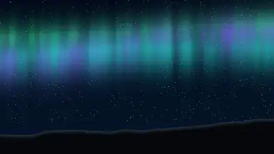

<!-- Generated by tools/gallery.mjs from showcase.yaml and build.json; do not edit. -->
# Night to Day Dip to White

[Film](../README.md) › [Transitions](../README.md#transitions) · `transitions` `dip-to-white` `demo-footage`

A road-trip film jumps from the aurora night to the next morning in the dunes through a flash of white.



<sub>Animated preview: 2.5–5.5 s, 30 frames rendered by Kition Film. Still: [thumb.png](thumb.png)</sub>

| | |
|---|---|
| Document | [night-to-day-dip-to-white.kfilm](night-to-day-dip-to-white.kfilm) (13 KB) |
| Contents | 1280 × 720 @ 24 fps; 8.0 s; 2 video clips; 2 audio clips; 1 transition |
| Features | `film.transitions.basics`, `film.timeline.basics` |
| Built by | `kition-film` @ `27c94b23fd`: 4 commands in 14 ms |

## About

A Dip to White 20 frames long sits on the cut at 4 s between the aurora and the desert: the
short, bright kind of dip that marks a jump in time. The thumbnail is four frames after the cut,
with the morning dunes still coming up out of the white.

## Checks

- `inspect.sequence.video.0.items`: `{"count":2}`
- `inspect.sequence.video.0.items.1.name`: `"Desert_Dunes.mp4"`
- `inspect.sequence.video.0.transitions`: `{"count":1}`
- `inspect.sequence.video.0.transitions.0.effect`: `"dip_to_white"`
- `inspect.sequence.video.0.transitions.0.duration`: `211680000000`
- diagnostics: none (the kit's check finds nothing wrong)
- the saved document opens again; the thumbnail matches `thumb.png` within the `render` tolerance

## Steps

<details><summary>4 commands (from <a href="showcase.yaml">showcase.yaml</a>, after the <code>demo-footage</code> prelude)</summary>

```yaml
- command: file.newSequence
  params:
    name: Next Morning
    width: 1280
    height: 720
    fps: 24
    video: 1
    audio: 1
  as: sequence
- command: timeline.place
  params:
    item: 6
    track: V1
    seconds: 0
    sourceIn: 762048000000
    duration: 1016064000000
  as: night
- command: timeline.place
  params:
    item: 8
    track: V1
    seconds: 4
    sourceIn: 254016000000
    duration: 1016064000000
  as: morning
- command: sequence.applyVideoTransition
  params:
    clip: $morning.clips.0
    edge: in
    effect: dip_to_white
    frames: 20
  as: flash
```

</details>
