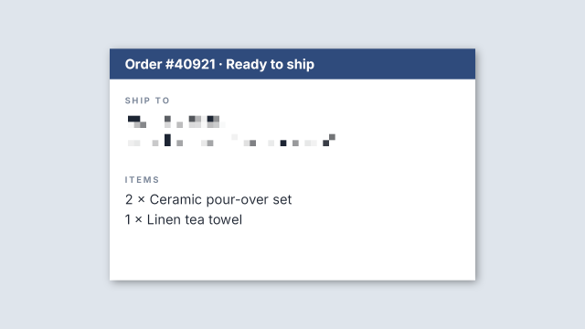

<!-- Generated by tools/gallery.mjs from showcase.yaml and build.json; do not edit. -->
# Privacy Mosaic Redaction

[Film](../README.md) › [Effects & Color](../README.md#effects--color) · `masks` `mosaic` `privacy` `adjustment-layer` `graphics`

A screen-recording style order card with the customer's name and address pixelated by a masked Mosaic on an adjustment layer.



| | |
|---|---|
| Document | [privacy-mosaic-redaction.kfilm](privacy-mosaic-redaction.kfilm) (23 KB) |
| Contents | 1920 × 1080 @ 30 fps; 8.0 s; 3 video clips; 10 effects |
| Features | `film.effects.basics`, `film.file.new-items`, `film.graphics.text-basics` |
| Built by | `kition-film` @ `27c94b23fd`: 29 commands in 26 ms |

## About

Tutorials and support videos often show real records that must not be readable. Here the
order card is built from graphics on a Color Matte; above it, an Adjustment Layer carries a
Mosaic effect, and a rectangular mask on that effect (masks.add naming the effect)
limits the pixelation to the name and address lines. Everything outside the mask, including
the order number and the items, stays sharp.

## Checks

- `results.redaction`: `{"effect":0,"mask":0}`
- `results.masks.masks`: `{"count":1}`
- `results.masks.masks.0`: `{"effectId":"mosaic","name":"Address"}`
- `results.masks.masks.0.path.vertices`: `[{"p":[390,360]},{"p":[1300,360]},{"p":[1300,500]},{"p":[390,500]}]`
- `inspect.sequence.video.2.items.0.effects.0`: `{"effect":"mosaic","masks":1,"params":{"horizontal":{"value":96},"vertical":{"value":54}}}`
- diagnostics: none (the kit's check finds nothing wrong)
- the saved document opens again; the thumbnail matches `thumb.png` within the `render` tolerance

## Steps

<details><summary>29 commands (from <a href="showcase.yaml">showcase.yaml</a>)</summary>

```yaml
- command: sequence.settings
  params:
    name: Support Walkthrough
    fps: 30
- command: file.newColorMatte
  params:
    color: "#dfe5ec"
    seconds: 8
  as: matte
- command: timeline.place
  params:
    item: $matte.item
    track: V1
    seconds: 0
- command: graphics.newRectangle
  params:
    position:
      - 960
      - 540
    size:
      - 1200
      - 760
    seconds: 8
    track: 1
    time: 0
  as: card
- command: graphics.set
  params:
    clip: $card.clip
    props:
      fill_color: "#ffffff"
      shadow: true
- command: graphics.newRectangle
  params:
    clip: $card.clip
    position:
      - 960
      - 210
    size:
      - 1200
      - 100
- command: graphics.set
  params:
    clip: $card.clip
    props:
      fill_color: "#2f4b7c"
- command: graphics.newText
  params:
    clip: $card.clip
    text: "Order #40921 · Ready to ship"
    position:
      - 410
      - 226
    size: 44
- command: graphics.set
  params:
    clip: $card.clip
    props:
      font_style: Bold
      fill_color: "#ffffff"
- command: graphics.newText
  params:
    clip: $card.clip
    text: SHIP TO
    position:
      - 410
      - 340
    size: 28
- command: graphics.set
  params:
    clip: $card.clip
    props:
      font_style: Bold
      tracking: 200
      fill_color: "#7a8699"
- command: graphics.newText
  params:
    clip: $card.clip
    text: Marta Velling
    position:
      - 410
      - 410
    size: 52
- command: graphics.set
  params:
    clip: $card.clip
    props:
      font_style: Bold
      fill_color: "#1d2533"
- command: graphics.newText
  params:
    clip: $card.clip
    text: 14 Lantern Row, Brightwater 4021
    position:
      - 410
      - 476
    size: 44
- command: graphics.set
  params:
    clip: $card.clip
    props:
      fill_color: "#1d2533"
- command: graphics.newText
  params:
    clip: $card.clip
    text: ITEMS
    position:
      - 410
      - 600
    size: 28
- command: graphics.set
  params:
    clip: $card.clip
    props:
      font_style: Bold
      tracking: 200
      fill_color: "#7a8699"
- command: graphics.newText
  params:
    clip: $card.clip
    text: 2 × Ceramic pour-over set
    position:
      - 410
      - 670
    size: 44
- command: graphics.set
  params:
    clip: $card.clip
    props:
      fill_color: "#1d2533"
- command: graphics.newText
  params:
    clip: $card.clip
    text: 1 × Linen tea towel
    position:
      - 410
      - 736
    size: 44
- command: graphics.set
  params:
    clip: $card.clip
    props:
      fill_color: "#1d2533"
- command: file.newAdjustmentLayer
  params:
    seconds: 8
  as: adjustment
- command: timeline.place
  params:
    item: $adjustment.item
    track: V3
    seconds: 0
  as: blur
- command: effects.apply
  params:
    clips:
      - $blur.clips.0
    effect: mosaic
- command: effects.setParam
  params:
    clip: $blur.clips.0
    effect: mosaic
    param: horizontal
    value: 96
- command: effects.setParam
  params:
    clip: $blur.clips.0
    effect: mosaic
    param: vertical
    value: 54
- command: masks.add
  params:
    clip: $blur.clips.0
    effect: mosaic
    shape: polygon
    path:
      - - 390
        - 360
      - - 1300
        - 360
      - - 1300
        - 500
      - - 390
        - 500
  as: redaction
- command: masks.set
  params:
    clip: $blur.clips.0
    effect: mosaic
    mask: 0
    name: Address
- command: masks.list
  params:
    clip: $blur.clips.0
  as: masks
```

</details>
