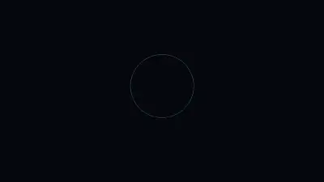

<!-- Generated by tools/gallery.mjs from showcase.yaml and build.json; do not edit. -->
# Product Launch Title

[Film](../README.md) › [Titles & Graphics](../README.md#titles--graphics) · `titles` `product` `shapes` `keyframes`

A glowing ring and a crisp product name reveal for a keynote-style launch video.



<sub>Animated preview: 0–3 s, 30 frames rendered by Kition Film. Still: [thumb.png](thumb.png)</sub>

| | |
|---|---|
| Document | [product-launch-title.kfilm](product-launch-title.kfilm) (18 KB) |
| Contents | 1280 × 720 @ 30 fps; 6.0 s; 2 video clips; 6 effects; 6 animated effects |
| Features | `film.graphics.titles`, `film.effects.keyframes`, `film.file.new-items` |
| Built by | `kition-film` @ `27c94b23fd`: 33 commands in 25 ms |

## About

The reveal moment of a launch video for a fictional gadget. The neon ring is an ellipse with
no fill, a thin cyan stroke and a zero-distance shadow (size 4, blur 50) used as a glow; a
fainter inner ring trails it. The ring grows from 70 % with an Ease In while it fades up, then
the kicker, the product name (settling from 112 % scale), the tagline and the footer arrive in
turn, each from its own layer keyframes.

## Checks

- `results.list.layers`: `{"count":6}`
- `results.list.layers.0`: `{"name":"Ring","kind":"Ellipse"}`
- `results.list.layers.3`: `{"name":"Product","text":"Lumen One"}`
- `inspect.sequence.video.1.items.0.effects.3.params`: `{"fill":{"value":false},"stroke":{"value":true},"shadow_distance":{"value":0},"shadow_size":{"value":4},"shadow_blur":{"value":50}}`
- `inspect.sequence.video.1.items.0.effects.3.params.scale.keyframes`: `[{"time":0,"value":70},{"time":304819200000,"value":100,"interpolation":"easeIn"}]`
- `inspect.sequence.video.1.items.0.effects.3.params.opacity.keyframes`: `[{"time":0,"value":0},{"time":203212800000,"value":100}]`
- `inspect.sequence.video.1.items.0.effects.6.params.scale.keyframes`: `[{"time":254016000000,"value":112},{"time":406425600000,"value":100}]`
- `inspect.sequence.video.1.items.0.effects.8.params.opacity.keyframes`: `[{"time":508032000000,"value":0},{"time":635040000000,"value":100}]`
- diagnostics: none (the kit's check finds nothing wrong)
- the saved document opens again; the thumbnail matches `thumb.png` within the `render` tolerance

## Steps

<details><summary>33 commands (from <a href="showcase.yaml">showcase.yaml</a>)</summary>

```yaml
- command: sequence.settings
  params:
    name: Launch Reveal
    width: 1280
    height: 720
    fps: 30
- command: file.newColorMatte
  params:
    color: "#05070d"
    seconds: 6
  as: matte
- command: timeline.place
  params:
    item: $matte.item
    track: V1
    seconds: 0
- command: graphics.newEllipse
  params:
    position:
      - 640
      - 340
    size:
      - 540
      - 540
    seconds: 6
    track: 1
    time: 0
  as: reveal
- command: graphics.set
  params:
    clip: $reveal.clip
    layer: 0
    props:
      name: Ring
      fill: false
      stroke: true
      stroke_color: "#7cf3ff"
      stroke_width: 3
      stroke_type: Center
      shadow: true
      shadow_color: "#2fb8ff"
      shadow_opacity: 80
      shadow_distance: 0
      shadow_size: 4
      shadow_blur: 50
- command: graphics.newEllipse
  params:
    clip: $reveal.clip
    position:
      - 640
      - 340
    size:
      - 500
      - 500
- command: graphics.set
  params:
    clip: $reveal.clip
    layer: 1
    props:
      name: Inner Ring
      fill: false
      stroke: true
      stroke_color: "#7cf3ff"
      stroke_width: 1
      stroke_type: Center
      opacity: 25
- command: graphics.newText
  params:
    clip: $reveal.clip
    text: INTRODUCING
    position:
      - 640
      - 282
    size: 20
    fontStyle: SemiBold
- command: graphics.set
  params:
    clip: $reveal.clip
    layer: 2
    props:
      name: Kicker
      align: center
      tracking: 600
      fill_color: "#9fb3c8"
- command: graphics.newText
  params:
    clip: $reveal.clip
    text: Lumen One
    position:
      - 640
      - 372
    size: 80
    fontStyle: SemiBold
- command: graphics.set
  params:
    clip: $reveal.clip
    layer: 3
    props:
      name: Product
      align: center
      tracking: -20
      fill_color: "#ffffff"
- command: graphics.newText
  params:
    clip: $reveal.clip
    text: The pocket light meter for every camera
    position:
      - 640
      - 420
    size: 20
- command: graphics.set
  params:
    clip: $reveal.clip
    layer: 4
    props:
      name: Tagline
      align: center
      fill_color: "#9fb3c8"
- command: graphics.newText
  params:
    clip: $reveal.clip
    text: AVAILABLE THIS SPRING
    position:
      - 640
      - 668
    size: 16
    fontStyle: SemiBold
- command: graphics.set
  params:
    clip: $reveal.clip
    layer: 5
    props:
      name: Footer
      align: center
      tracking: 500
      fill_color: "#5d6b7c"
- command: effects.setParam
  params:
    clip: $reveal.clip
    effect: 3
    param: scale
    value: 70
    seconds: 0
- command: effects.setParam
  params:
    clip: $reveal.clip
    effect: 3
    param: scale
    value: 100
    seconds: 1.2
- command: effects.setParam
  params:
    clip: $reveal.clip
    effect: 3
    param: opacity
    value: 0
    seconds: 0
- command: effects.setParam
  params:
    clip: $reveal.clip
    effect: 3
    param: opacity
    value: 100
    seconds: 0.8
- command: effects.setInterpolation
  params:
    clip: $reveal.clip
    effect: 3
    param: scale
    mediaTime: 304819200000
    interpolation: easeIn
- command: effects.setParam
  params:
    clip: $reveal.clip
    effect: 4
    param: scale
    value: 50
    seconds: 0.2
- command: effects.setParam
  params:
    clip: $reveal.clip
    effect: 4
    param: scale
    value: 100
    seconds: 1.4
- command: effects.setParam
  params:
    clip: $reveal.clip
    effect: 5
    param: opacity
    value: 0
    seconds: 0.8
- command: effects.setParam
  params:
    clip: $reveal.clip
    effect: 5
    param: opacity
    value: 100
    seconds: 1.3
- command: effects.setParam
  params:
    clip: $reveal.clip
    effect: 6
    param: opacity
    value: 0
    seconds: 1
- command: effects.setParam
  params:
    clip: $reveal.clip
    effect: 6
    param: opacity
    value: 100
    seconds: 1.6
- command: effects.setParam
  params:
    clip: $reveal.clip
    effect: 6
    param: scale
    value: 112
    seconds: 1
- command: effects.setParam
  params:
    clip: $reveal.clip
    effect: 6
    param: scale
    value: 100
    seconds: 1.6
- command: effects.setParam
  params:
    clip: $reveal.clip
    effect: 7
    param: opacity
    value: 0
    seconds: 1.5
- command: effects.setParam
  params:
    clip: $reveal.clip
    effect: 7
    param: opacity
    value: 100
    seconds: 2
- command: effects.setParam
  params:
    clip: $reveal.clip
    effect: 8
    param: opacity
    value: 0
    seconds: 2
- command: effects.setParam
  params:
    clip: $reveal.clip
    effect: 8
    param: opacity
    value: 100
    seconds: 2.5
- command: graphics.list
  params:
    clip: $reveal.clip
  as: list
```

</details>
