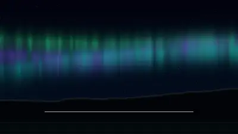

<!-- Generated by tools/gallery.mjs from showcase.yaml and build.json; do not edit. -->
# Radio Theme Volume Fades

[Film](../README.md) › [Audio](../README.md#audio) · `audio` `music` `fades` `keyframes` `demo-footage`

A late-night radio show's theme rises in over two seconds and sinks out over three, drawn with eased Volume keyframes on the music clip.



<sub>Animated preview: 0–12 s, 48 frames rendered by Kition Film. Still: [thumb.png](thumb.png)</sub>

| | |
|---|---|
| Document | [radio-theme-volume-fades.kfilm](radio-theme-volume-fades.kfilm) (25 KB) |
| Contents | 1920 × 1080 @ 24 fps; 12.0 s; 4 video clips; 1 audio clip; 5 effects; 3 animated effects |
| Features | `film.audio.basics`, `film.effects.keyframes`, `film.graphics.text-basics` |
| Built by | `kition-film` @ `27c94b23fd`: 30 commands in 25 ms |

## About

The Ambient Score sits on A1 for twelve seconds under the show's ident. Its clip gain is set
to −3 dB, and the clip's Volume ▸ Level is keyframed −40 → −6 dB over the first two seconds and
−6 → −40 dB over the last three, the eased curve an editor draws by hand instead of a fixed
crossfade. The ident on V2 fades with the music, and a progress bar shows where the show is.

## Checks

- `inspect.sequence.audio.0.items.0`: `{"name":"Ambient_Score.wav","gainDb":-3,"durationFrames":288}`
- `inspect.sequence.audio.0.items.0.effects.0.effect`: `"volume"`
- `inspect.sequence.audio.0.items.0.effects.0.params.level.keyframes`: `[{"time":0,"value":-40},{"time":508032000000,"value":-6,"interpolation":"easeIn"},{"time":2286144000000,"value":-6,"interpolation":"easeOut"},{"time":3048192000000,"value":-40}]`
- `inspect.sequence.video.1.items.0.effects.1.params.opacity.keyframes`: `[{"time":0,"value":0},{"time":508032000000,"value":100},{"time":2286144000000,"value":100},{"time":3048192000000,"value":0}]`
- `inspect.sequence.video.3.items.0.effects.0`: `{"effect":"motion","params":{"anchor":{"value":[360,900]},"uniform_scale":{"value":false},"scale_width":{"keyframes":[{"time":0,"value":0},{"time":3048192000000,"value":100}]}}}`
- diagnostics: none (the kit's check finds nothing wrong)
- the saved document opens again; the thumbnail matches `thumb.png` within the `render` tolerance

## Steps

<details><summary>30 commands (from <a href="showcase.yaml">showcase.yaml</a>, after the <code>demo-footage</code> prelude)</summary>

```yaml
- command: file.newSequence
  params:
    name: Night Shift Ident
    width: 1920
    height: 1080
    fps: 24
    video: 3
    audio: 1
- command: timeline.place
  params:
    item: 6
    track: V1
    seconds: 0
    duration: 3048192000000
    audio: false
  as: sky
- command: effects.apply
  params:
    clips:
      - $sky.clips.0
    effect: lumetri
- command: effects.setParam
  params:
    clip: $sky.clips.0
    effect: lumetri
    param: exposure
    value: -0.8
- command: timeline.place
  params:
    item: 11
    track: A1
    seconds: 0
    duration: 3048192000000
    video: false
  as: theme
- command: clip.audioGain
  params:
    clips:
      - $theme.clips.0
    mode: set
    db: -3
- command: effects.setParam
  params:
    clip: $theme.clips.0
    effect: volume
    param: level
    value: -40
    seconds: 0
- command: effects.setParam
  params:
    clip: $theme.clips.0
    effect: volume
    param: level
    value: -6
    seconds: 2
- command: effects.setParam
  params:
    clip: $theme.clips.0
    effect: volume
    param: level
    value: -6
    seconds: 9
- command: effects.setParam
  params:
    clip: $theme.clips.0
    effect: volume
    param: level
    value: -40
    seconds: 12
- command: effects.setInterpolation
  params:
    clip: $theme.clips.0
    effect: volume
    param: level
    mediaTime: 508032000000
    interpolation: easeIn
- command: effects.setInterpolation
  params:
    clip: $theme.clips.0
    effect: volume
    param: level
    mediaTime: 2286144000000
    interpolation: easeOut
- command: graphics.newText
  params:
    text: NIGHT SHIFT
    position:
      - 960
      - 520
    size: 150
    seconds: 12
    track: 1
    time: 0
  as: ident
- command: graphics.set
  params:
    clip: $ident.clip
    props:
      font_style: Bold
      align: center
      tracking: 260
      fill_color: "#ffffff"
      shadow: true
- command: graphics.newText
  params:
    clip: $ident.clip
    text: RADIO · AFTER MIDNIGHT · 94.6
    position:
      - 960
      - 610
    size: 40
- command: graphics.set
  params:
    clip: $ident.clip
    props:
      align: center
      tracking: 400
      fill_color: "#8ff0c8"
- command: effects.setParam
  params:
    clip: $ident.clip
    effect: opacity
    param: opacity
    value: 0
    seconds: 0
- command: effects.setParam
  params:
    clip: $ident.clip
    effect: opacity
    param: opacity
    value: 100
    seconds: 2
- command: effects.setParam
  params:
    clip: $ident.clip
    effect: opacity
    param: opacity
    value: 100
    seconds: 9
- command: effects.setParam
  params:
    clip: $ident.clip
    effect: opacity
    param: opacity
    value: 0
    seconds: 12
- command: graphics.newRectangle
  params:
    position:
      - 960
      - 900
    size:
      - 1200
      - 6
    seconds: 12
    track: 2
    time: 0
  as: rail
- command: graphics.set
  params:
    clip: $rail.clip
    props:
      fill_color: "#ffffff"
      opacity: 30
- command: sequence.addTracks
  params:
    video: 1
- command: graphics.newRectangle
  params:
    position:
      - 960
      - 900
    size:
      - 1200
      - 6
    seconds: 12
    track: 3
    time: 0
  as: progress
- command: graphics.set
  params:
    clip: $progress.clip
    props:
      fill_color: "#8ff0c8"
- command: effects.setParam
  params:
    clip: $progress.clip
    effect: motion
    param: anchor
    value:
      - 360
      - 900
- command: effects.setParam
  params:
    clip: $progress.clip
    effect: motion
    param: position
    value:
      - 360
      - 900
- command: effects.setParam
  params:
    clip: $progress.clip
    effect: motion
    param: uniform_scale
    value: false
- command: effects.setParam
  params:
    clip: $progress.clip
    effect: motion
    param: scale_width
    value: 0
    seconds: 0
- command: effects.setParam
  params:
    clip: $progress.clip
    effect: motion
    param: scale_width
    value: 100
    seconds: 12
```

</details>
