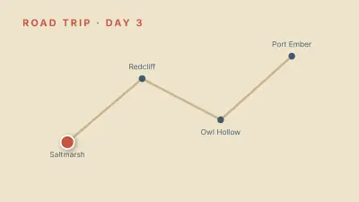

<!-- Generated by tools/gallery.mjs from showcase.yaml and build.json; do not edit. -->
# Road Trip Hold Keyframes

[Film](../README.md) › [Keyframes & Motion](../README.md#keyframes--motion) · `keyframes` `motion` `hold` `shapes` `graphics`

A travel-map graphic where a marker jumps from town to town on hold keyframes instead of sliding between them.



<sub>Animated preview: 0–4 s, 32 frames rendered by Kition Film. Still: [thumb.png](thumb.png)</sub>

| | |
|---|---|
| Document | [road-trip-hold-keyframes.kfilm](road-trip-hold-keyframes.kfilm) (25 KB) |
| Contents | 1920 × 1080 @ 24 fps; 6.0 s; 3 video clips; 11 effects; 1 animated effect |
| Features | `film.effects.keyframes`, `film.graphics.text-basics`, `film.file.new-items` |
| Built by | `kition-film` @ `27c94b23fd`: 33 commands in 36 ms |

## About

The map is built from graphics: a sand-coloured Color Matte, a route path, four town
pins with names. The red marker is its own graphic clip whose Motion position has a keyframe
on each town, one second apart. Every keyframe uses hold interpolation, so the marker stays
put for a second and then jumps to the next town, the stop-motion look of a travel recap.

## Checks

- `inspect.sequence.video.1.items.0.effects`: `{"count":13}`
- `inspect.sequence.video.1.items.0.effects.3.params.points.value`: `{"count":8}`
- `inspect.sequence.video.2.items.0.effects.0.params.position.keyframes`: `[{"time":0,"value":[360,760],"interpolation":"hold"},{"time":254016000000,"value":[760,420],"interpolation":"hold"},{"time":508032000000,"value":[1180,640],"interpolation":"hold"},{"time":762048000000,"value":[1560,300],"interpolation":"hold"}]`
- diagnostics: none (the kit's check finds nothing wrong)
- the saved document opens again; the thumbnail matches `thumb.png` within the `render` tolerance

## Steps

<details><summary>33 commands (from <a href="showcase.yaml">showcase.yaml</a>)</summary>

```yaml
- command: sequence.settings
  params:
    name: Route Recap
    fps: 24
- command: file.newColorMatte
  params:
    color: "#efe4cc"
    seconds: 6
  as: matte
- command: timeline.place
  params:
    item: $matte.item
    track: V1
    seconds: 0
- command: graphics.newShape
  params:
    shape: path
    points:
      - - 363.9
        - 764.6
      - - 760.8
        - 427.2
      - - 1180.9
        - 647.2
      - - 1564
        - 304.5
      - - 1556
        - 295.5
      - - 1179.1
        - 632.8
      - - 759.2
        - 412.8
      - - 356.1
        - 755.4
    seconds: 6
    track: 1
    time: 0
  as: map
- command: graphics.set
  params:
    clip: $map.clip
    props:
      fill_color: "#c9b48c"
- command: graphics.newEllipse
  params:
    clip: $map.clip
    position:
      - 360
      - 760
    size:
      - 36
      - 36
- command: graphics.set
  params:
    clip: $map.clip
    props:
      fill_color: "#3d5a6c"
- command: graphics.newEllipse
  params:
    clip: $map.clip
    position:
      - 760
      - 420
    size:
      - 36
      - 36
- command: graphics.set
  params:
    clip: $map.clip
    props:
      fill_color: "#3d5a6c"
- command: graphics.newEllipse
  params:
    clip: $map.clip
    position:
      - 1180
      - 640
    size:
      - 36
      - 36
- command: graphics.set
  params:
    clip: $map.clip
    props:
      fill_color: "#3d5a6c"
- command: graphics.newEllipse
  params:
    clip: $map.clip
    position:
      - 1560
      - 300
    size:
      - 36
      - 36
- command: graphics.set
  params:
    clip: $map.clip
    props:
      fill_color: "#3d5a6c"
- command: graphics.newText
  params:
    clip: $map.clip
    text: Saltmarsh
    position:
      - 360
      - 840
    size: 40
- command: graphics.set
  params:
    clip: $map.clip
    props:
      align: center
      fill_color: "#3d5a6c"
- command: graphics.newText
  params:
    clip: $map.clip
    text: Redcliff
    position:
      - 760
      - 370
    size: 40
- command: graphics.set
  params:
    clip: $map.clip
    props:
      align: center
      fill_color: "#3d5a6c"
- command: graphics.newText
  params:
    clip: $map.clip
    text: Owl Hollow
    position:
      - 1180
      - 720
    size: 40
- command: graphics.set
  params:
    clip: $map.clip
    props:
      align: center
      fill_color: "#3d5a6c"
- command: graphics.newText
  params:
    clip: $map.clip
    text: Port Ember
    position:
      - 1560
      - 250
    size: 40
- command: graphics.set
  params:
    clip: $map.clip
    props:
      align: center
      fill_color: "#3d5a6c"
- command: graphics.newText
  params:
    clip: $map.clip
    text: ROAD TRIP · DAY 3
    position:
      - 120
      - 140
    size: 52
- command: graphics.set
  params:
    clip: $map.clip
    props:
      font_style: Bold
      tracking: 200
      fill_color: "#c8553d"
- command: graphics.newEllipse
  params:
    position:
      - 960
      - 540
    size:
      - 64
      - 64
    seconds: 6
    track: 2
    time: 0
  as: marker
- command: graphics.set
  params:
    clip: $marker.clip
    props:
      fill_color: "#c8553d"
      stroke: true
      stroke_color: "#ffffff"
      stroke_width: 8
      shadow: true
- command: effects.setParam
  params:
    clip: $marker.clip
    effect: motion
    param: position
    value:
      - 360
      - 760
    seconds: 0
- command: effects.setParam
  params:
    clip: $marker.clip
    effect: motion
    param: position
    value:
      - 760
      - 420
    seconds: 1
- command: effects.setParam
  params:
    clip: $marker.clip
    effect: motion
    param: position
    value:
      - 1180
      - 640
    seconds: 2
- command: effects.setParam
  params:
    clip: $marker.clip
    effect: motion
    param: position
    value:
      - 1560
      - 300
    seconds: 3
- command: effects.setInterpolation
  params:
    clip: $marker.clip
    effect: motion
    param: position
    mediaTime: 0
    interpolation: hold
- command: effects.setInterpolation
  params:
    clip: $marker.clip
    effect: motion
    param: position
    mediaTime: 254016000000
    interpolation: hold
- command: effects.setInterpolation
  params:
    clip: $marker.clip
    effect: motion
    param: position
    mediaTime: 508032000000
    interpolation: hold
- command: effects.setInterpolation
  params:
    clip: $marker.clip
    effect: motion
    param: position
    mediaTime: 762048000000
    interpolation: hold
```

</details>
