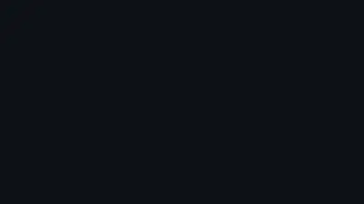

<!-- Generated by tools/gallery.mjs from showcase.yaml and build.json; do not edit. -->
# Rolling End Credits

[Film](../README.md) › [Titles & Graphics](../README.md#titles--graphics) · `titles` `credits` `roll`

Centered end credits roll up over a dark matte, starting and ending off screen.



<sub>Animated preview: 0–6 s, 48 frames rendered by Kition Film. Still: [thumb.png](thumb.png)</sub>

| | |
|---|---|
| Document | [rolling-end-credits.kfilm](rolling-end-credits.kfilm) (9 KB) |
| Contents | 1280 × 720 @ 24 fps; 12.0 s; 2 video clips; 1 effect |
| Features | `film.graphics.titles`, `film.file.new-items` |
| Built by | `kition-film` @ `27c94b23fd`: 18 commands in 20 ms |

## About

The whole credit list is one centered text layer: names are the layer's own style, and
graphics.setCharStyle restyles character ranges for the gold tracked title, the small all-caps
role lines and the italic closing notes. graphics.setRoll turns the clip into a roll that starts
below the frame and ends above it, so the text needs no position keyframes.

## Checks

- `results.roll.roll`: `{"mode":"roll","startOffScreen":true,"endOffScreen":true}`
- `results.list.graphic.roll.mode`: `"roll"`
- `results.list.layers`: `{"count":1}`
- `results.list.layers.0.text`: `{"contains":"THE LAST LIGHTHOUSE"}`
- `results.list.layers.0.styles`: `{"count":11}`
- `results.list.layers.0.quad.0.1`: `{"min":720}`
- `inspect.sequence.name`: `"End Credits"`
- `inspect.sequence.settings.frame_rate`: `{"num":24,"den":1}`
- `inspect.sequence.video.0.items`: `{"count":1}`
- `inspect.sequence.video.1.items`: `{"count":1}`
- diagnostics: none (the kit's check finds nothing wrong)
- the saved document opens again; the thumbnail matches `thumb.png` within the `render` tolerance

## Steps

<details><summary>18 commands (from <a href="showcase.yaml">showcase.yaml</a>)</summary>

```yaml
- command: sequence.settings
  params:
    name: End Credits
    width: 1280
    height: 720
    fps: 24
  as: sequence
- command: file.newColorMatte
  params:
    color: "#0d1117"
    seconds: 12
  as: matte
- command: timeline.place
  params:
    item: $matte.item
    track: V1
    seconds: 0
  as: background
- command: graphics.newText
  params:
    text: |-
      THE LAST LIGHTHOUSE


      Directed by
      Ilse Marrow

      Written by
      Tomas Ferreira
      Ilse Marrow

      Produced by
      Juno Okafor
      Bastian Leclair

      Director of Photography
      Ren Takahara

      Editor
      Priya Venkataraman

      Production Design
      Odile Brandt

      Original Music
      The Saltmarsh Quartet

      Sound Design
      Kofi Mensah-Arden


      Filmed on location along the northern coast


      Saltmarsh Pictures
    position:
      - 640
      - 120
    size: 34
    seconds: 12
    track: 1
    time: 0
  as: credits
- command: graphics.set
  params:
    clip: $credits.clip
    layer: 0
    props:
      align: center
      fill_color: "#ece8de"
      leading: 16
- command: graphics.setCharStyle
  params:
    clip: $credits.clip
    layer: 0
    start: 0
    end: 19
    style:
      size: 52
      fontStyle: Bold
      tracking: 160
      color: "#f4c76a"
- command: graphics.setCharStyle
  params:
    clip: $credits.clip
    layer: 0
    start: 22
    end: 33
    style:
      size: 22
      tracking: 140
      caps: all caps
      color: "#8a94a6"
- command: graphics.setCharStyle
  params:
    clip: $credits.clip
    layer: 0
    start: 47
    end: 57
    style:
      size: 22
      tracking: 140
      caps: all caps
      color: "#8a94a6"
- command: graphics.setCharStyle
  params:
    clip: $credits.clip
    layer: 0
    start: 86
    end: 97
    style:
      size: 22
      tracking: 140
      caps: all caps
      color: "#8a94a6"
- command: graphics.setCharStyle
  params:
    clip: $credits.clip
    layer: 0
    start: 127
    end: 150
    style:
      size: 22
      tracking: 140
      caps: all caps
      color: "#8a94a6"
- command: graphics.setCharStyle
  params:
    clip: $credits.clip
    layer: 0
    start: 165
    end: 171
    style:
      size: 22
      tracking: 140
      caps: all caps
      color: "#8a94a6"
- command: graphics.setCharStyle
  params:
    clip: $credits.clip
    layer: 0
    start: 192
    end: 209
    style:
      size: 22
      tracking: 140
      caps: all caps
      color: "#8a94a6"
- command: graphics.setCharStyle
  params:
    clip: $credits.clip
    layer: 0
    start: 224
    end: 238
    style:
      size: 22
      tracking: 140
      caps: all caps
      color: "#8a94a6"
- command: graphics.setCharStyle
  params:
    clip: $credits.clip
    layer: 0
    start: 262
    end: 274
    style:
      size: 22
      tracking: 140
      caps: all caps
      color: "#8a94a6"
- command: graphics.setCharStyle
  params:
    clip: $credits.clip
    layer: 0
    start: 296
    end: 339
    style:
      size: 24
      italic: true
      color: "#b7bfcc"
- command: graphics.setCharStyle
  params:
    clip: $credits.clip
    layer: 0
    start: 342
    end: 360
    style:
      size: 26
      fontStyle: Bold
      tracking: 60
      color: "#f4c76a"
- command: graphics.setRoll
  params:
    clip: $credits.clip
    mode: roll
    startOffScreen: true
    endOffScreen: true
  as: roll
- command: graphics.list
  params:
    clip: $credits.clip
  as: list
```

</details>
