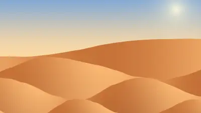

<!-- Generated by tools/gallery.mjs from showcase.yaml and build.json; do not edit. -->
# Rough Cut With a Hole

[Film](../README.md) › [Editing & Timeline](../README.md#editing--timeline) · `rough-cut` `gap` `disabled-clip` `track-states` `markers` `demo-footage`

A rough cut handed over mid-edit, with a hole waiting for a pickup shot, a disabled alternate take and a locked, muted guide track.



<sub>Animated preview: 6–12 s, 30 frames rendered by Kition Film. Still: [thumb.png](thumb.png)</sub>

| | |
|---|---|
| Document | [rough-cut-with-a-hole.kfilm](rough-cut-with-a-hole.kfilm) (16 KB) |
| Contents | 1280 × 720 @ 24 fps; 14.0 s; 4 video clips; 4 audio clips; 2 markers |
| Features | `film.timeline.basics`, `film.timeline.edit`, `film.clip.properties`, `film.markers.basics` |
| Built by | `kition-film` @ `27c94b23fd`: 10 commands in 17 ms |

## About

This sample is meant to fail the kit's check, the way a real work-in-progress does. Video 1
has two seconds of black between the dunes and the forest where a pickup shot will go, flagged
with a red range marker; the check reports it as `film.gap`. Above the forest, an alternate
take of the neon sign is kept on Video 2 but disabled, so it neither shows nor plays
(`film.disabled-clip`). The temp score on Audio 2 is renamed Guide, muted and locked so nobody
mixes against it by accident. The thumbnail is the opening shot; the preview runs across the
hole and under the disabled take, where only the forest on Video 1 shows.

## Checks

- `inspect.sequence.video.0.items`: `{"count":3}`
- `inspect.sequence.video.0.items.1.end`: `2032128000000`
- `inspect.sequence.video.0.items.2.start`: `2540160000000`
- `inspect.sequence.video.1.items`: `{"count":1}`
- `inspect.sequence.video.1.items.0`: `{"name":"Neon_Loop.mov","enabled":false}`
- `inspect.sequence.audio.1`: `{"name":"Guide","muted":true,"locked":true}`
- `inspect.sequence.audio.1.items.0.name`: `"Ambient_Score.wav"`
- `inspect.sequence.markers`: `{"count":2,"any":{"name":"Pickup shot","color":"Red","start":2032128000000,"duration":508032000000}}`
- diagnostics: `film.gap`, `film.disabled-clip`
- the saved document opens again; the thumbnail matches `thumb.png` within the `render` tolerance

## Steps

<details><summary>10 commands (from <a href="showcase.yaml">showcase.yaml</a>, after the <code>demo-footage</code> prelude)</summary>

```yaml
- command: file.newSequence
  params:
    name: Rough Cut 3
    width: 1280
    height: 720
    fps: 24
    video: 2
    audio: 2
  as: sequence
- command: timeline.place
  params:
    item: 5
    track: V1
    seconds: 0
    sourceIn: 508032000000
    duration: 1016064000000
  as: ocean
- command: timeline.place
  params:
    item: 8
    track: V1
    seconds: 4
    sourceIn: 254016000000
    duration: 1016064000000
  as: dunes
- command: timeline.place
  params:
    item: 9
    track: V1
    seconds: 10
    sourceIn: 254016000000
    duration: 1016064000000
  as: forest
- command: timeline.place
  params:
    item: 10
    track: V2
    seconds: 10.5
    duration: 762048000000
    audio: false
  as: altTake
- command: clip.enable
  params:
    clips:
      - $altTake.clips.0
- command: timeline.place
  params:
    item: 11
    track: A2
    seconds: 0
    duration: 3556224000000
  as: guide
- command: timeline.setTrack
  params:
    track: A2
    name: Guide
    muted: true
    locked: true
- command: markers.add
  params:
    target: program
    seconds: 8
    durationSeconds: 2
    name: Pickup shot
    comment: Wide of the dunes at dusk goes here
    color: Red
- command: markers.add
  params:
    target: program
    seconds: 10.5
    name: Alt take?
    comment: Director to choose between forest and neon
    color: Yellow
```

</details>
