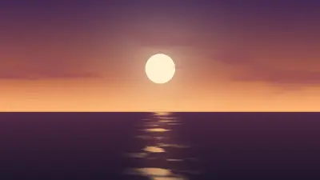

<!-- Generated by tools/gallery.mjs from showcase.yaml and build.json; do not edit. -->
# Seaside Documentary Title

[Film](../README.md) › [Titles & Graphics](../README.md#titles--graphics) · `titles` `typography` `demo-footage`

A two-line documentary title, a serif name over a tracked credit line, sits over a calm sunset at sea.



<sub>Animated preview: 0–3 s, 30 frames rendered by Kition Film. Still: [thumb.png](thumb.png)</sub>

| | |
|---|---|
| Document | [seaside-documentary-title.kfilm](seaside-documentary-title.kfilm) (17 KB) |
| Contents | 1280 × 720 @ 24 fps; 18.0 s; 2 video clips; 3 effects; 1 animated effect |
| Features | `film.graphics.text-basics`, `film.text.add-font` |
| Built by | `kition-film` @ `8281b2bb9e`: 11 commands in 30 ms |

## About

The film's name is set in Lora from kition-fonts (named in `fonts:` so every machine draws the
same glyphs); the credit line under it is Inter in capitals, tracked wide. Both lines and a short
rule sit in one graphic clip low over the water, away from the sun, and the clip fades in over
a second and a half.

## Checks

- `results.list.layers`: `{"count":3}`
- `results.list.layers.0.text`: `"Between the Tides"`
- `results.list.layers.1.text`: `"A FILM BY ISLA MORVEN"`
- `inspect.sequence.video.1.items`: `{"count":1}`
- `inspect.sequence.video.1.items.0.effects.3.params.font.value`: `"Lora"`
- `inspect.sequence.video.1.items.0.effects.4.params.font.value`: `"Inter"`
- `inspect.sequence.video.1.items.0.effects.1.params.opacity.keyframes`: `[{"time":0,"value":0},{"time":381024000000,"value":100}]`
- diagnostics: none (the kit's check finds nothing wrong)
- the saved document opens again; the thumbnail matches `thumb.png` within the `render` tolerance

## Steps

<details><summary>11 commands (from <a href="showcase.yaml">showcase.yaml</a>, after the <code>demo-footage</code> prelude)</summary>

```yaml
- command: file.newSequence
  params:
    name: Tide Line
    width: 1280
    height: 720
    fps: 24
    video: 2
    audio: 1
  as: sequence
- command: timeline.place
  params:
    item: 5
    track: V1
    seconds: 0
    audio: false
  as: footage
- command: graphics.newText
  params:
    text: Between the Tides
    position:
      - 640
      - 534
    size: 80
    font: Lora
    fontStyle: Medium
    seconds: 8
    track: 1
    time: 0
  as: title
- command: graphics.set
  params:
    clip: $title.clip
    layer: 0
    props:
      align: center
      tracking: 20
      fill_color: "#fff4e6"
      shadow: true
      shadow_opacity: 40
      shadow_blur: 30
- command: graphics.newText
  params:
    clip: $title.clip
    text: A FILM BY ISLA MORVEN
    position:
      - 640
      - 604
    size: 22
- command: graphics.set
  params:
    clip: $title.clip
    layer: 1
    props:
      align: center
      tracking: 420
      fill_color: "#ffd9a8"
- command: graphics.newRectangle
  params:
    clip: $title.clip
    position:
      - 640
      - 568
    size:
      - 96
      - 2
- command: graphics.set
  params:
    clip: $title.clip
    layer: 2
    props:
      name: Rule
      fill_color: "#ffd9a8"
- command: effects.setParam
  params:
    clip: $title.clip
    effect: opacity
    param: opacity
    value: 0
    seconds: 0
- command: effects.setParam
  params:
    clip: $title.clip
    effect: opacity
    param: opacity
    value: 100
    seconds: 1.5
- command: graphics.list
  params:
    clip: $title.clip
  as: list
```

</details>
