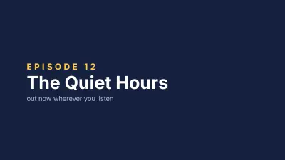

<!-- Generated by tools/gallery.mjs from showcase.yaml and build.json; do not edit. -->
# Spinning Badge Promo

[Film](../README.md) › [Keyframes & Motion](../README.md#keyframes--motion) · `keyframes` `motion` `shapes` `easing` `graphics`

A podcast promo where a starburst badge pops in with an overshoot and keeps turning beside the episode title.



<sub>Animated preview: 0–3 s, 45 frames rendered by Kition Film. Still: [thumb.png](thumb.png)</sub>

| | |
|---|---|
| Document | [spinning-badge-promo.kfilm](spinning-badge-promo.kfilm) (18 KB) |
| Contents | 1920 × 1080 @ 30 fps; 8.0 s; 4 video clips; 5 effects; 2 animated effects |
| Features | `film.effects.keyframes`, `film.graphics.text-basics`, `film.file.new-items` |
| Built by | `kition-film` @ `27c94b23fd`: 28 commands in 62 ms |

## About

The badge is a 16-point starburst path drawn around the frame centre, so Motion's anchor sits at its middle;
Motion position then moves it to the right. Its rotation is keyframed from 0° to 360° over eight
seconds at a constant speed, and its scale goes 0 → 118 → 100 % in the first 0.6 s with eased
keyframes for a springy pop. The NEW label is a separate clip with the same scale keys, so it
pops with the badge but stays upright.

## Checks

- `inspect.sequence.video.2.items.0.effects.3`: `{"effect":"graphic_shape","params":{"position":{"value":[960,540]},"points":{"value":{"count":32}}}}`
- `inspect.sequence.video.2.items.0.effects.3.params.points.value.0`: `[0,-235]`
- `inspect.sequence.video.2.items.0.effects.3.params.points.value.8`: `[235,0]`
- `inspect.sequence.video.2.items.0.effects.0.params.position.value`: `[1440,540]`
- `inspect.sequence.video.2.items.0.effects.0.params.rotation.keyframes`: `[{"time":0,"value":0},{"time":2032128000000,"value":360}]`
- `inspect.sequence.video.2.items.0.effects.0.params.scale.keyframes`: `[{"time":0,"value":0},{"time":101606400000,"value":118,"interpolation":"autoBezier"},{"time":152409600000,"value":100,"interpolation":"easeIn"}]`
- `inspect.sequence.video.3.items.0.effects.0.params.rotation.keyframes`: `[]`
- `inspect.sequence.video.3.items.0.effects.0.params.scale.keyframes`: `[{"time":0,"value":0},{"time":101606400000,"value":118,"interpolation":"autoBezier"},{"time":152409600000,"value":100,"interpolation":"easeIn"}]`
- diagnostics: none (the kit's check finds nothing wrong)
- the saved document opens again; the thumbnail matches `thumb.png` within the `render` tolerance

## Steps

<details><summary>28 commands (from <a href="showcase.yaml">showcase.yaml</a>)</summary>

```yaml
- command: sequence.settings
  params:
    name: Episode Promo
    fps: 30
- command: sequence.addTracks
  params:
    video: 1
- command: file.newColorMatte
  params:
    color: "#16213e"
    seconds: 8
  as: matte
- command: timeline.place
  params:
    item: $matte.item
    track: V1
    seconds: 0
- command: graphics.newText
  params:
    text: EPISODE 12
    position:
      - 180
      - 470
    size: 56
    seconds: 8
    track: 1
    time: 0
  as: copy
- command: graphics.set
  params:
    clip: $copy.clip
    props:
      font_style: Bold
      tracking: 300
      fill_color: "#ffc93c"
- command: graphics.newText
  params:
    clip: $copy.clip
    text: The Quiet Hours
    position:
      - 180
      - 600
    size: 120
- command: graphics.set
  params:
    clip: $copy.clip
    props:
      font_style: Bold
      fill_color: "#ffffff"
- command: graphics.newText
  params:
    clip: $copy.clip
    text: out now wherever you listen
    position:
      - 180
      - 680
    size: 44
- command: graphics.set
  params:
    clip: $copy.clip
    props:
      fill_color: "#aab4d4"
- command: graphics.newShape
  params:
    shape: path
    points:
      - - 960
        - 305
      - - 999
        - 343.8
      - - 1049.9
        - 322.9
      - - 1071.1
        - 373.7
      - - 1126.2
        - 373.8
      - - 1126.3
        - 428.9
      - - 1177.1
        - 450.1
      - - 1156.2
        - 501
      - - 1195
        - 540
      - - 1156.2
        - 579
      - - 1177.1
        - 629.9
      - - 1126.3
        - 651.1
      - - 1126.2
        - 706.2
      - - 1071.1
        - 706.3
      - - 1049.9
        - 757.1
      - - 999
        - 736.2
      - - 960
        - 775
      - - 921
        - 736.2
      - - 870.1
        - 757.1
      - - 848.9
        - 706.3
      - - 793.8
        - 706.2
      - - 793.7
        - 651.1
      - - 742.9
        - 629.9
      - - 763.8
        - 579
      - - 725
        - 540
      - - 763.8
        - 501
      - - 742.9
        - 450.1
      - - 793.7
        - 428.9
      - - 793.8
        - 373.8
      - - 848.9
        - 373.7
      - - 870.1
        - 322.9
      - - 921
        - 343.8
    seconds: 8
    track: 2
    time: 0
  as: badge
- command: graphics.set
  params:
    clip: $badge.clip
    props:
      fill_color: "#ffc93c"
      stroke: true
      stroke_color: "#ffffff"
      stroke_width: 8
- command: effects.setParam
  params:
    clip: $badge.clip
    effect: motion
    param: position
    value:
      - 1440
      - 540
- command: effects.setParam
  params:
    clip: $badge.clip
    effect: motion
    param: rotation
    value: 0
    seconds: 0
- command: effects.setParam
  params:
    clip: $badge.clip
    effect: motion
    param: rotation
    value: 360
    seconds: 8
- command: effects.setParam
  params:
    clip: $badge.clip
    effect: motion
    param: scale
    value: 0
    seconds: 0
- command: effects.setParam
  params:
    clip: $badge.clip
    effect: motion
    param: scale
    value: 118
    seconds: 0.4
- command: effects.setParam
  params:
    clip: $badge.clip
    effect: motion
    param: scale
    value: 100
    seconds: 0.6
- command: effects.setInterpolation
  params:
    clip: $badge.clip
    effect: motion
    param: scale
    mediaTime: 101606400000
    interpolation: autoBezier
- command: effects.setInterpolation
  params:
    clip: $badge.clip
    effect: motion
    param: scale
    mediaTime: 152409600000
    interpolation: easeIn
- command: graphics.newText
  params:
    text: NEW
    position:
      - 960
      - 580
    size: 120
    seconds: 8
    track: 3
    time: 0
  as: label
- command: graphics.set
  params:
    clip: $label.clip
    props:
      font_style: Bold
      align: center
      tracking: 60
      fill_color: "#16213e"
- command: effects.setParam
  params:
    clip: $label.clip
    effect: motion
    param: position
    value:
      - 1440
      - 540
- command: effects.setParam
  params:
    clip: $label.clip
    effect: motion
    param: scale
    value: 0
    seconds: 0
- command: effects.setParam
  params:
    clip: $label.clip
    effect: motion
    param: scale
    value: 118
    seconds: 0.4
- command: effects.setParam
  params:
    clip: $label.clip
    effect: motion
    param: scale
    value: 100
    seconds: 0.6
- command: effects.setInterpolation
  params:
    clip: $label.clip
    effect: motion
    param: scale
    mediaTime: 101606400000
    interpolation: autoBezier
- command: effects.setInterpolation
  params:
    clip: $label.clip
    effect: motion
    param: scale
    mediaTime: 152409600000
    interpolation: easeIn
```

</details>
