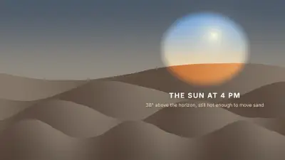

<!-- Generated by tools/gallery.mjs from showcase.yaml and build.json; do not edit. -->
# Spotlight Mask Callout

[Film](../README.md) › [Effects & Color](../README.md#effects--color) · `masks` `spotlight` `lumetri` `callout` `demo-footage`

A documentary explainer dims and desaturates the frame and keeps one feathered circle at full colour to point at the sun.



<sub>Animated preview: 0–3 s, 24 frames rendered by Kition Film. Still: [thumb.png](thumb.png)</sub>

| | |
|---|---|
| Document | [spotlight-mask-callout.kfilm](spotlight-mask-callout.kfilm) (20 KB) |
| Contents | 1920 × 1080 @ 24 fps; 15.0 s; 3 video clips; 3 effects |
| Features | `film.effects.basics`, `film.color.lumetri`, `film.graphics.text-basics` |
| Built by | `kition-film` @ `27c94b23fd`: 13 commands in 24 ms |

## About

The dunes are on V1 and V2. The V1 copy is graded down (Lumetri exposure −1.5, saturation 30 %),
and the V2 copy keeps the original picture but only inside an elliptical Opacity mask with an
80 px feather, named Spotlight. Where the mask is open the untouched shot shows through, so
the eye goes straight to the sun; a two-line caption explains what we are looking at.

## Checks

- `results.spot`: `{"effect":1,"mask":0}`
- `results.masks.masks`: `{"count":1}`
- `results.masks.masks.0`: `{"effectId":"opacity","name":"Spotlight","feather":80,"inverted":false,"mode":"Add"}`
- `results.masks.masks.0.path.vertices`: `[{"p":[1380,100]},{"p":[1660,330]},{"p":[1380,560]},{"p":[1100,330]}]`
- `inspect.sequence.video.0.items.0.effects.0.params`: `{"exposure":{"value":-1.5},"saturation":{"value":30}}`
- `inspect.sequence.video.1.items.0.effects`: `{"any":{"effect":"opacity","masks":1}}`
- diagnostics: none (the kit's check finds nothing wrong)
- the saved document opens again; the thumbnail matches `thumb.png` within the `render` tolerance

## Steps

<details><summary>13 commands (from <a href="showcase.yaml">showcase.yaml</a>, after the <code>demo-footage</code> prelude)</summary>

```yaml
- command: file.newSequence
  params:
    name: Explainer
    width: 1920
    height: 1080
    fps: 24
    video: 3
    audio: 1
- command: timeline.place
  params:
    item: 8
    track: V1
    seconds: 0
    audio: false
  as: dimmed
- command: effects.apply
  params:
    clips:
      - $dimmed.clips.0
    effect: lumetri
- command: effects.setParam
  params:
    clip: $dimmed.clips.0
    effect: lumetri
    param: exposure
    value: -1.5
- command: effects.setParam
  params:
    clip: $dimmed.clips.0
    effect: lumetri
    param: saturation
    value: 30
- command: timeline.place
  params:
    item: 8
    track: V2
    seconds: 0
    audio: false
  as: lit
- command: masks.add
  params:
    clip: $lit.clips.0
    shape: ellipse
    center:
      - 1380
      - 330
    size:
      - 560
      - 460
  as: spot
- command: masks.set
  params:
    clip: $lit.clips.0
    mask: 0
    feather: 80
    name: Spotlight
- command: masks.list
  params:
    clip: $lit.clips.0
  as: masks
- command: graphics.newText
  params:
    text: THE SUN AT 4 PM
    position:
      - 1380
      - 660
    size: 46
    seconds: 15
    track: 2
    time: 0
  as: caption
- command: graphics.set
  params:
    clip: $caption.clip
    props:
      font_style: Bold
      align: center
      tracking: 120
      fill_color: "#ffffff"
      shadow: true
- command: graphics.newText
  params:
    clip: $caption.clip
    text: 38° above the horizon, still hot enough to move sand
    position:
      - 1380
      - 720
    size: 32
- command: graphics.set
  params:
    clip: $caption.clip
    props:
      align: center
      fill_color: "#f3d9b5"
      shadow: true
```

</details>
