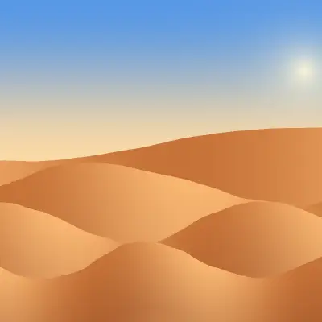

<!-- Generated by tools/gallery.mjs from showcase.yaml and build.json; do not edit. -->
# Square Travel Post

[Film](../README.md) › [Formats & Social](../README.md#formats--social) · `square` `social` `titles` `shapes` `demo-footage`

A 1:1 feed video for a desert travel diary, with an inset frame, title and carousel dots.



<sub>Animated preview: 0–3 s, 30 frames rendered by Kition Film. Still: [thumb.png](thumb.png)</sub>

| | |
|---|---|
| Document | [square-travel-post.kfilm](square-travel-post.kfilm) (24 KB) |
| Contents | 1080 × 1080 @ 30 fps; 15.0 s; 2 video clips; 7 effects; 2 animated effects |
| Features | `film.graphics.titles`, `film.clip.properties` |
| Built by | `kition-film` @ `27c94b23fd`: 22 commands in 109 ms |

## About

A 1080 × 1080 sequence for square feeds. clip.fillFrame crops the landscape dunes to the square,
and a slow Motion push-in keeps the still-looking scene alive. The inset frame is a rectangle
with its fill off and a centered 4 px stroke; the three carousel dots are small ellipses, the
first one solid, telling the viewer there is more to swipe.

## Checks

- `results.list.layers.0`: `{"name":"Frame","kind":"Rectangle"}`
- `results.list.layers.2.text`: `"48 Hours\nin the Dunes"`
- `results.list.layers`: `{"count":7,"all":{"quad":{"all":{"all":{"min":0,"max":1080}}}}}`
- `inspect.sequence.settings.width`: `1080`
- `inspect.sequence.settings.height`: `1080`
- `inspect.sequence.video.0.items.0.effects.0.params.scale.keyframes`: `[{"time":0,"value":100},{"time":2540160000000,"value":110}]`
- `inspect.sequence.video.1.items.0.effects.1.params.opacity.keyframes`: `[{"time":0,"value":0},{"time":203212800000,"value":100}]`
- `inspect.sequence.video.1.items.0.effects.3.params`: `{"fill":{"value":false},"stroke":{"value":true},"stroke_width":{"value":4},"stroke_type":{"option":"Center"}}`
- diagnostics: none (the kit's check finds nothing wrong)
- the saved document opens again; the thumbnail matches `thumb.png` within the `render` tolerance

## Steps

<details><summary>22 commands (from <a href="showcase.yaml">showcase.yaml</a>, after the <code>demo-footage</code> prelude)</summary>

```yaml
- command: file.newSequence
  params:
    name: Dune Diary Post
    width: 1080
    height: 1080
    fps: 30
    video: 2
    audio: 1
  as: sequence
- command: timeline.place
  params:
    item: 8
    track: V1
    seconds: 0
    audio: false
  as: footage
- command: clip.fillFrame
  params:
    clips:
      - $footage.clips.0
- command: graphics.newRectangle
  params:
    position:
      - 540
      - 540
    size:
      - 980
      - 980
    seconds: 10
    track: 1
    time: 0
  as: post
- command: graphics.set
  params:
    clip: $post.clip
    layer: 0
    props:
      name: Frame
      fill: false
      stroke: true
      stroke_color: "#fffaf0"
      stroke_width: 4
      stroke_type: Center
- command: graphics.newText
  params:
    clip: $post.clip
    text: TRAVEL DIARY  ·  DAY 02
    position:
      - 540
      - 200
    size: 30
    fontStyle: Bold
- command: graphics.set
  params:
    clip: $post.clip
    layer: 1
    props:
      name: Kicker
      align: center
      tracking: 260
      fill_color: "#fffaf0"
- command: graphics.newText
  params:
    clip: $post.clip
    text: |-
      48 Hours
      in the Dunes
    position:
      - 540
      - 330
    size: 110
    fontStyle: Bold
- command: graphics.set
  params:
    clip: $post.clip
    layer: 2
    props:
      name: Title
      align: center
      leading: -10
      fill_color: "#fffaf0"
      shadow: true
      shadow_color: "#7a3e12"
      shadow_opacity: 45
      shadow_blur: 30
      shadow_distance: 4
- command: graphics.newText
  params:
    clip: $post.clip
    text: Swipe for the route
    position:
      - 540
      - 948
    size: 34
- command: graphics.set
  params:
    clip: $post.clip
    layer: 3
    props:
      name: Prompt
      align: center
      fill_color: "#3b2414"
- command: graphics.newEllipse
  params:
    clip: $post.clip
    position:
      - 510
      - 985
    size:
      - 14
      - 14
- command: graphics.set
  params:
    clip: $post.clip
    layer: 4
    props:
      name: Dot 1
      fill_color: "#3b2414"
- command: graphics.newEllipse
  params:
    clip: $post.clip
    position:
      - 540
      - 985
    size:
      - 14
      - 14
- command: graphics.set
  params:
    clip: $post.clip
    layer: 5
    props:
      name: Dot 2
      fill_color: "#3b2414"
      opacity: 35
- command: graphics.newEllipse
  params:
    clip: $post.clip
    position:
      - 570
      - 985
    size:
      - 14
      - 14
- command: graphics.set
  params:
    clip: $post.clip
    layer: 6
    props:
      name: Dot 3
      fill_color: "#3b2414"
      opacity: 35
- command: effects.setParam
  params:
    clip: $footage.clips.0
    effect: motion
    param: scale
    value: 100
    seconds: 0
- command: effects.setParam
  params:
    clip: $footage.clips.0
    effect: motion
    param: scale
    value: 110
    seconds: 10
- command: effects.setParam
  params:
    clip: $post.clip
    effect: opacity
    param: opacity
    value: 0
    seconds: 0
- command: effects.setParam
  params:
    clip: $post.clip
    effect: opacity
    param: opacity
    value: 100
    seconds: 0.8
- command: graphics.list
  params:
    clip: $post.clip
  as: list
```

</details>
