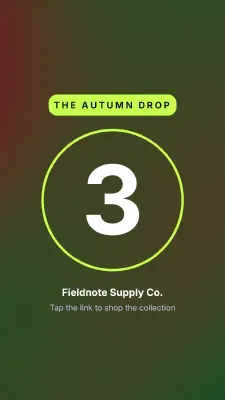

<!-- Generated by tools/gallery.mjs from showcase.yaml and build.json; do not edit. -->
# Story Launch Countdown

[Film](../README.md) › [Formats & Social](../README.md#formats--social) · `vertical` `social` `countdown` `keyframes` `demo-footage`

A 9:16 story counts down three, two, one with Source Text keyframes before a product drop goes live.



<sub>Animated preview: 0–4 s, 40 frames rendered by Kition Film. Still: [thumb.png](thumb.png)</sub>

| | |
|---|---|
| Document | [story-launch-countdown.kfilm](story-launch-countdown.kfilm) (27 KB) |
| Contents | 1080 × 1920 @ 30 fps; 10.0 s; 2 video clips; 7 effects; 3 animated effects |
| Features | `film.graphics.titles`, `film.effects.keyframes`, `film.clip.properties` |
| Built by | `kition-film` @ `27c94b23fd`: 34 commands in 62 ms |

## About

A five-second vertical story for a fictional shop's product drop. The big number is a single
text layer whose Source Text is keyframed to 3, 2 and 1 a second apart (text keyframes hold,
so each number cuts cleanly), then emptied at three seconds when the NOW LIVE layer pops in.
The lime ring is an ellipse with no fill whose scale kicks on every count. The neon demo
footage is filled to the tall frame and pushed back under a deep violet shade.

## Checks

- `report.width`: `1080`
- `report.height`: `1920`
- `results.list.layers`: `{"count":7}`
- `results.list.layers.3`: `{"name":"Count","kind":"text"}`
- `results.list.layers.4`: `{"name":"Live","text":"NOW\nLIVE"}`
- `inspect.sequence.settings.width`: `1080`
- `inspect.sequence.settings.height`: `1920`
- `inspect.sequence.video.1.items.0.effects.6.params.text.keyframes`: `[{"time":0,"value":"3","interpolation":"hold"},{"time":254016000000,"value":"2","interpolation":"hold"},{"time":508032000000,"value":"1","interpolation":"hold"},{"time":762048000000,"value":"","interpolation":"hold"}]`
- `inspect.sequence.video.1.items.0.effects.5.params.scale.keyframes`: `[{"time":0,"value":112},{"time":76204800000,"value":100},{"time":254016000000,"value":112},{"time":330220800000,"value":100},{"time":508032000000,"value":112},{"time":584236800000,"value":100},{"time":762048000000,"value":125},{"time":838252800000,"value":100}]`
- `inspect.sequence.video.1.items.0.effects.7.params.opacity.keyframes`: `[{"time":762048000000,"value":0},{"time":787449600000,"value":100}]`
- diagnostics: none (the kit's check finds nothing wrong)
- the saved document opens again; the thumbnail matches `thumb.png` within the `render` tolerance

## Steps

<details><summary>34 commands (from <a href="showcase.yaml">showcase.yaml</a>, after the <code>demo-footage</code> prelude)</summary>

```yaml
- command: file.newSequence
  params:
    name: Drop Countdown Story
    width: 1080
    height: 1920
    fps: 30
    video: 3
    audio: 1
  as: sequence
- command: timeline.place
  params:
    item: 10
    track: V1
    seconds: 0
    audio: false
  as: footage
- command: clip.fillFrame
  params:
    clips:
      - $footage.clips.0
- command: graphics.newRectangle
  params:
    position:
      - 540
      - 960
    size:
      - 1080
      - 1920
    seconds: 5
    track: 1
    time: 0
  as: story
- command: graphics.set
  params:
    clip: $story.clip
    layer: 0
    props:
      name: Shade
      fill_color: "#120a24"
      opacity: 88
- command: graphics.newText
  params:
    clip: $story.clip
    text: THE AUTUMN DROP
    position:
      - 540
      - 520
    size: 44
    fontStyle: Bold
- command: graphics.set
  params:
    clip: $story.clip
    layer: 1
    props:
      name: Tag
      align: center
      tracking: 200
      fill_color: "#120a24"
      background: true
      background_color: "#c6ff4d"
      background_opacity: 100
      background_size: 24
      background_radius: 40
- command: graphics.newEllipse
  params:
    clip: $story.clip
    position:
      - 540
      - 960
    size:
      - 600
      - 600
- command: graphics.set
  params:
    clip: $story.clip
    layer: 2
    props:
      name: Ring
      fill: false
      stroke: true
      stroke_color: "#c6ff4d"
      stroke_width: 10
      stroke_type: Center
- command: graphics.newText
  params:
    clip: $story.clip
    text: "3"
    position:
      - 540
      - 1125
    size: 460
    fontStyle: Bold
- command: graphics.set
  params:
    clip: $story.clip
    layer: 3
    props:
      name: Count
      align: center
      fill_color: "#ffffff"
- command: graphics.newText
  params:
    clip: $story.clip
    text: |-
      NOW
      LIVE
    position:
      - 540
      - 942
    size: 170
    fontStyle: Bold
- command: graphics.set
  params:
    clip: $story.clip
    layer: 4
    props:
      name: Live
      align: center
      leading: -20
      fill_color: "#c6ff4d"
      opacity: 0
- command: graphics.newText
  params:
    clip: $story.clip
    text: Fieldnote Supply Co.
    position:
      - 540
      - 1420
    size: 48
    fontStyle: Bold
- command: graphics.set
  params:
    clip: $story.clip
    layer: 5
    props:
      name: Shop
      align: center
      fill_color: "#ffffff"
- command: graphics.newText
  params:
    clip: $story.clip
    text: Tap the link to shop the collection
    position:
      - 540
      - 1490
    size: 38
- command: graphics.set
  params:
    clip: $story.clip
    layer: 6
    props:
      name: Prompt
      align: center
      fill_color: "#cbbfe6"
- command: effects.setParam
  params:
    clip: $story.clip
    effect: 6
    param: text
    value: "3"
    seconds: 0
- command: effects.setParam
  params:
    clip: $story.clip
    effect: 6
    param: text
    value: "2"
    seconds: 1
- command: effects.setParam
  params:
    clip: $story.clip
    effect: 6
    param: text
    value: "1"
    seconds: 2
- command: effects.setParam
  params:
    clip: $story.clip
    effect: 6
    param: text
    value: ""
    seconds: 3
- command: effects.setParam
  params:
    clip: $story.clip
    effect: 7
    param: opacity
    value: 0
    seconds: 3
- command: effects.setParam
  params:
    clip: $story.clip
    effect: 7
    param: opacity
    value: 100
    seconds: 3.1
- command: effects.setParam
  params:
    clip: $story.clip
    effect: 7
    param: scale
    value: 140
    seconds: 3
- command: effects.setParam
  params:
    clip: $story.clip
    effect: 7
    param: scale
    value: 100
    seconds: 3.3
- command: effects.setParam
  params:
    clip: $story.clip
    effect: 5
    param: scale
    value: 112
    seconds: 0
- command: effects.setParam
  params:
    clip: $story.clip
    effect: 5
    param: scale
    value: 100
    seconds: 0.3
- command: effects.setParam
  params:
    clip: $story.clip
    effect: 5
    param: scale
    value: 112
    seconds: 1
- command: effects.setParam
  params:
    clip: $story.clip
    effect: 5
    param: scale
    value: 100
    seconds: 1.3
- command: effects.setParam
  params:
    clip: $story.clip
    effect: 5
    param: scale
    value: 112
    seconds: 2
- command: effects.setParam
  params:
    clip: $story.clip
    effect: 5
    param: scale
    value: 100
    seconds: 2.3
- command: effects.setParam
  params:
    clip: $story.clip
    effect: 5
    param: scale
    value: 125
    seconds: 3
- command: effects.setParam
  params:
    clip: $story.clip
    effect: 5
    param: scale
    value: 100
    seconds: 3.3
- command: graphics.list
  params:
    clip: $story.clip
  as: list
```

</details>
