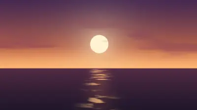

<!-- Generated by tools/gallery.mjs from showcase.yaml and build.json; do not edit. -->
# Sunset Singalong Karaoke

[Film](../README.md) › [Markers & Captions](../README.md#markers--captions) · `captions` `karaoke` `lyrics` `music` `demo-footage`

A lyric video lights up each word of the chorus in gold as it is sung, over the sea at sunset.



<sub>Animated preview: 0.25–7 s, 54 frames rendered by Kition Film. Still: [thumb.png](thumb.png)</sub>

| | |
|---|---|
| Document | [sunset-singalong-karaoke.kfilm](sunset-singalong-karaoke.kfilm) (12 KB) |
| Contents | 1280 × 720 @ 24 fps; 8.0 s; 1 video clip; 1 audio clip |
| Features | `film.captions.edit` |
| Built by | `kition-film` @ `27c94b23fd`: 8 commands in 14 ms |

## About

Each line of the chorus is one karaoke caption built from `words`, every word with its own start
and end in sequence seconds. The track style draws the sung word in gold at 115 % size, and the
rest of the line in white with a soft outline and no box. The words carry WebVTT timestamps, so an
exported .vtt keeps the timing. The thumbnail lands on the third word of the second line.

## Checks

- `results.list.tracks.0.name`: `"Lyrics"`
- `results.list.tracks.0.captions`: `{"count":2}`
- `results.list.tracks.0.captions.0`: `{"in":"00:00:00:12","start":127008000000}`
- `results.list.tracks.0.captions.1.text`: `{"contains":"<00:00:04.300>never"}`
- `results.list.tracks.0.style`: `{"highlightColor":"#ffc94aff","highlightScale":{"approx":1.15,"tol":0.001}}`
- `inspect.sequence.video.0.items`: `{"count":1}`
- `inspect.sequence.audio.0.items.0.name`: `"Ambient_Score.wav"`
- diagnostics: none (the kit's check finds nothing wrong)
- the saved document opens again; the thumbnail matches `thumb.png` within the `render` tolerance

## Steps

<details><summary>8 commands (from <a href="showcase.yaml">showcase.yaml</a>, after the <code>demo-footage</code> prelude)</summary>

```yaml
- command: file.newSequence
  params:
    name: Golden Hour Lyric Video
    width: 1280
    height: 720
    fps: 24
    video: 1
    audio: 1
  as: sequence
- command: timeline.place
  params:
    item: 5
    track: V1
    seconds: 0
    sourceIn: 508032000000
    duration: 2032128000000
    audio: false
  as: sea
- command: timeline.place
  params:
    item: 11
    track: A1
    seconds: 0
    duration: 2032128000000
  as: song
- command: captions.newTrack
  params:
    format: Subtitle
    name: Lyrics
    language: en
  as: lyrics
- command: captions.setStyle
  params:
    track: $lyrics.track
    size: 60
    color: "#ffffff"
    background: false
    outline: 6
    outlineColor: "#2a1630"
    highlightColor: "#ffc94a"
    highlightScale: 1.15
    margin: 0.1
- command: captions.add
  params:
    track: $lyrics.track
    words:
      - text: Hold
        start: 0.5
        end: 0.9
      - text: on
        start: 0.9
        end: 1.2
      - text: to
        start: 1.2
        end: 1.4
      - text: the
        start: 1.4
        end: 1.6
      - text: golden
        start: 1.6
        end: 2.3
      - text: light
        start: 2.3
        end: 3.4
  as: line1
- command: captions.add
  params:
    track: $lyrics.track
    words:
      - text: We
        start: 3.75
        end: 4
      - text: were
        start: 4
        end: 4.3
      - text: never
        start: 4.3
        end: 4.9
      - text: meant
        start: 4.9
        end: 5.4
      - text: to
        start: 5.4
        end: 5.6
      - text: stay
        start: 5.6
        end: 6.8
  as: line2
- command: captions.list
  params:
    track: $lyrics.track
  as: list
```

</details>
