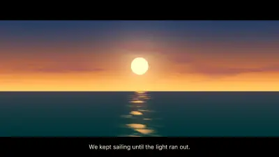

<!-- Generated by tools/gallery.mjs from showcase.yaml and build.json; do not edit. -->
# Teal & Orange Sunset Grade

[Film](../README.md) › [Effects & Color](../README.md#effects--color) · `color` `lumetri` `grading` `letterbox` `demo-footage`

A sunset at sea graded with Lumetri Color into a cinematic teal-and-orange look, framed in a 2.39:1 letterbox.



<sub>Animated preview: 0–3 s, 24 frames rendered by Kition Film. Still: [thumb.png](thumb.png)</sub>

| | |
|---|---|
| Document | [teal-orange-sunset-grade.kfilm](teal-orange-sunset-grade.kfilm) (20 KB) |
| Contents | 1920 × 1080 @ 24 fps; 18.0 s; 3 video clips; 4 effects |
| Features | `film.color.lumetri`, `film.effects.basics`, `film.graphics.text-basics` |
| Built by | `kition-film` @ `27c94b23fd`: 13 commands in 138 ms |

## About

One Lumetri Color effect does the whole grade: the built-in Teal & Orange creative look, a
little more contrast and vibrance, and the shadow wheel pushed toward teal so the water goes
green-blue while the sky and the sun's path stay warm. Two black graphic bars crop the 16:9 frame
to a 2.39:1 letterbox, and a subtitle sits in the lower bar.

## Checks

- `inspect.sequence.video.0.items.0.effects.0.effect`: `"lumetri"`
- `inspect.sequence.video.0.items.0.effects.0.params.look_lut.value`: `{"contains":"look-teal-orange"}`
- `inspect.sequence.video.0.items.0.effects.0.params`: `{"contrast":{"value":15},"vibrance":{"value":15},"wheel_shadows":{"value":[-0.4,0.2]}}`
- `inspect.sequence.video.1.items.0.effects`: `{"count":5}`
- `inspect.sequence.video.2.items.0.name`: `"We kept sailing until the light ran out."`
- diagnostics: none (the kit's check finds nothing wrong)
- the saved document opens again; the thumbnail matches `thumb.png` within the `render` tolerance

## Steps

<details><summary>13 commands (from <a href="showcase.yaml">showcase.yaml</a>, after the <code>demo-footage</code> prelude)</summary>

```yaml
- command: file.newSequence
  params:
    name: Sunset Grade
    width: 1920
    height: 1080
    fps: 24
    video: 3
    audio: 1
- command: timeline.place
  params:
    item: 5
    track: V1
    seconds: 0
    audio: false
  as: shot
- command: effects.apply
  params:
    clips:
      - $shot.clips.0
    effect: lumetri
- command: lumetri.setLook
  params:
    clip: $shot.clips.0
    lut: builtin:look-teal-orange
- command: effects.setParam
  params:
    clip: $shot.clips.0
    effect: lumetri
    param: contrast
    value: 15
- command: effects.setParam
  params:
    clip: $shot.clips.0
    effect: lumetri
    param: vibrance
    value: 15
- command: effects.setParam
  params:
    clip: $shot.clips.0
    effect: lumetri
    param: wheel_shadows
    value:
      - -0.4
      - 0.2
- command: graphics.newRectangle
  params:
    position:
      - 960
      - 70
    size:
      - 1920
      - 140
    seconds: 18
    track: 1
    time: 0
  as: bars
- command: graphics.set
  params:
    clip: $bars.clip
    props:
      fill_color: "#000000"
- command: graphics.newRectangle
  params:
    clip: $bars.clip
    position:
      - 960
      - 1010
    size:
      - 1920
      - 140
- command: graphics.set
  params:
    clip: $bars.clip
    props:
      fill_color: "#000000"
- command: graphics.newText
  params:
    text: We kept sailing until the light ran out.
    position:
      - 960
      - 1024
    size: 40
    seconds: 18
    track: 2
    time: 0
  as: subtitle
- command: graphics.set
  params:
    clip: $subtitle.clip
    props:
      align: center
      fill_color: "#f3e6c8"
```

</details>
