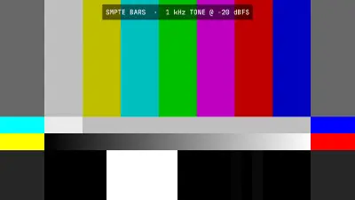

<!-- Generated by tools/gallery.mjs from showcase.yaml and build.json; do not edit. -->
# Technical Slate

[Film](../README.md) › [Titles & Graphics](../README.md#titles--graphics) · `titles` `slate` `bars-and-tone` `typography`

Bars and tone with a label strip, then a delivery slate card listing the master's specs.



<sub>Animated preview: 3–7 s, 32 frames rendered by Kition Film. Still: [thumb.png](thumb.png)</sub>

| | |
|---|---|
| Document | [technical-slate.kfilm](technical-slate.kfilm) (20 KB) |
| Contents | 1280 × 720 @ 25 fps; 10.0 s; 4 video clips; 1 audio clip; 6 effects |
| Features | `film.file.new-items`, `film.graphics.text-basics`, `film.timeline.basics` |
| Built by | `kition-film` @ `27c94b23fd`: 18 commands in 14 ms |

## About

The head of a delivery master: five seconds of the kit's generated bars and 1 kHz tone with a
label strip, then a slate card on a near-black Color Matte. The slate's field names and values
are two multi-line text layers in JetBrains Mono (from kition-fonts) with extra leading, so
every row lines up; a gold rule and the facility name finish the card. It is built without the
demo footage, in the document's own first sequence.

## Checks

- `results.barsClip.clips`: `{"count":2}`
- `results.list.layers`: `{"count":5}`
- `results.list.layers.2`: `{"name":"Labels","text":{"matches":"^PROGRAMME\\n"}}`
- `results.list.layers.3.text`: `{"contains":"00:22:30:00"}`
- `inspect.sequence.name`: `"Delivery Master"`
- `inspect.sequence.settings`: `{"frame_rate":{"num":25,"den":1},"preset":"1280x720 25"}`
- `inspect.sequence.video.0.items`: `{"count":2}`
- `inspect.sequence.video.0.items.0`: `{"name":"Bars and Tone","startFrame":0,"durationFrames":125}`
- `inspect.sequence.video.0.items.1`: `{"name":"Color Matte","startFrame":125}`
- `inspect.sequence.video.1.items.1`: `{"startFrame":125}`
- `inspect.sequence.video.1.items.0.effects.3.params.font.value`: `"JetBrains Mono"`
- `inspect.sequence.video.1.items.1.effects.5.params.font.value`: `"JetBrains Mono"`
- `inspect.sequence.video.1.items.1.effects.6.params.font.value`: `"JetBrains Mono"`
- `inspect.sequence.audio.0.items`: `{"count":1}`
- diagnostics: none (the kit's check finds nothing wrong)
- the saved document opens again; the thumbnail matches `thumb.png` within the `render` tolerance

## Steps

<details><summary>18 commands (from <a href="showcase.yaml">showcase.yaml</a>)</summary>

```yaml
- command: sequence.settings
  params:
    name: Delivery Master
    width: 1280
    height: 720
    fps: 25
  as: sequence
- command: file.newBarsAndTone
  params:
    seconds: 5
  as: bars
- command: file.newColorMatte
  params:
    color: "#0e0f12"
    seconds: 5
  as: matte
- command: timeline.place
  params:
    item: $bars.item
    track: V1
    seconds: 0
  as: barsClip
- command: timeline.place
  params:
    item: $matte.item
    track: V1
    seconds: 5
  as: card
- command: graphics.newText
  params:
    text: SMPTE BARS  ·  1 kHz TONE @ -20 dBFS
    position:
      - 640
      - 52
    size: 24
    font: JetBrains Mono
    seconds: 5
    track: 1
    time: 0
  as: label
- command: graphics.set
  params:
    clip: $label.clip
    layer: 0
    props:
      align: center
      fill_color: "#ffffff"
      background: true
      background_color: "#000000"
      background_opacity: 80
      background_size: 12
- command: graphics.newText
  params:
    text: DELIVERY SLATE
    position:
      - 160
      - 170
    size: 44
    fontStyle: Bold
    seconds: 5
    track: 1
    time: 1270080000000
  as: slate
- command: graphics.set
  params:
    clip: $slate.clip
    layer: 0
    props:
      name: Heading
      tracking: 160
      fill_color: "#ffffff"
- command: graphics.newRectangle
  params:
    clip: $slate.clip
    position:
      - 640
      - 202
    size:
      - 960
      - 3
- command: graphics.set
  params:
    clip: $slate.clip
    layer: 1
    props:
      name: Rule
      fill_color: "#e8b339"
- command: graphics.newText
  params:
    clip: $slate.clip
    text: |-
      PROGRAMME
      VERSION
      DURATION
      PICTURE
      AUDIO
      LOUDNESS
      FIRST FRAME
    position:
      - 160
      - 262
    size: 22
    font: JetBrains Mono
- command: graphics.set
  params:
    clip: $slate.clip
    layer: 2
    props:
      name: Labels
      fill_color: "#8c93a1"
      leading: 22
- command: graphics.newText
  params:
    clip: $slate.clip
    text: |-
      Harbour Lights  —  Episode 3
      Broadcast master v2, textless at end
      00:22:30:00
      1280 × 720  ·  25p  ·  Rec. 709
      A1/A2 stereo mix  ·  A3/A4 M&E
      −23 LUFS integrated
      10:00:00:00
    position:
      - 420
      - 262
    size: 22
    font: JetBrains Mono
- command: graphics.set
  params:
    clip: $slate.clip
    layer: 3
    props:
      name: Values
      fill_color: "#f4f5f7"
      leading: 22
- command: graphics.newText
  params:
    clip: $slate.clip
    text: TIDEMARK POST
    position:
      - 1120
      - 168
    size: 20
    fontStyle: Bold
- command: graphics.set
  params:
    clip: $slate.clip
    layer: 4
    props:
      name: Facility
      align: right
      tracking: 300
      fill_color: "#e8b339"
- command: graphics.list
  params:
    clip: $slate.clip
  as: list
```

</details>
