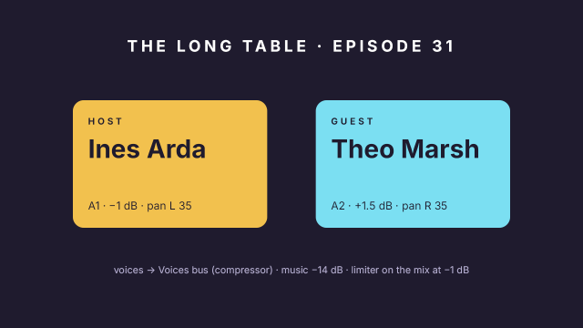

<!-- Generated by tools/gallery.mjs from showcase.yaml and build.json; do not edit. -->
# Two-Host Podcast Mixer

[Film](../README.md) › [Audio](../README.md#audio) · `audio` `mixer` `submix` `panning` `podcast`

A video podcast's audio mix set in the track mixer, with the two hosts panned apart, a voices submix with compression and a limiter on the master.



| | |
|---|---|
| Document | [two-host-podcast-mixer.kfilm](two-host-podcast-mixer.kfilm) (34 KB) |
| Contents | 1920 × 1080 @ 30 fps; 10.0 s; 2 video clips; 3 audio clips; 10 effects |
| Features | `film.audio.mixing`, `film.audio.basics`, `film.graphics.text-basics` |
| Built by | `kition-film` @ `27c94b23fd`: 36 commands in 29 ms |

## About

Three audio tracks are set up the way a podcast editor would: Host on A1 at −1 dB panned 35 %
left, Guest on A2 at +1.5 dB panned 35 % right, Music on A3 at −14 dB. Both voices are routed
to a Voices submix (mixer.addSubmix, mixer.setStrip output) carrying Dynamics Processing as an
insert, and the Mix has a Hard Limiter at −1 dB. The demo project's ambience recordings stand
in for the voices. The card on screen mirrors the mix: who sits on which side, and at what level.

## Checks

- `results.voices.ref`: `"S1"`
- `results.mixer.strips.0`: `{"ref":"A1","name":"Host","volumeDb":-1,"pan":-0.35,"output":"S1"}`
- `results.mixer.strips.1`: `{"ref":"A2","name":"Guest","volumeDb":1.5,"pan":0.35,"output":"S1"}`
- `results.mixer.strips.2`: `{"ref":"A3","name":"Music","volumeDb":-14,"output":"Mix"}`
- `results.mixer.strips.3`: `{"ref":"S1","name":"Voices","kind":"submix","inserts":{"count":1,"all":{"effect":"dynamics"}}}`
- `results.mixer.strips.4`: `{"ref":"Mix","inserts":{"count":1,"all":{"effect":"hard_limiter","params":{"max":-1,"boost":2}}}}`
- `inspect.sequence.audio`: `{"count":3}`
- `inspect.sequence.audio.0`: `{"name":"Host","volumeDb":-1,"pan":-0.35}`
- `inspect.sequence.audio.1`: `{"name":"Guest","volumeDb":1.5,"pan":0.35}`
- `inspect.sequence.audio.2`: `{"name":"Music","volumeDb":-14,"pan":0}`
- diagnostics: none (the kit's check finds nothing wrong)
- the saved document opens again; the thumbnail matches `thumb.png` within the `render` tolerance

## Steps

<details><summary>36 commands (from <a href="showcase.yaml">showcase.yaml</a>, after the <code>demo-footage</code> prelude)</summary>

```yaml
- command: file.newSequence
  params:
    name: The Long Table 31
    width: 1920
    height: 1080
    fps: 30
    video: 2
    audio: 3
- command: timeline.place
  params:
    item: 9
    track: A1
    seconds: 0
    video: false
    duration: 2540160000000
  as: host
- command: timeline.place
  params:
    item: 7
    track: A2
    seconds: 0
    video: false
    duration: 2540160000000
  as: guest
- command: timeline.place
  params:
    item: 11
    track: A3
    seconds: 0
    video: false
    duration: 2540160000000
  as: music
- command: mixer.setStrip
  params:
    strip: A1
    name: Host
    volumeDb: -1
    pan: -0.35
- command: mixer.setStrip
  params:
    strip: A2
    name: Guest
    volumeDb: 1.5
    pan: 0.35
- command: mixer.setStrip
  params:
    strip: A3
    name: Music
    volumeDb: -14
- command: mixer.addSubmix
  params:
    name: Voices
  as: voices
- command: mixer.setStrip
  params:
    strip: A1
    output: S1
- command: mixer.setStrip
  params:
    strip: A2
    output: S1
- command: mixer.addInsert
  params:
    strip: S1
    effect: dynamics
  as: compressor
- command: mixer.addInsert
  params:
    strip: Mix
    effect: hard_limiter
  as: limiter
- command: mixer.setInsert
  params:
    strip: Mix
    slot: 0
    params:
      max: -1
      boost: 2
- command: mixer.inspect
  as: mixer
- command: file.newColorMatte
  params:
    color: "#1f1b2e"
    seconds: 10
  as: matte
- command: timeline.place
  params:
    item: $matte.item
    track: V1
    seconds: 0
- command: graphics.newText
  params:
    text: THE LONG TABLE · EPISODE 31
    position:
      - 960
      - 170
    size: 52
    seconds: 10
    track: 1
    time: 0
  as: card
- command: graphics.set
  params:
    clip: $card.clip
    props:
      font_style: Bold
      align: center
      tracking: 220
      fill_color: "#ffffff"
- command: graphics.newRectangle
  params:
    clip: $card.clip
    position:
      - 560
      - 540
    size:
      - 640
      - 420
- command: graphics.set
  params:
    clip: $card.clip
    props:
      fill_color: "#f2c14e"
      corner_radius: 36
- command: graphics.newRectangle
  params:
    clip: $card.clip
    position:
      - 1360
      - 540
    size:
      - 640
      - 420
- command: graphics.set
  params:
    clip: $card.clip
    props:
      fill_color: "#7bdff2"
      corner_radius: 36
- command: graphics.newText
  params:
    clip: $card.clip
    text: HOST
    position:
      - 290
      - 410
    size: 30
- command: graphics.set
  params:
    clip: $card.clip
    props:
      font_style: Bold
      tracking: 300
      fill_color: "#1f1b2e"
- command: graphics.newText
  params:
    clip: $card.clip
    text: Ines Arda
    position:
      - 290
      - 520
    size: 84
- command: graphics.set
  params:
    clip: $card.clip
    props:
      font_style: Bold
      fill_color: "#1f1b2e"
- command: graphics.newText
  params:
    clip: $card.clip
    text: A1 · −1 dB · pan L 35
    position:
      - 290
      - 690
    size: 36
- command: graphics.set
  params:
    clip: $card.clip
    props:
      fill_color: "#1f1b2e"
- command: graphics.newText
  params:
    clip: $card.clip
    text: GUEST
    position:
      - 1090
      - 410
    size: 30
- command: graphics.set
  params:
    clip: $card.clip
    props:
      font_style: Bold
      tracking: 300
      fill_color: "#1f1b2e"
- command: graphics.newText
  params:
    clip: $card.clip
    text: Theo Marsh
    position:
      - 1090
      - 520
    size: 84
- command: graphics.set
  params:
    clip: $card.clip
    props:
      font_style: Bold
      fill_color: "#1f1b2e"
- command: graphics.newText
  params:
    clip: $card.clip
    text: A2 · +1.5 dB · pan R 35
    position:
      - 1090
      - 690
    size: 36
- command: graphics.set
  params:
    clip: $card.clip
    props:
      fill_color: "#1f1b2e"
- command: graphics.newText
  params:
    clip: $card.clip
    text: voices → Voices bus (compressor) · music −14 dB · limiter on the mix at −1 dB
    position:
      - 960
      - 900
    size: 32
- command: graphics.set
  params:
    clip: $card.clip
    props:
      align: center
      fill_color: "#b9b2d6"
```

</details>
