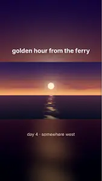

<!-- Generated by tools/gallery.mjs from showcase.yaml and build.json; do not edit. -->
# Vertical Blur Backdrop

[Film](../README.md) › [Effects & Color](../README.md#effects--color) · `blur` `vertical` `social` `motion` `demo-footage`

A landscape clip fitted into a 9:16 vertical frame over a blurred, enlarged copy of itself instead of black bars.



<sub>Animated preview: 0–3 s, 24 frames rendered by Kition Film. Still: [thumb.png](thumb.png)</sub>

| | |
|---|---|
| Document | [vertical-blur-backdrop.kfilm](vertical-blur-backdrop.kfilm) (17 KB) |
| Contents | 1080 × 1920 @ 30 fps; 18.0 s; 3 video clips; 4 effects |
| Features | `film.effects.basics`, `film.graphics.text-basics` |
| Built by | `kition-film` @ `27c94b23fd`: 14 commands in 17 ms |

## About

The usual fix for horizontal footage in a vertical story: the clip is placed twice. The copy on
V1 is scaled to 178 % so it fills the 1080 × 1920 frame, then softened with Gaussian Blur and
darkened with Brightness & Contrast; the sharp copy on V2 is scaled to 56.25 % so its width
matches the frame. A caption names the moment.

## Checks

- `inspect.sequence.settings.width`: `1080`
- `inspect.sequence.settings.height`: `1920`
- `inspect.sequence.video.0.items.0.effects.0`: `{"effect":"gaussian_blur","params":{"blurriness":{"value":80},"repeat_edge":{"value":true}}}`
- `inspect.sequence.video.0.items.0.effects.1`: `{"effect":"brightness_contrast","params":{"brightness":{"value":-25}}}`
- `inspect.sequence.video.0.items.0.effects.2`: `{"effect":"motion","params":{"scale":{"value":178}}}`
- `inspect.sequence.video.1.items.0.effects.0`: `{"effect":"motion","params":{"scale":{"value":56.25}}}`
- diagnostics: none (the kit's check finds nothing wrong)
- the saved document opens again; the thumbnail matches `thumb.png` within the `render` tolerance

## Steps

<details><summary>14 commands (from <a href="showcase.yaml">showcase.yaml</a>, after the <code>demo-footage</code> prelude)</summary>

```yaml
- command: file.newSequence
  params:
    name: Ferry Story
    width: 1080
    height: 1920
    fps: 30
    video: 3
    audio: 1
- command: timeline.place
  params:
    item: 5
    track: V1
    seconds: 0
    audio: false
  as: backdrop
- command: effects.setParam
  params:
    clip: $backdrop.clips.0
    effect: motion
    param: scale
    value: 178
- command: effects.apply
  params:
    clips:
      - $backdrop.clips.0
    effect: gaussian_blur
- command: effects.setParam
  params:
    clip: $backdrop.clips.0
    effect: gaussian_blur
    param: blurriness
    value: 80
- command: effects.setParam
  params:
    clip: $backdrop.clips.0
    effect: gaussian_blur
    param: repeat_edge
    value: true
- command: effects.apply
  params:
    clips:
      - $backdrop.clips.0
    effect: brightness_contrast
- command: effects.setParam
  params:
    clip: $backdrop.clips.0
    effect: brightness_contrast
    param: brightness
    value: -25
- command: timeline.place
  params:
    item: 5
    track: V2
    seconds: 0
    audio: false
  as: picture
- command: effects.setParam
  params:
    clip: $picture.clips.0
    effect: motion
    param: scale
    value: 56.25
- command: graphics.newText
  params:
    text: golden hour from the ferry
    position:
      - 540
      - 560
    size: 64
    seconds: 18
    track: 2
    time: 0
  as: caption
- command: graphics.set
  params:
    clip: $caption.clip
    props:
      font_style: Bold
      align: center
      fill_color: "#ffffff"
      shadow: true
- command: graphics.newText
  params:
    clip: $caption.clip
    text: day 4 · somewhere west
    position:
      - 540
      - 1440
    size: 44
- command: graphics.set
  params:
    clip: $caption.clip
    props:
      align: center
      fill_color: "#f6dcc0"
```

</details>
