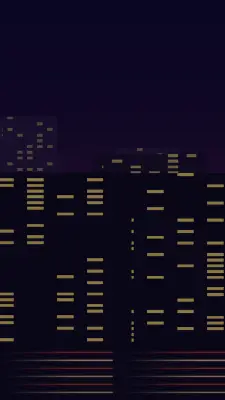

<!-- Generated by tools/gallery.mjs from showcase.yaml and build.json; do not edit. -->
# Vertical Reels Promo

[Film](../README.md) › [Formats & Social](../README.md#formats--social) · `vertical` `social` `titles` `shapes` `demo-footage`

A 9:16 night-market promo for short-video feeds, with footage filled to the tall frame.



<sub>Animated preview: 0–2 s, 20 frames rendered by Kition Film. Still: [thumb.png](thumb.png)</sub>

| | |
|---|---|
| Document | [vertical-reels-promo.kfilm](vertical-reels-promo.kfilm) (26 KB) |
| Contents | 1080 × 1920 @ 30 fps; 14.0 s; 3 video clips; 7 effects; 2 animated effects |
| Features | `film.graphics.titles`, `film.clip.properties`, `film.effects.keyframes` |
| Built by | `kition-film` @ `27c94b23fd`: 22 commands in 56 ms |

## About

A 1080 × 1920 sequence at 30 fps, the shape of a phone held upright. The landscape city footage
is scaled with clip.fillFrame so it covers the tall frame, a 45 % shade calms it down, and the
copy stays in the middle of the frame, clear of where feed apps put their own buttons. The tag
is a text layer with a rounded Background; the button is a rounded rectangle under its label.
The headline lands with a quick scale-down while the copy fades in.

## Checks

- `report.width`: `1080`
- `report.height`: `1920`
- `results.list.layers`: `{"count":6}`
- `results.list.layers.1`: `{"name":"Headline","text":"NIGHT\nMARKET"}`
- `results.list.layers.4`: `{"name":"Button","kind":"Rectangle"}`
- `inspect.sequence.settings.width`: `1080`
- `inspect.sequence.settings.height`: `1920`
- `inspect.sequence.settings.frame_rate`: `{"num":30,"den":1}`
- `inspect.sequence.video.0.items.0.effects.0.params.scale.value`: `{"approx":177.778,"tol":0.001}`
- `inspect.sequence.video.2.items.0.effects.4.params.scale.keyframes`: `[{"time":0,"value":125},{"time":152409600000,"value":100}]`
- `inspect.sequence.video.2.items.0.effects.1.params.opacity.keyframes`: `[{"time":0,"value":0},{"time":101606400000,"value":100}]`
- diagnostics: none (the kit's check finds nothing wrong)
- the saved document opens again; the thumbnail matches `thumb.png` within the `render` tolerance

## Steps

<details><summary>22 commands (from <a href="showcase.yaml">showcase.yaml</a>, after the <code>demo-footage</code> prelude)</summary>

```yaml
- command: file.newSequence
  params:
    name: Night Market Reel
    width: 1080
    height: 1920
    fps: 30
    video: 3
    audio: 1
  as: sequence
- command: timeline.place
  params:
    item: 7
    track: V1
    seconds: 0
    audio: false
  as: footage
- command: clip.fillFrame
  params:
    clips:
      - $footage.clips.0
- command: graphics.newRectangle
  params:
    position:
      - 540
      - 960
    size:
      - 1080
      - 1920
    seconds: 8
    track: 1
    time: 0
  as: shade
- command: graphics.set
  params:
    clip: $shade.clip
    layer: 0
    props:
      name: Shade
      fill_color: "#0b0820"
      opacity: 45
- command: graphics.newText
  params:
    text: THIS FRIDAY
    position:
      - 540
      - 640
    size: 44
    fontStyle: Bold
    seconds: 8
    track: 2
    time: 0
  as: copy
- command: graphics.set
  params:
    clip: $copy.clip
    layer: 0
    props:
      name: Tag
      align: center
      tracking: 160
      fill_color: "#0b0820"
      background: true
      background_color: "#ffd166"
      background_opacity: 100
      background_size: 22
      background_radius: 34
- command: graphics.newText
  params:
    clip: $copy.clip
    text: |-
      NIGHT
      MARKET
    position:
      - 540
      - 880
    size: 200
    fontStyle: Bold
- command: graphics.set
  params:
    clip: $copy.clip
    layer: 1
    props:
      name: Headline
      align: center
      leading: -30
      fill_color: "#ffffff"
      shadow: true
      shadow_opacity: 50
- command: graphics.newText
  params:
    clip: $copy.clip
    text: Street food · Live music · Makers
    position:
      - 540
      - 1240
    size: 46
- command: graphics.set
  params:
    clip: $copy.clip
    layer: 2
    props:
      name: Details
      align: center
      fill_color: "#f2e9ff"
- command: graphics.newText
  params:
    clip: $copy.clip
    text: Pier 9  ·  6 PM till late
    position:
      - 540
      - 1310
    size: 46
    fontStyle: Bold
- command: graphics.set
  params:
    clip: $copy.clip
    layer: 3
    props:
      name: Where
      align: center
      fill_color: "#ffd166"
- command: graphics.newRectangle
  params:
    clip: $copy.clip
    position:
      - 540
      - 1460
    size:
      - 420
      - 96
- command: graphics.set
  params:
    clip: $copy.clip
    layer: 4
    props:
      name: Button
      fill_color: "#ff4d8d"
      corner_radius: 48
- command: graphics.newText
  params:
    clip: $copy.clip
    text: SAVE THE DATE
    position:
      - 540
      - 1474
    size: 38
    fontStyle: Bold
- command: graphics.set
  params:
    clip: $copy.clip
    layer: 5
    props:
      name: Button Label
      align: center
      tracking: 80
      fill_color: "#ffffff"
- command: effects.setParam
  params:
    clip: $copy.clip
    effect: opacity
    param: opacity
    value: 0
    seconds: 0
- command: effects.setParam
  params:
    clip: $copy.clip
    effect: opacity
    param: opacity
    value: 100
    seconds: 0.4
- command: effects.setParam
  params:
    clip: $copy.clip
    effect: 4
    param: scale
    value: 125
    seconds: 0
- command: effects.setParam
  params:
    clip: $copy.clip
    effect: 4
    param: scale
    value: 100
    seconds: 0.6
- command: graphics.list
  params:
    clip: $copy.clip
  as: list
```

</details>
