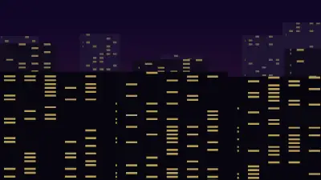

<!-- Generated by tools/gallery.mjs from showcase.yaml and build.json; do not edit. -->
# Waves First J and L Cuts

[Film](../README.md) › [Editing & Timeline](../README.md#editing--timeline) · `j-cut` `l-cut` `linked-clips` `roll` `demo-footage`

A coastal short lets the sound of the sea arrive a second before its picture and linger a second after it.



<sub>Animated preview: 3–12 s, 45 frames rendered by Kition Film. Still: [thumb.png](thumb.png)</sub>

| | |
|---|---|
| Document | [waves-first-j-and-l-cuts.kfilm](waves-first-j-and-l-cuts.kfilm) (17 KB) |
| Contents | 1280 × 720 @ 24 fps; 15.0 s; 4 video clips; 3 audio clips; 1 effect |
| Features | `film.timeline.edit`, `film.timeline.basics` |
| Built by | `kition-film` @ `27c94b23fd`: 9 commands in 70 ms |

## About

Three scenes are placed with their sound, so each video clip is linked to its audio clip. Two
rolling edits on Audio 1 only then split the cuts: the ocean's sound rolls 24 frames earlier
under the night drive (a J-cut, heard before it is seen), and 24 frames later under the forest
(an L-cut, still heard after the picture has moved on). The picture cuts stay at 5 s and 10 s and
the total length does not change. The short's title sits on Video 2 over the ocean. The thumbnail is the ocean, the scene whose sound overlaps both
of its neighbours.

## Checks

- `results.jcut.delta`: `-254016000000`
- `results.lcut.delta`: `254016000000`
- `inspect.sequence.video.0.items.1.start`: `1270080000000`
- `inspect.sequence.video.0.items.1.end`: `2540160000000`
- `inspect.sequence.audio.0.items`: `{"count":3}`
- `inspect.sequence.audio.0.items.1.name`: `"Ocean_Sunset.mp4"`
- `inspect.sequence.audio.0.items.1.start`: `1016064000000`
- `inspect.sequence.audio.0.items.1.end`: `2794176000000`
- `inspect.sequence.audio.0.items.0.end`: `1016064000000`
- `inspect.sequence.audio.0.items.2.start`: `2794176000000`
- `inspect.sequence.duration`: `3810240000000`
- `inspect.sequence.video.1.items`: `{"count":1}`
- diagnostics: none (the kit's check finds nothing wrong)
- the saved document opens again; the thumbnail matches `thumb.png` within the `render` tolerance

## Steps

<details><summary>9 commands (from <a href="showcase.yaml">showcase.yaml</a>, after the <code>demo-footage</code> prelude)</summary>

```yaml
- command: file.newSequence
  params:
    name: Coastal Short
    width: 1280
    height: 720
    fps: 24
    video: 1
    audio: 1
  as: sequence
- command: timeline.place
  params:
    item: 7
    track: V1
    seconds: 0
    sourceIn: 254016000000
    duration: 1270080000000
  as: city
- command: timeline.place
  params:
    item: 5
    track: V1
    seconds: 5
    sourceIn: 762048000000
    duration: 1270080000000
  as: ocean
- command: timeline.place
  params:
    item: 9
    track: V1
    seconds: 10
    sourceIn: 254016000000
    duration: 1270080000000
  as: forest
- command: sequence.addTracks
  params:
    video: 1
- command: graphics.newText
  params:
    text: LOW TIDE
    position:
      - 640
      - 196
    size: 64
    seconds: 4
    track: 1
    time: 1397088000000
  as: title
- command: graphics.set
  params:
    clip: $title.clip
    props:
      font_style: Bold
      align: center
      tracking: 600
      fill_color: "#fff4e6"
      shadow: true
- command: timeline.roll
  params:
    left: $city.clips.1
    right: $ocean.clips.1
    deltaFrames: -24
  as: jcut
- command: timeline.roll
  params:
    left: $ocean.clips.1
    right: $forest.clips.1
    deltaFrames: 24
  as: lcut
```

</details>
