<!-- Generated by tools/gallery.mjs from showcase.yaml and build.json; do not edit. -->
# HTML showcase

Web pages drawn by Kition's own HTML and CSS renderer: layout, typography, flex, grid and tables. Saved as .html. Every sample is built from `showcase.yaml` by the kit's own commands and drawn by its own engine (`kition-html`).

**11 samples** · 6 categories · 3 features of `kition-html/features.yaml` · [all kits](../README.md)

[Components](#components) (4) · [Email Templates](#email-templates) (1) · [Flex & Grid Layout](#flex--grid-layout) (2) · [Landing Pages](#landing-pages) (1) · [Tables & Data](#tables--data) (1) · [Typography](#typography) (2)

## Components

<table>
<tr>
<td width="33%" valign="top">
<a href="concert-ticket-card/">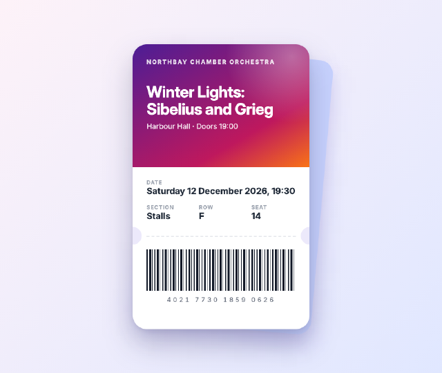</a> 
HTML 
<b><a href="concert-ticket-card/">Concert Ticket Card</a></b> 
A mobile e-ticket for an orchestra concert, with a gradient header, punched notches, a dashed tear line, seat details in a grid and a barcode drawn with a repeating gradient. 
<i>900 × 760 px; 2.9 KB of HTML</i> 
<code>card</code> <code>gradients</code> <code>border-radius</code> <code>repeating-gradient</code> <code>mobile</code>
</td>
<td width="33%" valign="top">
<a href="help-centre-tabs-accordion/">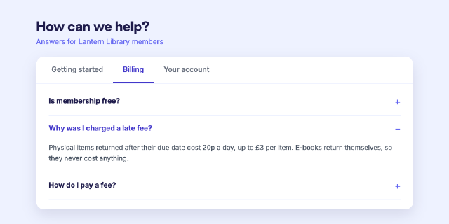</a> 
HTML 
<b><a href="help-centre-tabs-accordion/">Help Centre Tabs Accordion</a></b> 
A help-centre panel with tabs and an accordion driven by a small script; two clicks switch to the Billing tab and open its second question before the thumbnail is taken. 
<i>1000 × 500 px; 3.2 KB of HTML</i> 
<code>tabs</code> <code>accordion</code> <code>javascript</code> <code>interaction</code>
</td>
<td width="33%" valign="top">
<a href="home-energy-dashboard/">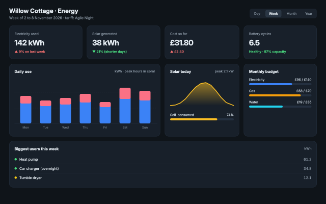</a> 
HTML 
<b><a href="home-energy-dashboard/">Home Energy Dashboard</a></b> 
A household energy dashboard with KPI cards, an inline SVG bar chart of daily use, a solar sparkline, progress bars and a device list, laid out with CSS grid. 
<i>1280 × 800 px; 6.0 KB of HTML</i> 
<code>dashboard</code> <code>inline-svg</code> <code>css-grid</code> <code>kpi</code> <code>progress-bars</code>
</td>
</tr>
<tr>
<td width="33%" valign="top">
<a href="volunteer-signup-form/">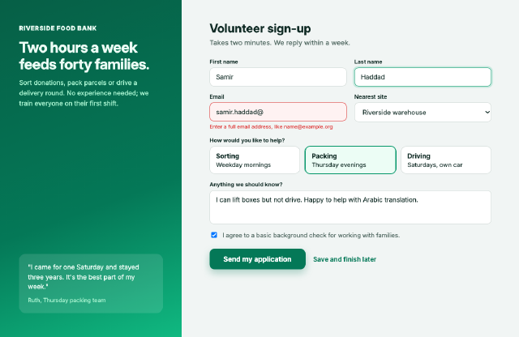</a> 
HTML 
<b><a href="volunteer-signup-form/">Volunteer Signup Form</a></b> 
A two-column signup page with real form controls, a field in its error state, radio cards, a consent check box and a primary button beside an illustrated panel. 
<i>1200 × 780 px; 4.2 KB of HTML</i> 
<code>forms</code> <code>inputs</code> <code>validation</code> <code>radio-buttons</code> <code>buttons</code>
</td>
<td width="33%"></td>
<td width="33%"></td>
</tr>
</table>

## Email Templates

<table>
<tr>
<td width="33%" valign="top">
<a href="bakery-newsletter-email/">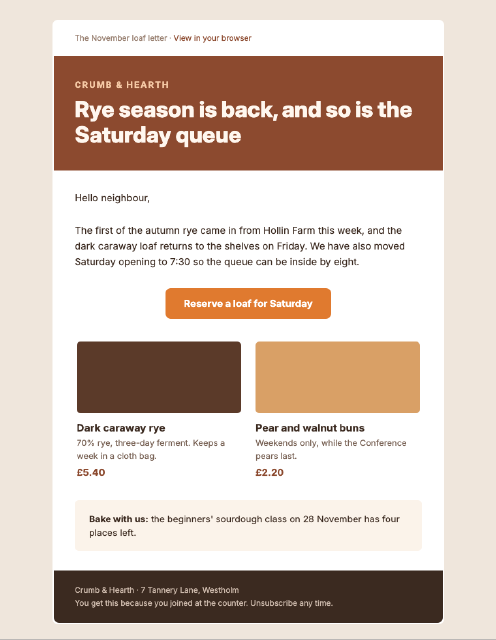</a> 
HTML 
<b><a href="bakery-newsletter-email/">Bakery Newsletter Email</a></b> 
A 600-pixel email newsletter built the way mail clients need it, with nested tables, inline styles, a bulletproof button and a two-column product row. 
<i>760 × 980 px; 3.4 KB of HTML</i> 
<code>email</code> <code>tables</code> <code>inline-styles</code> <code>newsletter</code>
</td>
<td width="33%"></td>
<td width="33%"></td>
</tr>
</table>

## Flex & Grid Layout

<table>
<tr>
<td width="33%" valign="top">
<a href="team-plan-pricing-cards/">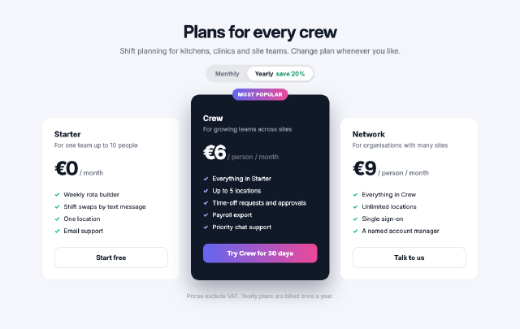</a> 
HTML 
<b><a href="team-plan-pricing-cards/">Team Plan Pricing Cards</a></b> 
Three pricing tiers laid out with flexbox, the middle plan raised and highlighted, each with a feature list, a price and a full-width button. 
<i>1200 × 760 px; 3.8 KB of HTML</i> 
<code>pricing</code> <code>flexbox</code> <code>cards</code> <code>shadows</code> <code>lists</code>
</td>
<td width="33%" valign="top">
<a href="travel-magazine-grid/">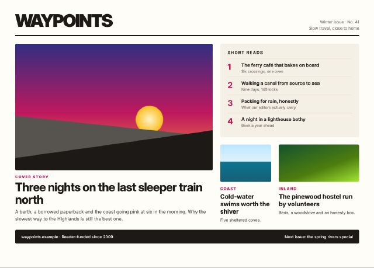</a> 
HTML 
<b><a href="travel-magazine-grid/">Travel Magazine Grid</a></b> 
A magazine front page built on a twelve-column CSS grid, with a lead story spanning two rows, gradient artwork panels, a sidebar of short reads and a footer band. 
<i>1200 × 860 px; 4.1 KB of HTML</i> 
<code>css-grid</code> <code>grid-template-areas</code> <code>magazine</code> <code>gradients</code>
</td>
<td width="33%"></td>
</tr>
</table>

## Landing Pages

<table>
<tr>
<td width="33%" valign="top">
<a href="coffee-roaster-landing-hero/">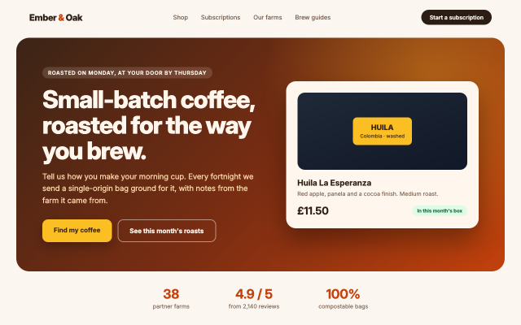</a> 
HTML 
<b><a href="coffee-roaster-landing-hero/">Coffee Roaster Landing Hero</a></b> 
The first screen of a coffee subscription site, with a navigation bar, a gradient hero, two call-to-action buttons, a product card and a row of trust figures. 
<i>1280 × 800 px; 4.1 KB of HTML</i> 
<code>hero</code> <code>gradients</code> <code>flexbox</code> <code>buttons</code> <code>shadows</code>
</td>
<td width="33%"></td>
<td width="33%"></td>
</tr>
</table>

## Tables & Data

<table>
<tr>
<td width="33%" valign="top">
<a href="ferry-departures-board/">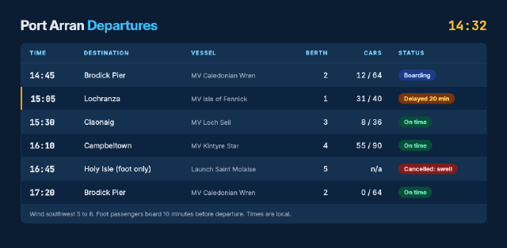</a> 
HTML 
<b><a href="ferry-departures-board/">Ferry Departures Board</a></b> 
A harbour departures table with zebra rows, right-aligned times in tabular figures, coloured status pills and a summary row, styled entirely with CSS. 
<i>1100 × 540 px; 3.2 KB of HTML</i> 
<code>tables</code> <code>zebra-rows</code> <code>status-pills</code> <code>nth-child</code>
</td>
<td width="33%"></td>
<td width="33%"></td>
</tr>
</table>

## Typography

<table>
<tr>
<td width="33%" valign="top">
<a href="bistro-dinner-menu/">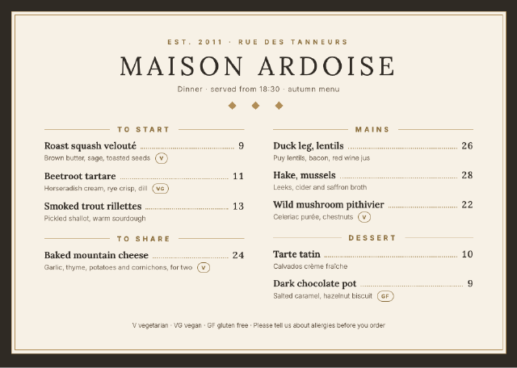</a> 
HTML 
<b><a href="bistro-dinner-menu/">Bistro Dinner Menu</a></b> 
A printed-style dinner menu with a centred masthead, dotted leaders between dishes and prices, small descriptions, dietary tags and a two-column course layout. 
<i>1000 × 712 px; 4.1 KB of HTML</i> 
<code>menu</code> <code>typography</code> <code>dotted-leaders</code> <code>columns</code>
</td>
<td width="33%" valign="top">
<a href="inter-type-specimen/">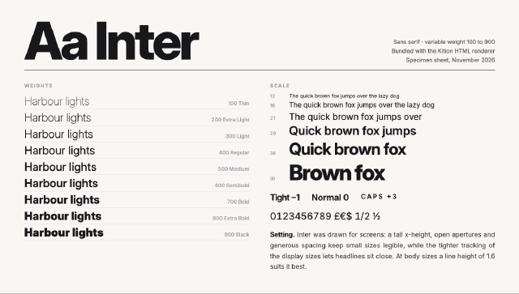</a> 
HTML 
<b><a href="inter-type-specimen/">Inter Type Specimen</a></b> 
A type specimen sheet for the renderer's bundled Inter, showing nine weights, a size scale, tracking, line height, figures and a paragraph setting. 
<i>1200 × 680 px; 3.7 KB of HTML</i> 
<code>typography</code> <code>font-weight</code> <code>letter-spacing</code> <code>type-scale</code>
</td>
<td width="33%"></td>
</tr>
</table>

## Tags

`accordion` 1 · `border-radius` 1 · `buttons` 2 · `card` 1 · `cards` 1 · `columns` 1 · `css-grid` 2 · `dashboard` 1 · `dotted-leaders` 1 · `email` 1 · `flexbox` 2 · `font-weight` 1 · `forms` 1 · `gradients` 3 · `grid-template-areas` 1 · `hero` 1 · `inline-styles` 1 · `inline-svg` 1 · `inputs` 1 · `interaction` 1 · `javascript` 1 · `kpi` 1 · `letter-spacing` 1 · `lists` 1 · `magazine` 1 · `menu` 1 · `mobile` 1 · `newsletter` 1 · `nth-child` 1 · `pricing` 1 · `progress-bars` 1 · `radio-buttons` 1 · `repeating-gradient` 1 · `shadows` 2 · `status-pills` 1 · `tables` 2 · `tabs` 1 · `type-scale` 1 · `typography` 2 · `validation` 1 · `zebra-rows` 1
