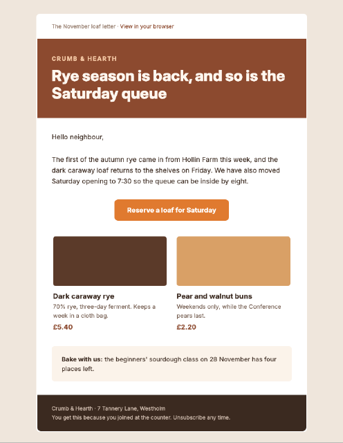

<!-- Generated by tools/gallery.mjs from showcase.yaml and build.json; do not edit. -->
# Bakery Newsletter Email

[HTML](../README.md) › [Email Templates](../README.md#email-templates) · `email` `tables` `inline-styles` `newsletter`

A 600-pixel email newsletter built the way mail clients need it, with nested tables, inline styles, a bulletproof button and a two-column product row.



| | |
|---|---|
| Document | [bakery-newsletter-email.html](bakery-newsletter-email.html) (3 KB) |
| Contents | 760 × 980 px; 3.4 KB of HTML |
| Features | `html.page.edit`, `html.agent.act` |
| Built by | `kition-html` @ `7f15327df8`: 1 commands in 5 ms |

## About

Email HTML is written for the strictest client: layout with nested `<table>`s and `align`,
`bgcolor` and `width` attributes, every style inline, a centred 600 px body on a tinted
background, a table-cell button and a two-column row of products. The renderer lays out the
attribute-driven table layout as a browser would.

## Checks

- `inspect.width`: `760`
- `inspect.height`: `980`
- `inspect.source`: `{"contains":"width=\"600\""}`
- `results.page.changed`: `true`
- diagnostics: none (the kit's check finds nothing wrong)
- the saved document opens again; the thumbnail matches `thumb.png` within the `render` tolerance

## Steps

<details><summary>1 commands (from <a href="showcase.yaml">showcase.yaml</a>)</summary>

```yaml
- command: html.setSource
  as: page
  params:
    source: |
      <!doctype html>
      <html lang="en">
      <head><meta charset="utf-8"><title>Crumb &amp; Hearth: the November loaf letter</title></head>
      <body style="margin:0;padding:0;background:#efe6dc;">
      <table role="presentation" width="100%" cellpadding="0" cellspacing="0" bgcolor="#efe6dc">
        <tr><td align="center" style="padding:28px 0;">
          <table role="presentation" width="600" cellpadding="0" cellspacing="0" bgcolor="#ffffff" style="font-family:Inter,Arial,sans-serif;color:#3b2a20;border-radius:8px;">
            <tr><td style="padding:18px 32px;font-size:12px;color:#9a8273;">The November loaf letter · <span style="color:#8c4a2f;">View in your browser</span></td></tr>
            <tr><td bgcolor="#8c4a2f" style="padding:36px 32px;color:#fff7ef;">
              <div style="font-size:13px;letter-spacing:2px;font-weight:700;color:#f5c9a5;">CRUMB &amp; HEARTH</div>
              <div style="font-size:34px;font-weight:800;line-height:1.15;margin-top:10px;">Rye season is back, and so is the Saturday queue</div>
            </td></tr>
            <tr><td style="padding:28px 32px 8px;font-size:15px;line-height:1.6;">
              Hello neighbour,<br><br>
              The first of the autumn rye came in from Hollin Farm this week, and the dark caraway loaf returns to the shelves on Friday. We have also moved Saturday opening to 7:30 so the queue can be inside by eight.
            </td></tr>
            <tr><td align="center" style="padding:16px 32px 28px;">
              <table role="presentation" cellpadding="0" cellspacing="0"><tr>
                <td bgcolor="#e07a2f" style="border-radius:8px;padding:14px 28px;font-size:15px;font-weight:700;color:#ffffff;">Reserve a loaf for Saturday</td>
              </tr></table>
            </td></tr>
            <tr><td style="padding:0 32px;">
              <table role="presentation" width="100%" cellpadding="0" cellspacing="0"><tr>
                <td width="50%" valign="top" style="padding-right:10px;">
                  <div style="height:110px;border-radius:6px;background:#5b3a29;"></div>
                  <div style="font-size:16px;font-weight:700;margin:12px 0 4px;">Dark caraway rye</div>
                  <div style="font-size:13px;color:#7a6457;line-height:1.5;">70% rye, three-day ferment. Keeps a week in a cloth bag.</div>
                  <div style="font-size:15px;font-weight:700;color:#8c4a2f;margin-top:6px;">£5.40</div>
                </td>
                <td width="50%" valign="top" style="padding-left:10px;">
                  <div style="height:110px;border-radius:6px;background:#d9a066;"></div>
                  <div style="font-size:16px;font-weight:700;margin:12px 0 4px;">Pear and walnut buns</div>
                  <div style="font-size:13px;color:#7a6457;line-height:1.5;">Weekends only, while the Conference pears last.</div>
                  <div style="font-size:15px;font-weight:700;color:#8c4a2f;margin-top:6px;">£2.20</div>
                </td>
              </tr></table>
            </td></tr>
            <tr><td style="padding:28px 32px;">
              <table role="presentation" width="100%" cellpadding="0" cellspacing="0" bgcolor="#fbf3ea" style="border-radius:6px;"><tr><td style="padding:16px 20px;font-size:14px;line-height:1.5;">
                <b>Bake with us:</b> the beginners' sourdough class on 28 November has four places left.
              </td></tr></table>
            </td></tr>
            <tr><td bgcolor="#3b2a20" style="padding:20px 32px;font-size:12px;color:#cbb8aa;line-height:1.6;border-radius:0 0 8px 8px;">
              Crumb &amp; Hearth · 7 Tannery Lane, Westholm<br>You get this because you joined at the counter. Unsubscribe any time.
            </td></tr>
          </table>
        </td></tr>
      </table>
      </body>
      </html>
```

</details>
