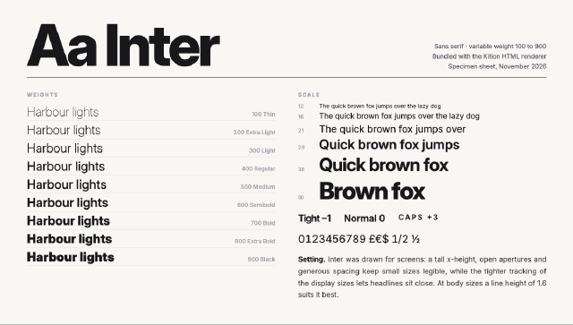

<!-- Generated by tools/gallery.mjs from showcase.yaml and build.json; do not edit. -->
# Inter Type Specimen

[HTML](../README.md) › [Typography](../README.md#typography) · `typography` `font-weight` `letter-spacing` `type-scale`

A type specimen sheet for the renderer's bundled Inter, showing nine weights, a size scale, tracking, line height, figures and a paragraph setting.



| | |
|---|---|
| Document | [inter-type-specimen.html](inter-type-specimen.html) (4 KB) |
| Contents | 1200 × 680 px; 3.7 KB of HTML |
| Features | `html.page.edit`, `html.agent.act` |
| Built by | `kition-html` @ `7f15327df8`: 1 commands in 6 ms |

## About

Every weight from 100 to 900 of the variable Inter face the renderer bundles, a modular size
scale from 12 to 72 px, negative and positive `letter-spacing`, uppercase tracking, tabular and
proportional figures, and a justified paragraph with a hanging drop line. The page uses no
other font: pages name Inter first and fall back to sans-serif.

## Checks

- `inspect.width`: `1200`
- `inspect.height`: `680`
- `inspect.source`: `{"contains":"font-weight:900"}`
- `results.page.changed`: `true`
- diagnostics: none (the kit's check finds nothing wrong)
- the saved document opens again; the thumbnail matches `thumb.png` within the `render` tolerance

## Steps

<details><summary>1 commands (from <a href="showcase.yaml">showcase.yaml</a>)</summary>

```yaml
- command: html.setSource
  as: page
  params:
    source: |
      <!doctype html>
      <html lang="en">
      <head>
      <meta charset="utf-8">
      <title>Inter specimen</title>
      <style>
        * { box-sizing: border-box; }
        body { margin: 0; padding: 40px 56px; font-family: Inter, sans-serif; background: #f8f7f4; color: #18181b; }
        .head { display: flex; justify-content: space-between; align-items: flex-end; border-bottom: 1px solid #18181b; padding-bottom: 14px; }
        .head h1 { margin: 0; font-size: 120px; font-weight: 800; letter-spacing: -6px; line-height: 0.9; }
        .head p { margin: 0; text-align: right; font-size: 13px; line-height: 1.6; color: #52525b; }
        .cols { display: grid; grid-template-columns: 1fr 1fr; gap: 48px; margin-top: 28px; }
        .label { font-size: 11px; font-weight: 700; letter-spacing: 2px; text-transform: uppercase; color: #a1a1aa; margin: 0 0 10px; }
        .weights div { display: flex; justify-content: space-between; align-items: baseline; font-size: 26px; padding: 3px 0; border-bottom: 1px solid #e4e4e7; }
        .weights span { font-size: 12px; font-weight: 500; color: #a1a1aa; }
        .scale div { line-height: 1.1; margin-bottom: 6px; white-space: nowrap; overflow: hidden; }
        .scale span { display: inline-block; width: 44px; font-size: 11px; color: #a1a1aa; font-weight: 500; }
        .tracking { display: flex; gap: 28px; margin-top: 18px; font-size: 20px; font-weight: 600; }
        .figures { margin-top: 18px; font-size: 22px; }
        .tab { font-variant-numeric: tabular-nums; }
        .para { margin-top: 18px; font-size: 15px; line-height: 1.65; text-align: justify; color: #3f3f46; }
        .para b { color: #18181b; }
      </style>
      </head>
      <body>
        <div class="head"><h1>Aa Inter</h1><p>Sans serif · variable weight 100 to 900<br>Bundled with the Kition HTML renderer<br>Specimen sheet, November 2026</p></div>
        <div class="cols">
          <div class="weights">
            <p class="label">Weights</p>
            <div style="font-weight:100">Harbour lights <span>100 Thin</span></div>
            <div style="font-weight:200">Harbour lights <span>200 Extra Light</span></div>
            <div style="font-weight:300">Harbour lights <span>300 Light</span></div>
            <div style="font-weight:400">Harbour lights <span>400 Regular</span></div>
            <div style="font-weight:500">Harbour lights <span>500 Medium</span></div>
            <div style="font-weight:600">Harbour lights <span>600 Semibold</span></div>
            <div style="font-weight:700">Harbour lights <span>700 Bold</span></div>
            <div style="font-weight:800">Harbour lights <span>800 Extra Bold</span></div>
            <div style="font-weight:900">Harbour lights <span>900 Black</span></div>
          </div>
          <div>
            <p class="label">Scale</p>
            <div class="scale">
              <div style="font-size:12px"><span>12</span>The quick brown fox jumps over the lazy dog</div>
              <div style="font-size:16px"><span>16</span>The quick brown fox jumps over the lazy dog</div>
              <div style="font-size:21px"><span>21</span>The quick brown fox jumps over</div>
              <div style="font-size:28px;font-weight:600"><span>28</span>Quick brown fox jumps</div>
              <div style="font-size:38px;font-weight:700;letter-spacing:-1px"><span>38</span>Quick brown fox</div>
              <div style="font-size:50px;font-weight:800;letter-spacing:-2px"><span>50</span>Brown fox</div>
            </div>
            <div class="tracking"><span style="letter-spacing:-1px">Tight −1</span><span>Normal 0</span><span style="letter-spacing:3px;text-transform:uppercase;font-size:15px">Caps +3</span></div>
            <div class="figures"><span class="tab">0123456789 £€$ 1/2 ½</span></div>
            <p class="para"><b>Setting.</b> Inter was drawn for screens: a tall x-height, open apertures and generous spacing keep small sizes legible, while the tighter tracking of the display sizes lets headlines sit close. At body sizes a line height of 1.6 suits it best.</p>
          </div>
        </div>
      </body>
      </html>
```

</details>
