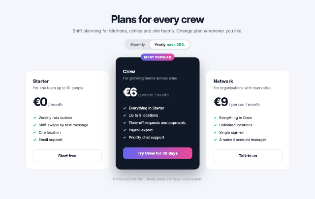

<!-- Generated by tools/gallery.mjs from showcase.yaml and build.json; do not edit. -->
# Team Plan Pricing Cards

[HTML](../README.md) › [Flex & Grid Layout](../README.md#flex--grid-layout) · `pricing` `flexbox` `cards` `shadows` `lists`

Three pricing tiers laid out with flexbox, the middle plan raised and highlighted, each with a feature list, a price and a full-width button.



| | |
|---|---|
| Document | [team-plan-pricing-cards.html](team-plan-pricing-cards.html) (4 KB) |
| Contents | 1200 × 760 px; 3.8 KB of HTML |
| Features | `html.page.edit`, `html.agent.act` |
| Built by | `kition-html` @ `7f15327df8`: 1 commands in 12 ms |

## About

A row of three equal-width flex items aligned to the bottom so the highlighted plan stands
taller, a monthly/yearly switch drawn as a segmented control, check-mark lists made with
`::before`, and a ribbon badge positioned on the featured card.

## Checks

- `inspect.width`: `1200`
- `inspect.height`: `760`
- `inspect.source`: `{"contains":"MOST POPULAR"}`
- `results.page.changed`: `true`
- diagnostics: none (the kit's check finds nothing wrong)
- the saved document opens again; the thumbnail matches `thumb.png` within the `render` tolerance

## Steps

<details><summary>1 commands (from <a href="showcase.yaml">showcase.yaml</a>)</summary>

```yaml
- command: html.setSource
  as: page
  params:
    source: |
      <!doctype html>
      <html lang="en">
      <head>
      <meta charset="utf-8">
      <title>Plans for every crew</title>
      <style>
        * { box-sizing: border-box; }
        body { margin: 0; font-family: Inter, sans-serif; background: #f4f6fb; color: #111827; }
        header { text-align: center; padding: 48px 0 28px; }
        header h1 { margin: 0; font-size: 40px; letter-spacing: -1px; }
        header p { margin: 10px 0 22px; color: #6b7280; font-size: 17px; }
        .switch { display: inline-flex; background: #e5e7eb; border-radius: 999px; padding: 4px; font-size: 14px; font-weight: 600; }
        .switch span { padding: 8px 18px; border-radius: 999px; color: #6b7280; }
        .switch .on { background: #ffffff; color: #111827; box-shadow: 0 1px 3px rgba(0,0,0,0.15); }
        .switch em { font-style: normal; color: #059669; margin-left: 6px; }
        .plans { display: flex; gap: 24px; align-items: flex-end; justify-content: center; padding: 0 80px; }
        .plan { flex: 1; max-width: 320px; background: #ffffff; border-radius: 20px; padding: 28px; border: 1px solid #e5e7eb; position: relative; }
        .plan.featured { background: #111827; color: #f9fafb; border: none; padding-top: 44px; padding-bottom: 40px; box-shadow: 0 24px 48px rgba(17,24,39,0.35); }
        .badge { position: absolute; top: -14px; left: 50%; margin-left: -64px; width: 128px; text-align: center; background: linear-gradient(90deg, #6366f1, #ec4899); color: #ffffff; font-size: 12px; font-weight: 700; padding: 6px 0; border-radius: 999px; letter-spacing: 0.5px; }
        .plan h2 { margin: 0; font-size: 18px; }
        .plan .for { margin: 6px 0 18px; font-size: 14px; color: #6b7280; }
        .featured .for { color: #9ca3af; }
        .price { font-size: 44px; font-weight: 800; letter-spacing: -1.5px; }
        .price small { font-size: 15px; font-weight: 500; color: #6b7280; letter-spacing: 0; }
        ul { list-style: none; padding: 0; margin: 20px 0 24px; font-size: 14px; line-height: 2; }
        li::before { content: "✓"; display: inline-block; width: 22px; color: #10b981; font-weight: 800; }
        .featured li::before { color: #a5b4fc; }
        .btn { display: block; text-align: center; padding: 13px 0; border-radius: 12px; font-weight: 700; font-size: 15px; border: 1px solid #d1d5db; }
        .featured .btn { background: linear-gradient(90deg, #6366f1, #ec4899); border: none; color: #ffffff; }
        footer { text-align: center; color: #9ca3af; font-size: 13px; padding-top: 28px; }
      </style>
      </head>
      <body>
        <header>
          <h1>Plans for every crew</h1>
          <p>Shift planning for kitchens, clinics and site teams. Change plan whenever you like.</p>
          <div class="switch"><span>Monthly</span><span class="on">Yearly<em>save 20%</em></span></div>
        </header>
        <section class="plans">
          <div class="plan">
            <h2>Starter</h2>
            <p class="for">For one team up to 10 people</p>
            <div class="price">€0<small> / month</small></div>
            <ul><li>Weekly rota builder</li><li>Shift swaps by text message</li><li>One location</li><li>Email support</li></ul>
            <span class="btn">Start free</span>
          </div>
          <div class="plan featured">
            <span class="badge">MOST POPULAR</span>
            <h2>Crew</h2>
            <p class="for">For growing teams across sites</p>
            <div class="price">€6<small> / person / month</small></div>
            <ul><li>Everything in Starter</li><li>Up to 5 locations</li><li>Time-off requests and approvals</li><li>Payroll export</li><li>Priority chat support</li></ul>
            <span class="btn">Try Crew for 30 days</span>
          </div>
          <div class="plan">
            <h2>Network</h2>
            <p class="for">For organisations with many sites</p>
            <div class="price">€9<small> / person / month</small></div>
            <ul><li>Everything in Crew</li><li>Unlimited locations</li><li>Single sign-on</li><li>A named account manager</li></ul>
            <span class="btn">Talk to us</span>
          </div>
        </section>
        <footer>Prices exclude VAT. Yearly plans are billed once a year.</footer>
      </body>
      </html>
```

</details>
