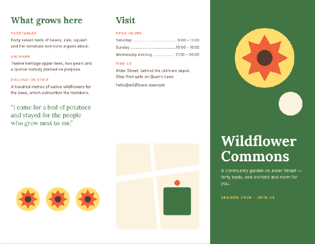
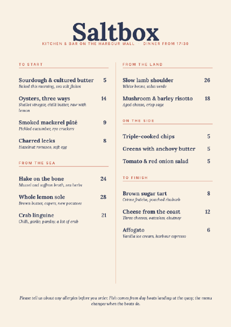
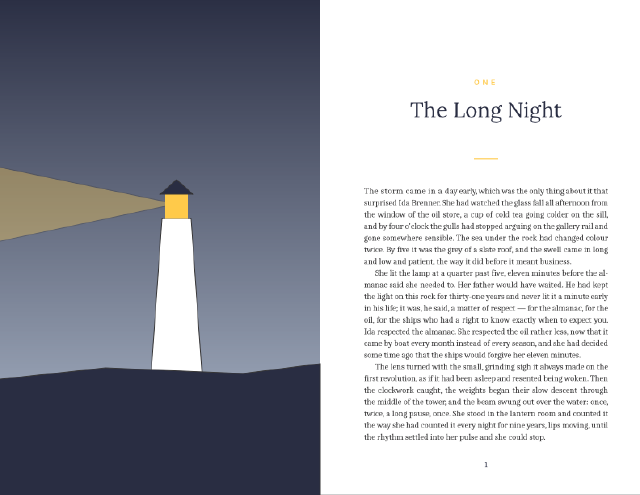
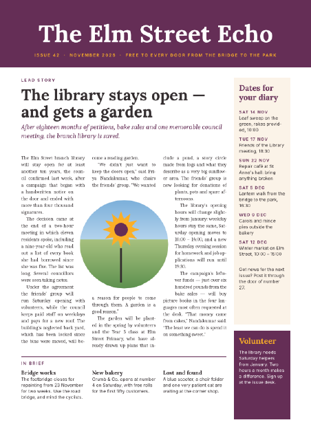
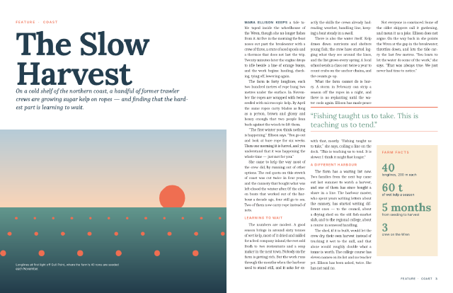
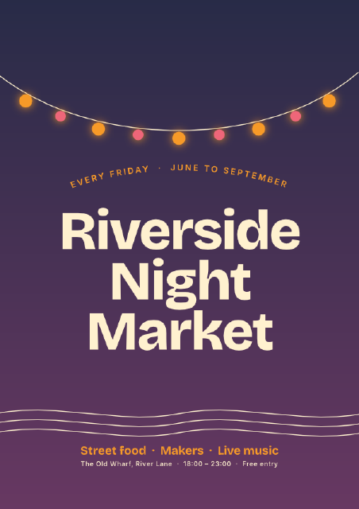
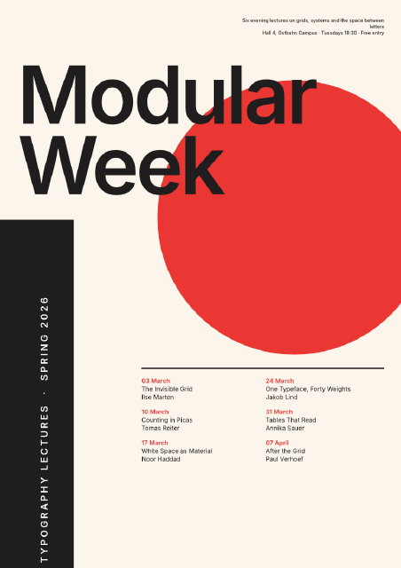
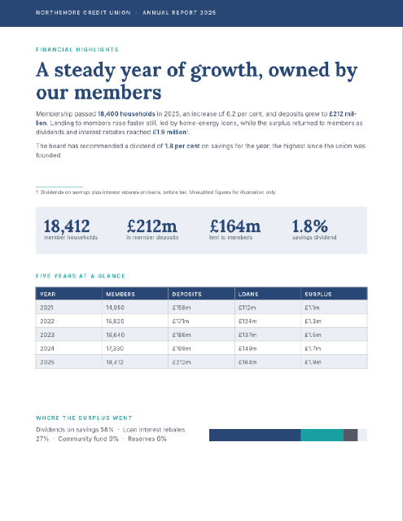
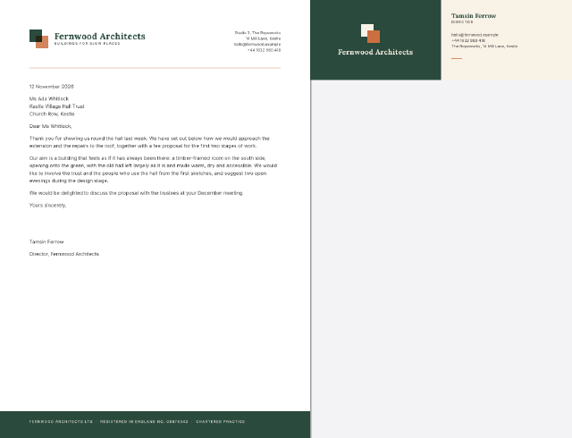
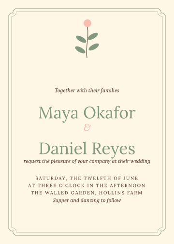

<!-- Generated by tools/gallery.mjs from showcase.yaml and build.json; do not edit. -->
# Layout showcase

Page layout: frames, text flow, master pages, styles, colour swatches and grids. Saved as .klayout. Every sample is built from `showcase.yaml` by the kit's own commands and drawn by its own engine (`kition-layout`).

**10 samples** · 5 categories · 15 features of `kition-layout/features.yaml` · [all kits](../README.md)

[Brochures & Flyers](#brochures--flyers) (2) · [Magazines & Books](#magazines--books) (3) · [Posters](#posters) (2) · [Reports](#reports) (1) · [Stationery](#stationery) (2)

## Brochures & Flyers

<table>
<tr>
<td width="33%" valign="top">
 
Layout 
<b><a href="community-garden-trifold/">Community Garden Tri-Fold</a></b> 
A letter-size tri-fold brochure, outside and inside, laid out on a three-panel column grid with tabbed price lists and dot leaders. 
<i>2 pages; 7 stories; 10 paragraph styles</i> 
<code>brochure</code> <code>tri-fold</code> <code>columns</code> <code>tabs</code> <code>paragraph-styles</code>
</td>
<td width="33%" valign="top">
 
Layout 
<b><a href="saltbox-dinner-menu/">Saltbox Dinner Menu</a></b> 
A two-column restaurant menu in one story — section heads, dishes with right-tabbed prices, italic descriptions and a column rule. 
<i>1 page; 3 stories; 5 paragraph styles</i> 
<code>menu</code> <code>tabs</code> <code>columns</code> <code>paragraph-styles</code> <code>column-rule</code>
</td>
<td width="33%"></td>
</tr>
</table>

## Magazines & Books

<table>
<tr>
<td width="33%" valign="top">
 
Layout 
<b><a href="lantern-keeper-novel/">Lantern Keeper Novel Interior</a></b> 
A trade-paperback novel — cover, frontispiece and a chapter that autoflows across pages under two parent pages with running heads and numbered folios. 
<i>5 pages; 8 stories; 8 paragraph styles</i> 
<code>book</code> <code>parent-pages</code> <code>page-numbers</code> <code>sections</code> <code>autoflow</code> <code>threaded-frames</code>
</td>
<td width="33%" valign="top">
 
Layout 
<b><a href="neighbourhood-newsletter-front/">Neighbourhood Newsletter Front</a></b> 
A community newsletter front page — masthead, a lead story in three columns flowing around a wrapped round picture, and a diary sidebar. 
<i>1 page; 8 stories; 11 paragraph styles</i> 
<code>newsletter</code> <code>text-wrap</code> <code>columns</code> <code>paragraph-styles</code>
</td>
<td width="33%" valign="top">
 
Layout 
<b><a href="tideline-magazine-feature/">Tideline Magazine Feature</a></b> 
A three-page magazine — cover and a feature spread whose story threads from one column into a two-column frame around a wrapped pull quote. 
<i>3 pages; 9 stories; 16 paragraph styles</i> 
<code>magazine</code> <code>threaded-frames</code> <code>paragraph-styles</code> <code>parent-pages</code> <code>text-wrap</code>
</td>
</tr>
</table>

## Posters

<table>
<tr>
<td width="33%" valign="top">
 
Layout 
<b><a href="riverside-night-market-poster/">Riverside Night Market Poster</a></b> 
A night-market poster with type set on a curved path, a garland of lanterns stepped along a swag and a gradient sky. 
<i>1 page; 3 stories; 5 paragraph styles</i> 
<code>poster</code> <code>type-on-path</code> <code>gradient</code> <code>step-and-repeat</code>
</td>
<td width="33%" valign="top">
 
Layout 
<b><a href="swiss-grid-lecture-poster/">Swiss Grid Lecture Poster</a></b> 
An A3 typographic poster built on a six-column, eight-row guide grid — a cropped red disc, a rotated side bar and a two-column lecture list. 
<i>1 page; 4 stories; 4 paragraph styles</i> 
<code>poster</code> <code>grid</code> <code>guides</code> <code>typography</code> <code>rotation</code>
</td>
<td width="33%"></td>
</tr>
</table>

## Reports

<table>
<tr>
<td width="33%" valign="top">
 
Layout 
<b><a href="credit-union-annual-report/">Credit Union Annual Report Page</a></b> 
A financial-highlights page with paragraph and character styles, key figures, a styled five-year table converted from tabbed text and a footnote. 
<i>1 page; 9 stories; 10 paragraph styles</i> 
<code>report</code> <code>tables</code> <code>paragraph-styles</code> <code>character-styles</code> <code>footnotes</code>
</td>
<td width="33%"></td>
<td width="33%"></td>
</tr>
</table>

## Stationery

<table>
<tr>
<td width="33%" valign="top">
 
Layout 
<b><a href="architect-stationery-set/">Architect Stationery Set</a></b> 
A studio's letterhead with a business card front and back, three pages of different sizes gathered into one spread. 
<i>3 pages; 6 stories; 10 paragraph styles</i> 
<code>stationery</code> <code>letterhead</code> <code>business-card</code> <code>page-sizes</code> <code>brand</code>
</td>
<td width="33%" valign="top">
 
Layout 
<b><a href="garden-wedding-invitation/">Garden Wedding Invitation</a></b> 
A 5 × 7 in wedding invitation — centred serif type, an inset border with fancy corners and a botanical sprig built from rotated leaf frames. 
<i>1 page; 1 story; 6 paragraph styles</i> 
<code>invitation</code> <code>wedding</code> <code>corner-options</code> <code>typography</code> <code>transform</code>
</td>
<td width="33%"></td>
</tr>
</table>

## Tags

`autoflow` 1 · `book` 1 · `brand` 1 · `brochure` 1 · `business-card` 1 · `character-styles` 1 · `column-rule` 1 · `columns` 3 · `corner-options` 1 · `footnotes` 1 · `gradient` 1 · `grid` 1 · `guides` 1 · `invitation` 1 · `letterhead` 1 · `magazine` 1 · `menu` 1 · `newsletter` 1 · `page-numbers` 1 · `page-sizes` 1 · `paragraph-styles` 5 · `parent-pages` 2 · `poster` 2 · `report` 1 · `rotation` 1 · `sections` 1 · `stationery` 1 · `step-and-repeat` 1 · `tables` 1 · `tabs` 2 · `text-wrap` 2 · `threaded-frames` 2 · `transform` 1 · `tri-fold` 1 · `type-on-path` 1 · `typography` 2 · `wedding` 1
