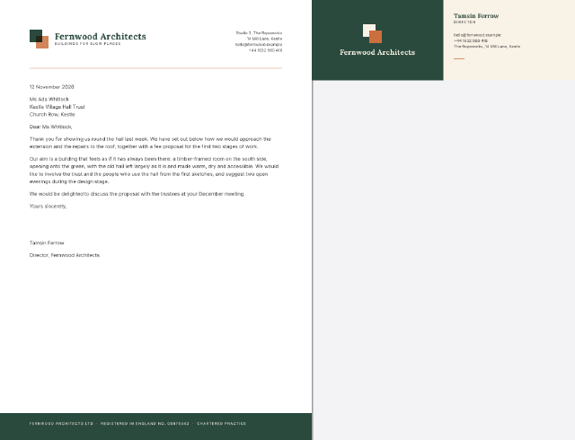

<!-- Generated by tools/gallery.mjs from showcase.yaml and build.json; do not edit. -->
# Architect Stationery Set

[Layout](../README.md) › [Stationery](../README.md#stationery) · `stationery` `letterhead` `business-card` `page-sizes` `brand`

A studio's letterhead with a business card front and back, three pages of different sizes gathered into one spread.



| | |
|---|---|
| Document | [architect-stationery-set.klayout](architect-stationery-set.klayout) (46 KB) |
| Contents | 3 pages; 6 stories; 10 paragraph styles |
| Features | `layout.layout.pages`, `layout.type.styles`, `layout.object.fill-stroke`, `layout.color.swatches`, `layout.text.frames` |
| Built by | `kition-layout` @ `e2c4271dc0`: 75 commands in 281 ms |

## About

One document, three page sizes: an A4 letterhead and a 3.5 × 2 in business card front and back,
resized with `layout.pageSize` and gathered into the letterhead's spread with
`layout.pages.toSpread` so the set is seen together. The monogram is two overlapping squares, the
copper one multiplied over the forest green. Letter, address, footer and card text are
paragraph styles; colours are CMYK swatches with bleed on the outer edges.

## Checks

- `inspect.pageCount`: `3`
- `inspect.spreads`: `{"count":1}`
- `inspect.spreads.0.pages`: `{"count":3}`
- `inspect.spreads.0.pages.0.bounds`: `[0,0,595,842]`
- `inspect.spreads.0.pages.1.bounds`: `[595,0,847,144]`
- `inspect.spreads.0.pages.2.bounds`: `[847,0,1099,144]`
- `inspect.paragraphStyles`: `{"contains":"Card Wordmark"}`
- `inspect.stories`: `{"count":6,"all":{"overset":false}}`
- `results.recipient`: `{"count":1}`
- `results.fonts`: `{"all":{"missing":false,"styleMissing":false}}`
- diagnostics: none (the kit's check finds nothing wrong)
- the saved document opens again; the thumbnail matches `thumb.png` within the `render` tolerance

## Steps

<details><summary>75 commands (from <a href="showcase.yaml">showcase.yaml</a>)</summary>

```yaml
- command: layout.documentSetup
  params:
    pages: 3
    bleed: 9
- command: layout.pageSize
  params:
    pages:
      - 2
      - 3
    width: 252
    height: 144
- command: layout.pages.toSpread
  params:
    page: 2
    spread: 0
- command: layout.pages.toSpread
  params:
    page: 3
    spread: 0
- command: document.inspect
  params: {}
  as: setup
- command: swatch.create
  params:
    name: Forest
    color:
      c: 80
      m: 40
      y: 70
      k: 45
- command: swatch.create
  params:
    name: Copper
    color:
      c: 15
      m: 60
      y: 80
      k: 5
- command: swatch.create
  params:
    name: Linen
    color:
      c: 3
      m: 4
      y: 9
      k: 0
- command: swatch.create
  params:
    name: Graphite
    color:
      c: 60
      m: 50
      y: 45
      k: 60
- command: style.paragraph.create
  params:
    name: Wordmark
    chars:
      fontFamily: Lora
      fontStyle: Bold
      size: 17
      tracking: 20
      fill: Forest
- command: style.paragraph.create
  params:
    name: Small Caps Line
    chars:
      fontFamily: Inter
      fontStyle: Medium
      size: 6.5
      leading:
        kind: points
        value: 10
      tracking: 180
      capitalization: allCaps
      fill: Graphite
- command: style.paragraph.create
  params:
    name: Footer Line
    basedOn: Small Caps Line
    chars:
      fill: Linen
- command: style.paragraph.create
  params:
    name: Card Wordmark
    basedOn: Wordmark
    para:
      align: center
    chars:
      size: 14
      fill: Linen
- command: style.paragraph.create
  params:
    name: Card Name
    chars:
      fontFamily: Lora
      fontStyle: Bold
      size: 12
      fill: Forest
- command: style.paragraph.create
  params:
    name: Letter
    para:
      spaceAfter: 9
    chars:
      fontFamily: Inter
      fontStyle: Regular
      size: 9.5
      leading:
        kind: points
        value: 14.5
      fill: Graphite
- command: style.paragraph.create
  params:
    name: Letter Tight
    basedOn: Letter
    para:
      spaceAfter: 0
- command: style.paragraph.create
  params:
    name: Address
    para:
      align: right
    chars:
      fontFamily: Inter
      fontStyle: Regular
      size: 7.5
      leading:
        kind: points
        value: 11
      fill: Graphite
- command: frame.create
  params:
    spread: 0
    rect:
      - 56
      - 56
      - 80
      - 80
    content: graphic
  as: markA
- command: object.fill
  params:
    ids:
      - $markA.id
    swatch: Forest
- command: frame.create
  params:
    spread: 0
    rect:
      - 68
      - 68
      - 92
      - 92
    content: graphic
  as: markB
- command: object.fill
  params:
    ids:
      - $markB.id
    swatch: Copper
- command: object.opacity
  params:
    ids:
      - $markB.id
    opacity: 0.85
    blend: multiply
- command: frame.create
  params:
    spread: 0
    rect:
      - 104
      - 58
      - 330
      - 96
    text: |-
      Fernwood Architects
      Buildings for slow places
  as: logo
- command: text.select
  params:
    story: $logo.story
    anchor: 0
    focus: 1
- command: style.paragraph.apply
  params:
    name: Wordmark
- command: text.select
  params:
    story: $logo.story
    anchor: 21
    focus: 22
- command: style.paragraph.apply
  params:
    name: Small Caps Line
- command: text.exitToFrame
  params: {}
- command: frame.create
  params:
    spread: 0
    rect:
      - 360
      - 58
      - 539
      - 110
    text: |-
      Studio 3, The Ropeworks
      14 Mill Lane, Kestle
      hello@fernwood.example
      +44 1632 960 418
  as: address
- command: story.get
  params:
    frame: $address.id
  as: addressText
- command: text.select
  params:
    story: $address.story
    anchor: 0
    focus: $addressText.length
- command: style.paragraph.apply
  params:
    name: Address
- command: text.exitToFrame
  params: {}
- command: path.create
  params:
    spread: 0
    anchors:
      - p:
          - 56
          - 130
      - p:
          - 539
          - 130
  as: rule
- command: object.stroke
  params:
    ids:
      - $rule.id
    swatch: Copper
    weight: 0.75
- command: frame.create
  params:
    spread: 0
    rect:
      - 56
      - 160
      - 539
      - 700
    text: |-
      12 November 2026
      Ms Ada Whitlock
      Kestle Village Hall Trust
      Church Row, Kestle
      Dear Ms Whitlock,
      Thank you for showing us round the hall last week. We have set out below how we would approach the extension and the repairs to the roof, together with a fee proposal for the first two stages of work.
      Our aim is a building that feels as if it has always been there: a timber-framed room on the south side, opening onto the green, with the old hall left largely as it is and made warm, dry and accessible. We would like to involve the trust and the people who use the hall from the first sketches, and suggest two open evenings during the design stage.
      We would be delighted to discuss the proposal with the trustees at your December meeting.
      Yours sincerely,


      Tamsin Ferrow
      Director, Fernwood Architects
  as: letter
- command: story.get
  params:
    frame: $letter.id
  as: letterText
- command: text.select
  params:
    story: $letter.story
    anchor: 0
    focus: $letterText.length
- command: style.paragraph.apply
  params:
    name: Letter
- command: find.find
  params:
    find: Ms Ada Whitlock\nKestle Village Hall Trust
    grep: true
    story: $letter.story
    scope: story
  as: recipient
- command: text.select
  params:
    story: $letter.story
    anchor: $recipient.0.start
    focus: $recipient.0.end
- command: style.paragraph.apply
  params:
    name: Letter Tight
- command: text.exitToFrame
  params: {}
- command: frame.create
  params:
    spread: 0
    rect:
      - -9
      - 790
      - 595
      - 851
    content: graphic
  as: foot
- command: object.fill
  params:
    ids:
      - $foot.id
    swatch: Forest
- command: frame.create
  params:
    spread: 0
    rect:
      - 56
      - 806
      - 539
      - 818
    text: Fernwood Architects Ltd  ·  Registered in England No. 09876543  ·  Chartered Practice
  as: footText
- command: text.select
  params:
    story: $footText.story
    anchor: 0
    focus: 1
- command: style.paragraph.apply
  params:
    name: Footer Line
- command: text.exitToFrame
  params: {}
- command: frame.create
  params:
    spread: 0
    rect:
      - 595
      - -9
      - 847
      - 153
    content: graphic
  as: cardBg
- command: object.fill
  params:
    ids:
      - $cardBg.id
    swatch: Forest
- command: frame.create
  params:
    spread: 0
    rect:
      - 693
      - 46
      - 717
      - 70
    content: graphic
  as: cardMarkA
- command: object.fill
  params:
    ids:
      - $cardMarkA.id
    swatch: Linen
- command: frame.create
  params:
    spread: 0
    rect:
      - 705
      - 58
      - 729
      - 82
    content: graphic
  as: cardMarkB
- command: object.fill
  params:
    ids:
      - $cardMarkB.id
    swatch: Copper
- command: frame.create
  params:
    spread: 0
    rect:
      - 615
      - 90
      - 827
      - 118
    text: Fernwood Architects
  as: cardWord
- command: text.select
  params:
    story: $cardWord.story
    anchor: 0
    focus: 1
- command: style.paragraph.apply
  params:
    name: Card Wordmark
- command: text.exitToFrame
  params: {}
- command: frame.create
  params:
    spread: 0
    rect:
      - 847
      - -9
      - 1108
      - 153
    content: graphic
  as: backBg
- command: object.fill
  params:
    ids:
      - $backBg.id
    swatch: Linen
- command: frame.create
  params:
    spread: 0
    rect:
      - 867
      - 22
      - 1079
      - 124
    text: |-
      Tamsin Ferrow
      Director
      hello@fernwood.example
      +44 1632 960 418
      The Ropeworks, 14 Mill Lane, Kestle
  as: cardBack
- command: story.get
  params:
    frame: $cardBack.id
  as: cardBackText
- command: text.select
  params:
    story: $cardBack.story
    anchor: 0
    focus: $cardBackText.length
- command: style.paragraph.apply
  params:
    name: Address
- command: type.para
  params:
    attrs:
      align: left
- command: text.select
  params:
    story: $cardBack.story
    anchor: 0
    focus: 1
- command: style.paragraph.apply
  params:
    name: Card Name
- command: text.select
  params:
    story: $cardBack.story
    anchor: 14
    focus: 15
- command: style.paragraph.apply
  params:
    name: Small Caps Line
- command: type.para
  params:
    attrs:
      spaceAfter: 14
- command: text.exitToFrame
  params: {}
- command: path.create
  params:
    spread: 0
    anchors:
      - p:
          - 867
          - 112
      - p:
          - 887
          - 112
  as: cardRule
- command: object.stroke
  params:
    ids:
      - $cardRule.id
    swatch: Copper
    weight: 1.5
- command: font.list
  params: {}
  as: fonts
```

</details>
