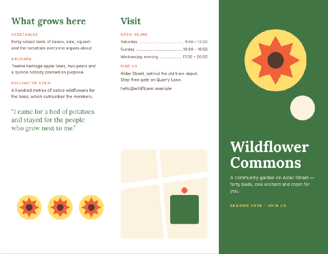

<!-- Generated by tools/gallery.mjs from showcase.yaml and build.json; do not edit. -->
# Community Garden Tri-Fold

[Layout](../README.md) › [Brochures & Flyers](../README.md#brochures--flyers) · `brochure` `tri-fold` `columns` `tabs` `paragraph-styles`

A letter-size tri-fold brochure, outside and inside, laid out on a three-panel column grid with tabbed price lists and dot leaders.



| | |
|---|---|
| Document | [community-garden-trifold.klayout](community-garden-trifold.klayout) (77 KB) |
| Contents | 2 pages; 7 stories; 10 paragraph styles |
| Features | `layout.layout.pages-guides`, `layout.type.styles`, `layout.type.format`, `layout.object.fill-stroke`, `layout.color.swatches`, `layout.text.frames` |
| Built by | `kition-layout` @ `e2c4271dc0`: 152 commands in 281 ms |

## About

Two landscape Letter pages with three columns and a 54 pt gutter, so each column is one folded
panel. The outside carries the inside flap, the back panel with opening hours and a little map,
and the front cover; the inside, the story, membership prices and the season calendar. Hours and
prices are tab-separated paragraphs in a "Leader Row" style with a right tab and dot leader;
labels and quotes are styled by finding their paragraphs with GREP (`find.find {grep: true}`).
The flowers are an ellipse, an eight-point star polygon and a centre, grouped and repeated with
`edit.stepAndRepeat`.

## Checks

- `inspect.pageCount`: `2`
- `inspect.spreads`: `{"count":2,"all":{"pages":{"count":1,"all":{"columns":3}}}}`
- `inspect.spreads.0.items`: `{"count":16}`
- `inspect.paragraphStyles`: `{"contains":"Leader Row"}`
- `inspect.swatches`: `{"contains":"Meadow"}`
- `inspect.stories`: `{"count":7,"all":{"overset":false}}`
- `results.priceTabs`: `{"count":4}`
- `results.backTabs`: `{"count":3}`
- `results.months`: `{"count":5}`
- `results.flowers`: `{"created":2}`
- `results.fonts`: `{"count":4,"all":{"missing":false,"styleMissing":false}}`
- diagnostics: none (the kit's check finds nothing wrong)
- the saved document opens again; the thumbnail matches `thumb.png` within the `render` tolerance

## Steps

<details><summary>152 commands (from <a href="showcase.yaml">showcase.yaml</a>)</summary>

```yaml
- command: layout.documentSetup
  params:
    pages: 2
    bleed: 9
- command: layout.marginsAndColumns
  params:
    margins: 27
    columns: 3
    gutter: 54
- command: swatch.create
  params:
    name: Meadow
    color:
      c: 72
      m: 22
      y: 85
      k: 22
- command: swatch.create
  params:
    name: Poppy
    color:
      c: 0
      m: 72
      y: 78
      k: 0
- command: swatch.create
  params:
    name: Butter
    color:
      c: 0
      m: 12
      y: 62
      k: 0
- command: swatch.create
  params:
    name: Cream
    color:
      c: 2
      m: 4
      y: 12
      k: 0
- command: swatch.create
  params:
    name: Soil
    color:
      c: 45
      m: 62
      y: 72
      k: 52
- command: style.paragraph.create
  params:
    name: Panel Head
    para:
      spaceAfter: 8
      hyphenate: false
    chars:
      fontFamily: Lora
      fontStyle: Bold
      size: 22
      leading:
        kind: points
        value: 25
      fill: Meadow
- command: style.paragraph.create
  params:
    name: Label
    para:
      spaceBefore: 10
      spaceAfter: 3
    chars:
      fontFamily: Inter
      fontStyle: SemiBold
      size: 8
      tracking: 160
      fill: Poppy
      capitalization: allCaps
- command: style.paragraph.create
  params:
    name: Copy
    para:
      spaceAfter: 6
      hyphenate: true
    chars:
      fontFamily: Inter
      fontStyle: Regular
      size: 10
      leading:
        kind: points
        value: 15
      fill: Soil
- command: style.paragraph.create
  params:
    name: Leader Row
    para:
      spaceAfter: 3
      spaceBefore: 0
      tabs:
        - position: 210
          align: right
          leader: .
    chars:
      fontFamily: Inter
      fontStyle: Regular
      size: 9.5
      leading:
        kind: points
        value: 15
      fill: Soil
- command: style.paragraph.create
  params:
    name: Cover Title
    para:
      spaceAfter: 12
      hyphenate: false
    chars:
      fontFamily: Lora
      fontStyle: Bold
      size: 36
      leading:
        kind: points
        value: 38
      fill: "[Paper]"
- command: style.paragraph.create
  params:
    name: Cover Copy
    chars:
      fontFamily: Inter
      fontStyle: Regular
      size: 11
      leading:
        kind: points
        value: 16
      fill: Cream
- command: style.paragraph.create
  params:
    name: Cover Tag
    para:
      spaceBefore: 24
    chars:
      fontFamily: Inter
      fontStyle: SemiBold
      size: 9
      tracking: 160
      fill: Butter
      capitalization: allCaps
- command: style.paragraph.create
  params:
    name: Quote
    para:
      spaceBefore: 12
      hyphenate: false
    chars:
      fontFamily: Lora
      fontStyle: Regular
      size: 15
      leading:
        kind: points
        value: 20
      fill: Meadow
- command: frame.create
  params:
    spread: 0
    rect:
      - 528
      - -9
      - 801
      - 621
    content: graphic
  as: coverBg
- command: object.fill
  params:
    ids:
      - $coverBg.id
    swatch: Meadow
- command: frame.create
  params:
    spread: 0
    shape: ellipse
    rect:
      - 590
      - 70
      - 740
      - 220
    content: graphic
  as: bloom
- command: object.fill
  params:
    ids:
      - $bloom.id
    swatch: Butter
- command: tool.polygonSettings
  params:
    sides: 8
    starInset: 38
- command: frame.create
  params:
    spread: 0
    shape: polygon
    sides: 8
    rect:
      - 606
      - 86
      - 724
      - 204
    content: graphic
  as: petals
- command: object.fill
  params:
    ids:
      - $petals.id
    swatch: Poppy
- command: frame.create
  params:
    spread: 0
    shape: ellipse
    rect:
      - 645
      - 125
      - 685
      - 165
    content: graphic
  as: heart
- command: object.fill
  params:
    ids:
      - $heart.id
    swatch: Soil
- command: frame.create
  params:
    spread: 0
    shape: ellipse
    rect:
      - 700
      - 230
      - 760
      - 290
    content: graphic
  as: bud
- command: object.fill
  params:
    ids:
      - $bud.id
    swatch: Cream
- command: frame.create
  params:
    spread: 0
    rect:
      - 555
      - 330
      - 765
      - 560
    text: |-
      Wildflower Commons
      A community garden on Alder Street — forty beds, one orchard and room for you.
      Season 2026 · Join us
  as: cover
- command: story.get
  params:
    frame: $cover.id
  as: coverText
- command: text.select
  params:
    story: $cover.story
    anchor: 0
    focus: $coverText.length
- command: style.paragraph.apply
  params:
    name: Cover Copy
- command: text.select
  params:
    story: $cover.story
    anchor: 0
    focus: 1
- command: style.paragraph.apply
  params:
    name: Cover Title
- command: find.find
  params:
    find: Season 2026 · Join us
    story: $cover.story
    scope: story
  as: join
- command: text.select
  params:
    story: $cover.story
    anchor: $join.0.start
    focus: $join.0.end
- command: style.paragraph.apply
  params:
    name: Cover Tag
- command: text.exitToFrame
  params: {}
- command: frame.create
  params:
    spread: 0
    rect:
      - 27
      - 36
      - 237
      - 576
    text: |-
      What grows here
      Vegetables
      Forty raised beds of beans, kale, squash and the tomatoes everyone argues about.
      Orchard
      Twelve heritage apple trees, two pears and a quince nobody planted on purpose.
      Pollinator strip
      A hundred metres of native wildflowers for the bees, which outnumber the members.
      “I came for a bed of potatoes and stayed for the people who grow next to me.”
  as: flap
- command: story.get
  params:
    frame: $flap.id
  as: flapStory
- command: text.select
  params:
    story: $flap.story
    anchor: 0
    focus: $flapStory.length
- command: style.paragraph.apply
  params:
    name: Copy
- command: text.select
  params:
    story: $flap.story
    anchor: 0
    focus: 1
- command: style.paragraph.apply
  params:
    name: Panel Head
- command: find.find
  params:
    find: ^(Vegetables|Orchard|Pollinator strip)$
    grep: true
    story: $flap.story
    scope: story
  as: flapLabels
- command: text.select
  params:
    story: $flap.story
    anchor: $flapLabels.0.start
    focus: $flapLabels.0.end
- command: style.paragraph.apply
  params:
    name: Label
- command: text.select
  params:
    story: $flap.story
    anchor: $flapLabels.1.start
    focus: $flapLabels.1.end
- command: style.paragraph.apply
  params:
    name: Label
- command: text.select
  params:
    story: $flap.story
    anchor: $flapLabels.2.start
    focus: $flapLabels.2.end
- command: style.paragraph.apply
  params:
    name: Label
- command: find.find
  params:
    find: “I came
    story: $flap.story
    scope: story
  as: flapQuote
- command: text.select
  params:
    story: $flap.story
    anchor: $flapQuote.0.start
    focus: $flapQuote.0.end
- command: style.paragraph.apply
  params:
    name: Quote
- command: text.exitToFrame
  params: {}
- command: frame.create
  params:
    spread: 0
    shape: ellipse
    rect:
      - 40
      - 470
      - 100
      - 530
    content: graphic
  as: f1
- command: object.fill
  params:
    ids:
      - $f1.id
    swatch: Butter
- command: frame.create
  params:
    spread: 0
    shape: polygon
    sides: 8
    rect:
      - 46
      - 476
      - 94
      - 524
    content: graphic
  as: f2
- command: object.fill
  params:
    ids:
      - $f2.id
    swatch: Poppy
- command: frame.create
  params:
    spread: 0
    shape: ellipse
    rect:
      - 62
      - 492
      - 78
      - 508
    content: graphic
  as: f3
- command: object.fill
  params:
    ids:
      - $f3.id
    swatch: Soil
- command: object.group
  params:
    ids:
      - $f1.id
      - $f2.id
      - $f3.id
  as: flower
- command: edit.stepAndRepeat
  params:
    ids:
      - $flower.id
    count: 2
    dx: 75
  as: flowers
- command: frame.create
  params:
    spread: 0
    rect:
      - 291
      - 36
      - 501
      - 340
    text: |-
      Visit
      Open hours
      Saturday	9:00 – 13:00
      Sunday	10:00 – 16:00
      Wednesday evening	17:00 – 20:00
      Find us
      Alder Street, behind the old tram depot. Step-free gate on Quarry Lane.
      hello@wildflower.example
  as: back
- command: story.get
  params:
    frame: $back.id
  as: backStory
- command: text.select
  params:
    story: $back.story
    anchor: 0
    focus: $backStory.length
- command: style.paragraph.apply
  params:
    name: Copy
- command: text.select
  params:
    story: $back.story
    anchor: 0
    focus: 1
- command: style.paragraph.apply
  params:
    name: Panel Head
- command: find.find
  params:
    find: ^(Open hours|Find us)$
    grep: true
    story: $back.story
    scope: story
  as: backLabels
- command: text.select
  params:
    story: $back.story
    anchor: $backLabels.0.start
    focus: $backLabels.0.end
- command: style.paragraph.apply
  params:
    name: Label
- command: text.select
  params:
    story: $back.story
    anchor: $backLabels.1.start
    focus: $backLabels.1.end
- command: style.paragraph.apply
  params:
    name: Label
- command: find.find
  params:
    find: \t
    grep: true
    story: $back.story
    scope: story
  as: backTabs
- command: text.select
  params:
    story: $back.story
    anchor: $backTabs.0.start
    focus: $backTabs.2.end
- command: style.paragraph.apply
  params:
    name: Leader Row
- command: text.exitToFrame
  params: {}
- command: frame.create
  params:
    spread: 0
    rect:
      - 291
      - 360
      - 501
      - 576
    content: graphic
  as: map
- command: object.fill
  params:
    ids:
      - $map.id
    swatch: Cream
- command: object.cornerOptions
  params:
    ids:
      - $map.id
    shape: rounded
    size: 10
- command: path.create
  params:
    spread: 0
    anchors:
      - p:
          - 291
          - 450
      - p:
          - 501
          - 420
  as: street
- command: object.stroke
  params:
    ids:
      - $street.id
    swatch: "[Paper]"
    weight: 14
- command: path.create
  params:
    spread: 0
    anchors:
      - p:
          - 380
          - 360
      - p:
          - 400
          - 576
  as: lane
- command: object.stroke
  params:
    ids:
      - $lane.id
    swatch: "[Paper]"
    weight: 9
- command: frame.create
  params:
    spread: 0
    rect:
      - 410
      - 470
      - 480
      - 540
    content: graphic
  as: plot
- command: object.fill
  params:
    ids:
      - $plot.id
    swatch: Meadow
- command: object.cornerOptions
  params:
    ids:
      - $plot.id
    shape: rounded
    size: 6
- command: frame.create
  params:
    spread: 0
    shape: ellipse
    rect:
      - 438
      - 452
      - 452
      - 466
    content: graphic
  as: pin
- command: object.fill
  params:
    ids:
      - $pin.id
    swatch: Poppy
- command: frame.create
  params:
    spread: 1
    rect:
      - 264
      - -9
      - 528
      - 621
    content: graphic
  as: band
- command: object.fill
  params:
    ids:
      - $band.id
    swatch: Cream
- command: frame.create
  params:
    spread: 1
    rect:
      - -9
      - 520
      - 801
      - 621
    content: graphic
  as: meadow
- command: object.fill
  params:
    ids:
      - $meadow.id
    swatch: Meadow
- command: frame.create
  params:
    spread: 1
    rect:
      - 27
      - 54
      - 237
      - 500
    text: |-
      Our story
      In 2019 the lot behind the tram depot was gravel, nettles and one shopping trolley. A dozen neighbours asked the council for a five-year lease, borrowed a skip and started digging.
      Today Wildflower Commons is run by its members: about ninety households, a primary school class and a Thursday group from the care home on Quarry Lane. Beds are shared, tools are shared, and so — mostly — is the harvest.
      We compost everything, collect rain from the depot roof and keep a seed library in the old ticket office. Anyone can borrow seeds; we only ask that you bring some back in autumn.
  as: story
- command: story.get
  params:
    frame: $story.id
  as: storyText
- command: text.select
  params:
    story: $story.story
    anchor: 0
    focus: $storyText.length
- command: style.paragraph.apply
  params:
    name: Copy
- command: text.select
  params:
    story: $story.story
    anchor: 0
    focus: 1
- command: style.paragraph.apply
  params:
    name: Panel Head
- command: text.exitToFrame
  params: {}
- command: frame.create
  params:
    spread: 1
    rect:
      - 291
      - 54
      - 501
      - 500
    text: |-
      Membership
      Per year, per household
      Seedling	£15
      Half bed	£35
      Full bed	£60
      School or group	free
      Every member gets a key to the tool shed, a vote at the spring meeting and a share of the orchard harvest.
      Bursaries
      No one is turned away for money. Ask at the gate or write to us, and we will find you a bed.
  as: members
- command: story.get
  params:
    frame: $members.id
  as: membersText
- command: text.select
  params:
    story: $members.story
    anchor: 0
    focus: $membersText.length
- command: style.paragraph.apply
  params:
    name: Copy
- command: text.select
  params:
    story: $members.story
    anchor: 0
    focus: 1
- command: style.paragraph.apply
  params:
    name: Panel Head
- command: find.find
  params:
    find: ^(Per year, per household|Bursaries)$
    grep: true
    story: $members.story
    scope: story
  as: memberLabels
- command: text.select
  params:
    story: $members.story
    anchor: $memberLabels.0.start
    focus: $memberLabels.0.end
- command: style.paragraph.apply
  params:
    name: Label
- command: text.select
  params:
    story: $members.story
    anchor: $memberLabels.1.start
    focus: $memberLabels.1.end
- command: style.paragraph.apply
  params:
    name: Label
- command: find.find
  params:
    find: Every member
    story: $members.story
    scope: story
  as: afterPrices
- command: text.select
  params:
    story: $members.story
    anchor: $afterPrices.0.start
    focus: $afterPrices.0.end
- command: type.para
  params:
    attrs:
      spaceBefore: 10
- command: find.find
  params:
    find: \t
    grep: true
    story: $members.story
    scope: story
  as: priceTabs
- command: text.select
  params:
    story: $members.story
    anchor: $priceTabs.0.start
    focus: $priceTabs.3.end
- command: style.paragraph.apply
  params:
    name: Leader Row
- command: text.exitToFrame
  params: {}
- command: frame.create
  params:
    spread: 1
    rect:
      - 555
      - 54
      - 765
      - 500
    text: |-
      Season calendar
      March
      Seed swap and bed allocation
      April
      Potato day — bring a bucket
      June
      Midsummer supper in the orchard
      September
      Apple pressing and jam stall
      November
      Bulb planting and the AGM
      “Nothing grows on a schedule, but the suppers do.”
  as: calendar
- command: story.get
  params:
    frame: $calendar.id
  as: calendarText
- command: text.select
  params:
    story: $calendar.story
    anchor: 0
    focus: $calendarText.length
- command: style.paragraph.apply
  params:
    name: Copy
- command: text.select
  params:
    story: $calendar.story
    anchor: 0
    focus: 1
- command: style.paragraph.apply
  params:
    name: Panel Head
- command: find.find
  params:
    find: ^(March|April|June|September|November)$
    grep: true
    story: $calendar.story
    scope: story
  as: months
- command: text.select
  params:
    story: $calendar.story
    anchor: $months.0.start
    focus: $months.0.end
- command: style.paragraph.apply
  params:
    name: Label
- command: text.select
  params:
    story: $calendar.story
    anchor: $months.1.start
    focus: $months.1.end
- command: style.paragraph.apply
  params:
    name: Label
- command: text.select
  params:
    story: $calendar.story
    anchor: $months.2.start
    focus: $months.2.end
- command: style.paragraph.apply
  params:
    name: Label
- command: text.select
  params:
    story: $calendar.story
    anchor: $months.3.start
    focus: $months.3.end
- command: style.paragraph.apply
  params:
    name: Label
- command: text.select
  params:
    story: $calendar.story
    anchor: $months.4.start
    focus: $months.4.end
- command: style.paragraph.apply
  params:
    name: Label
- command: find.find
  params:
    find: “Nothing
    story: $calendar.story
    scope: story
  as: calQuote
- command: text.select
  params:
    story: $calendar.story
    anchor: $calQuote.0.start
    focus: $calQuote.0.end
- command: style.paragraph.apply
  params:
    name: Quote
- command: text.exitToFrame
  params: {}
- command: frame.create
  params:
    spread: 1
    shape: ellipse
    rect:
      - 36
      - 541
      - 86
      - 591
    content: graphic
  as: g1
- command: object.fill
  params:
    ids:
      - $g1.id
    swatch: Butter
- command: frame.create
  params:
    spread: 1
    shape: polygon
    sides: 8
    rect:
      - 41
      - 546
      - 81
      - 586
    content: graphic
  as: g2
- command: object.fill
  params:
    ids:
      - $g2.id
    swatch: Poppy
- command: frame.create
  params:
    spread: 1
    shape: ellipse
    rect:
      - 54
      - 559
      - 68
      - 573
    content: graphic
  as: g3
- command: object.fill
  params:
    ids:
      - $g3.id
    swatch: Soil
- command: object.group
  params:
    ids:
      - $g1.id
      - $g2.id
      - $g3.id
  as: border
- command: edit.stepAndRepeat
  params:
    ids:
      - $border.id
    count: 2
    dx: 80
- command: frame.create
  params:
    spread: 1
    rect:
      - 300
      - 556
      - 765
      - 576
    text: wildflower.example  ·  Alder Street gate, Saturdays 9–13
  as: footer
- command: text.select
  params:
    story: $footer.story
    anchor: 0
    focus: 1
- command: style.paragraph.apply
  params:
    name: Cover Tag
- command: type.para
  params:
    attrs:
      spaceBefore: 0
      align: right
- command: text.exitToFrame
  params: {}
- command: font.list
  params: {}
  as: fonts
```

</details>
