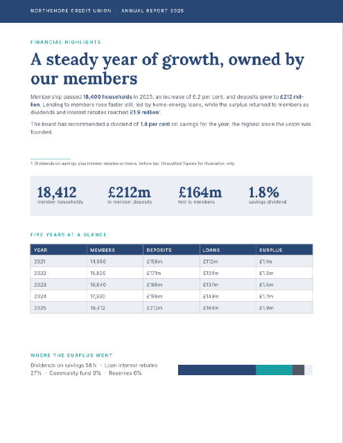

<!-- Generated by tools/gallery.mjs from showcase.yaml and build.json; do not edit. -->
# Credit Union Annual Report Page

[Layout](../README.md) › [Reports](../README.md#reports) · `report` `tables` `paragraph-styles` `character-styles` `footnotes`

A financial-highlights page with paragraph and character styles, key figures, a styled five-year table converted from tabbed text and a footnote.



| | |
|---|---|
| Document | [credit-union-annual-report.klayout](credit-union-annual-report.klayout) (70 KB) |
| Contents | 1 page; 9 stories; 10 paragraph styles |
| Features | `layout.type.styles`, `layout.table.edit`, `layout.table.cells`, `layout.notes.footnotes`, `layout.object.fill-stroke`, `layout.color.swatches` |
| Built by | `kition-layout` @ `e2c4271dc0`: 100 commands in 279 ms |

## About

Every text block uses paragraph styles (section label, H1, body, key figure, table text), and
the figures in the introduction are picked out with an "Emphasis Figure" character style found
by GREP. The five-year table starts as tab-separated paragraphs and becomes a table with
`table.convertFromText`; a table style ("Five Year") brings a header cell style, a body cell
style and alternating Mist rows. The footnote on the surplus figure uses its own paragraph style
and a short teal separator rule. The surplus split is four frames, one sized with
`transform.set`.

## Checks

- `inspect.pageCount`: `1`
- `inspect.paragraphStyles`: `{"contains":"Figure Label"}`
- `inspect.characterStyles`: `{"contains":"Emphasis Figure"}`
- `inspect.stories`: `{"all":{"overset":false}}`
- `results.emph`: `{"count":4}`
- `results.notes`: `{"count":1,"all":{"text":{"matches":"^Dividends on savings"}}}`
- `results.table`: `{"style":"Five Year","headerRows":1,"rows":{"count":6},"columns":{"count":5},"cells":{"count":30,"any":{"row":0,"style":"Head Cell","fill":"Harbour Blue","text":"Year"}}}`
- `results.table.options.altRows`: `{"firstColor":"Mist","nextColor":"[Paper]"}`
- `results.barInfo`: `{"width":139.2,"x":318}`
- `results.fonts`: `{"all":{"missing":false,"styleMissing":false}}`
- diagnostics: none (the kit's check finds nothing wrong)
- the saved document opens again; the thumbnail matches `thumb.png` within the `render` tolerance

## Steps

<details><summary>100 commands (from <a href="showcase.yaml">showcase.yaml</a>)</summary>

```yaml
- command: layout.marginsAndColumns
  params:
    margins:
      top: 54
      bottom: 54
      inside: 54
      outside: 54
    columns: 4
    gutter: 12
- command: swatch.create
  params:
    name: Harbour Blue
    color:
      c: 95
      m: 70
      y: 25
      k: 15
- command: swatch.create
  params:
    name: Teal
    color:
      c: 75
      m: 10
      y: 40
      k: 0
- command: swatch.create
  params:
    name: Mist
    color:
      c: 8
      m: 3
      y: 2
      k: 0
- command: swatch.create
  params:
    name: Slate
    color:
      c: 55
      m: 40
      y: 30
      k: 40
- command: style.paragraph.create
  params:
    name: Section
    para:
      spaceAfter: 4
    chars:
      fontFamily: Inter
      fontStyle: SemiBold
      size: 8
      tracking: 200
      capitalization: allCaps
      fill: Teal
- command: style.paragraph.create
  params:
    name: H1
    para:
      spaceAfter: 12
      hyphenate: false
    chars:
      fontFamily: Lora
      fontStyle: Bold
      size: 30
      leading:
        kind: points
        value: 34
      fill: Harbour Blue
- command: style.paragraph.create
  params:
    name: Body
    para:
      spaceAfter: 7
      hyphenate: true
    chars:
      fontFamily: Inter
      fontStyle: Regular
      size: 9.5
      leading:
        kind: points
        value: 14
      fill: Slate
- command: style.paragraph.create
  params:
    name: Figure
    chars:
      fontFamily: Lora
      fontStyle: Bold
      size: 26
      leading:
        kind: points
        value: 28
      fill: Harbour Blue
- command: style.paragraph.create
  params:
    name: Figure Label
    chars:
      fontFamily: Inter
      fontStyle: Regular
      size: 8.5
      leading:
        kind: points
        value: 11
      fill: Slate
- command: style.paragraph.create
  params:
    name: Table Text
    chars:
      fontFamily: Inter
      fontStyle: Regular
      size: 9
      leading:
        kind: points
        value: 12
      fill: Slate
- command: style.paragraph.create
  params:
    name: Table Head
    chars:
      fontFamily: Inter
      fontStyle: SemiBold
      size: 8
      tracking: 80
      capitalization: allCaps
      fill: "[Paper]"
- command: style.paragraph.create
  params:
    name: Footnote
    chars:
      fontFamily: Inter
      fontStyle: Regular
      size: 7.5
      leading:
        kind: points
        value: 10
      fill: Slate
- command: footnote.options
  params:
    paraStyle: Footnote
    separator: "  "
    rule:
      on: true
      weight: 0.5
      color: Teal
      width: 72
- command: style.character.create
  params:
    name: Emphasis Figure
    chars:
      fontStyle: SemiBold
      fill: Harbour Blue
- command: frame.create
  params:
    rect:
      - -9
      - -9
      - 621
      - 40
    content: graphic
  as: band
- command: object.fill
  params:
    ids:
      - $band.id
    swatch: Harbour Blue
- command: frame.create
  params:
    rect:
      - 54
      - 14
      - 558
      - 28
    text: Northshore Credit Union  ·  Annual Report 2025
  as: header
- command: text.select
  params:
    story: $header.story
    anchor: 0
    focus: 1
- command: type.char
  params:
    attrs:
      fontFamily: Inter
      fontStyle: Medium
      size: 8
      tracking: 160
      capitalization: allCaps
      fill: "[Paper]"
- command: text.select
  params:
    story: $header.story
    anchor: 0
    focus: 50
- command: type.char
  params:
    attrs:
      fontFamily: Inter
      fontStyle: Medium
      size: 8
      tracking: 160
      capitalization: allCaps
      fill: "[Paper]"
- command: text.exitToFrame
  params: {}
- command: frame.create
  params:
    rect:
      - 54
      - 70
      - 558
      - 296
    text: |-
      Financial highlights
      A steady year of growth, owned by our members
      Membership passed 18,400 households in 2025, an increase of 6.2 per cent, and deposits grew to £212 million. Lending to members rose faster still, led by home-energy loans, while the surplus returned to members as dividends and interest rebates reached £1.9 million.
      The board has recommended a dividend of 1.8 per cent on savings for the year, the highest since the union was founded.
  as: intro
- command: story.get
  params:
    frame: $intro.id
  as: introText
- command: text.select
  params:
    story: $intro.story
    anchor: 0
    focus: $introText.length
- command: style.paragraph.apply
  params:
    name: Body
- command: text.select
  params:
    story: $intro.story
    anchor: 0
    focus: 1
- command: style.paragraph.apply
  params:
    name: Section
- command: text.select
  params:
    story: $intro.story
    anchor: 22
    focus: 23
- command: style.paragraph.apply
  params:
    name: H1
- command: find.find
  params:
    find: 18,400 households|£212 million|£1.9 million|1.8 per cent
    grep: true
    story: $intro.story
    scope: story
  as: emph
- command: text.select
  params:
    story: $intro.story
    anchor: $emph.0.start
    focus: $emph.0.end
- command: style.character.apply
  params:
    name: Emphasis Figure
- command: text.select
  params:
    story: $intro.story
    anchor: $emph.1.start
    focus: $emph.1.end
- command: style.character.apply
  params:
    name: Emphasis Figure
- command: text.select
  params:
    story: $intro.story
    anchor: $emph.2.start
    focus: $emph.2.end
- command: style.character.apply
  params:
    name: Emphasis Figure
- command: text.select
  params:
    story: $intro.story
    anchor: $emph.3.start
    focus: $emph.3.end
- command: style.character.apply
  params:
    name: Emphasis Figure
- command: text.select
  params:
    story: $intro.story
    anchor: $emph.2.end
    focus: $emph.2.end
- command: footnote.insert
  params:
    text: Dividends on savings plus interest rebates on loans, before tax. Unaudited figures for illustration only.
- command: text.exitToFrame
  params: {}
- command: frame.create
  params:
    rect:
      - 54
      - 314
      - 558
      - 386
    content: graphic
  as: figBand
- command: object.fill
  params:
    ids:
      - $figBand.id
    swatch: Mist
- command: frame.create
  params:
    rect:
      - 66
      - 326
      - 174
      - 382
    text: |-
      18,412
      member households
  as: k1
- command: frame.create
  params:
    rect:
      - 192
      - 326
      - 300
      - 382
    text: |-
      £212m
      in member deposits
  as: k2
- command: frame.create
  params:
    rect:
      - 318
      - 326
      - 426
      - 382
    text: |-
      £164m
      lent to members
  as: k3
- command: frame.create
  params:
    rect:
      - 444
      - 326
      - 552
      - 382
    text: |-
      1.8%
      savings dividend
  as: k4
- command: text.select
  params:
    story: $k1.story
    anchor: 0
    focus: 1
- command: style.paragraph.apply
  params:
    name: Figure
- command: text.select
  params:
    story: $k1.story
    anchor: 8
    focus: 9
- command: style.paragraph.apply
  params:
    name: Figure Label
- command: text.select
  params:
    story: $k2.story
    anchor: 0
    focus: 1
- command: style.paragraph.apply
  params:
    name: Figure
- command: text.select
  params:
    story: $k2.story
    anchor: 8
    focus: 9
- command: style.paragraph.apply
  params:
    name: Figure Label
- command: text.select
  params:
    story: $k3.story
    anchor: 0
    focus: 1
- command: style.paragraph.apply
  params:
    name: Figure
- command: text.select
  params:
    story: $k3.story
    anchor: 8
    focus: 9
- command: style.paragraph.apply
  params:
    name: Figure Label
- command: text.select
  params:
    story: $k4.story
    anchor: 0
    focus: 1
- command: style.paragraph.apply
  params:
    name: Figure
- command: text.select
  params:
    story: $k4.story
    anchor: 6
    focus: 7
- command: style.paragraph.apply
  params:
    name: Figure Label
- command: text.exitToFrame
  params: {}
- command: frame.create
  params:
    rect:
      - 54
      - 414
      - 558
      - 432
    text: Five years at a glance
  as: tableHead
- command: text.select
  params:
    story: $tableHead.story
    anchor: 0
    focus: 1
- command: style.paragraph.apply
  params:
    name: Section
- command: text.exitToFrame
  params: {}
- command: frame.create
  params:
    rect:
      - 54
      - 436
      - 558
      - 600
    text: |-
      Year	Members	Deposits	Loans	Surplus
      2021	14,950	£158m	£112m	£1.1m
      2022	15,820	£171m	£124m	£1.3m
      2023	16,640	£186m	£137m	£1.5m
      2024	17,330	£199m	£149m	£1.7m
      2025	18,412	£212m	£164m	£1.9m
  as: tableFrame
- command: story.get
  params:
    frame: $tableFrame.id
  as: tableText
- command: text.select
  params:
    story: $tableFrame.story
    anchor: 0
    focus: $tableText.length
- command: style.paragraph.apply
  params:
    name: Table Text
- command: table.convertFromText
  params:
    columnSeparator: tab
- command: style.cell.create
  params:
    name: Head Cell
    fill: Harbour Blue
    insets:
      - 6
      - 6
      - 6
      - 6
    paragraphStyle: Table Head
- command: style.cell.create
  params:
    name: Body Cell
    insets:
      - 6
      - 6
      - 6
      - 6
    stroke:
      weight: 0.5
      color: Slate
      tint: 0.3
- command: style.table.create
  params:
    name: Five Year
    header: Head Cell
    body: Body Cell
    border:
      weight: 0.5
      color: Slate
    altRows:
      first: 1
      firstColor: Mist
      next: 1
      nextColor: "[Paper]"
- command: table.options
  params:
    headerRows: 1
- command: style.table.apply
  params:
    name: Five Year
- command: table.get
  params: {}
  as: table
- command: text.exitToFrame
  params: {}
- command: frame.create
  params:
    rect:
      - 54
      - 630
      - 300
      - 738
    text: |-
      Where the surplus went
      Dividends on savings 58%  ·  Loan interest rebates 27%  ·  Community fund 9%  ·  Reserves 6%
  as: splitText
- command: text.select
  params:
    story: $splitText.story
    anchor: 0
    focus: 1
- command: style.paragraph.apply
  params:
    name: Section
- command: text.select
  params:
    story: $splitText.story
    anchor: 24
    focus: 25
- command: style.paragraph.apply
  params:
    name: Body
- command: text.exitToFrame
  params: {}
- command: frame.create
  params:
    rect:
      - 318
      - 652
      - 558
      - 670
    content: graphic
  as: s1
- command: object.fill
  params:
    ids:
      - $s1.id
    swatch: Harbour Blue
- command: transform.set
  params:
    ids:
      - $s1.id
    width: 139.2
    ref: 0
- command: transform.info
  params:
    ids:
      - $s1.id
  as: barInfo
- command: frame.create
  params:
    rect:
      - 457.2
      - 652
      - 522
      - 670
    content: graphic
  as: s2
- command: object.fill
  params:
    ids:
      - $s2.id
    swatch: Teal
- command: frame.create
  params:
    rect:
      - 522
      - 652
      - 543.6
      - 670
    content: graphic
  as: s3
- command: object.fill
  params:
    ids:
      - $s3.id
    swatch: Slate
- command: frame.create
  params:
    rect:
      - 543.6
      - 652
      - 558
      - 670
    content: graphic
  as: s4
- command: object.fill
  params:
    ids:
      - $s4.id
    swatch: Mist
- command: footnote.list
  params: {}
  as: notes
- command: font.list
  params: {}
  as: fonts
```

</details>
