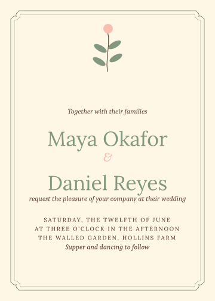

<!-- Generated by tools/gallery.mjs from showcase.yaml and build.json; do not edit. -->
# Garden Wedding Invitation

[Layout](../README.md) › [Stationery](../README.md#stationery) · `invitation` `wedding` `corner-options` `typography` `transform`

A 5 × 7 in wedding invitation — centred serif type, an inset border with fancy corners and a botanical sprig built from rotated leaf frames.



| | |
|---|---|
| Document | [garden-wedding-invitation.klayout](garden-wedding-invitation.klayout) (31 KB) |
| Contents | 1 page; 1 story; 6 paragraph styles |
| Features | `layout.object.options`, `layout.type.styles`, `layout.transform.objects`, `layout.object.fill-stroke`, `layout.color.swatches` |
| Built by | `kition-layout` @ `e2c4271dc0`: 46 commands in 281 ms |

## About

A single 5 × 7 in card on an ivory page background. The border is two frames: an outer hairline
with Fancy corner options and an inner one with Inverse Rounded corners. The sprig is a curved
stem with four ellipse leaves rotated ±30° and copied up with `transform.move {copy: true}`. The
wording is one story with vertical justification centred, in five paragraph styles (names and
details found by GREP).

## Checks

- `inspect.pageCount`: `1`
- `inspect.spreads.0.pages.0.background`: `"Ivory"`
- `inspect.spreads.0.items.0`: `{"kind":"<rectangle>","corner":{"shape":"fancy","size":14}}`
- `inspect.spreads.0.items.1`: `{"corner":{"shape":"inverseRounded","size":10}}`
- `inspect.swatchColors`: `{"any":{"name":"Ivory","color":{"matches":"^#f"}}}`
- `inspect.paragraphStyles`: `{"contains":"Names"}`
- `inspect.stories`: `{"count":1,"all":{"overset":false,"paragraphs":9}}`
- `results.names`: `{"count":2}`
- `results.details`: `{"count":3}`
- `results.fonts`: `{"all":{"missing":false,"styleMissing":false}}`
- diagnostics: none (the kit's check finds nothing wrong)
- the saved document opens again; the thumbnail matches `thumb.png` within the `render` tolerance

## Steps

<details><summary>46 commands (from <a href="showcase.yaml">showcase.yaml</a>)</summary>

```yaml
- command: layout.documentSetup
  params:
    bleed: 9
- command: swatch.create
  params:
    name: Ivory
    color:
      c: 0
      m: 3
      y: 10
      k: 0
- command: swatch.create
  params:
    name: Sage
    color:
      c: 45
      m: 15
      y: 45
      k: 15
- command: swatch.create
  params:
    name: Blush
    color:
      c: 0
      m: 30
      y: 20
      k: 0
- command: swatch.create
  params:
    name: Bark
    color:
      c: 40
      m: 55
      y: 60
      k: 45
- command: page.background
  params:
    color: Ivory
- command: frame.create
  params:
    rect:
      - 18
      - 18
      - 342
      - 486
    content: graphic
  as: border
- command: object.stroke
  params:
    ids:
      - $border.id
    swatch: Sage
    weight: 1
- command: object.cornerOptions
  params:
    ids:
      - $border.id
    shape: fancy
    size: 14
- command: frame.create
  params:
    rect:
      - 24
      - 24
      - 336
      - 480
    content: graphic
  as: border2
- command: object.stroke
  params:
    ids:
      - $border2.id
    swatch: Sage
    weight: 0.5
- command: object.cornerOptions
  params:
    ids:
      - $border2.id
    shape: inverseRounded
    size: 10
- command: path.create
  params:
    anchors:
      - p:
          - 180
          - 120
        out:
          - 176
          - 95
      - p:
          - 180
          - 52
        in:
          - 186
          - 75
  as: stem
- command: object.stroke
  params:
    ids:
      - $stem.id
    swatch: Bark
    weight: 1.2
- command: frame.create
  params:
    shape: ellipse
    rect:
      - 182
      - 92
      - 206
      - 102
    content: graphic
  as: leafR1
- command: object.fill
  params:
    ids:
      - $leafR1.id
    swatch: Sage
- command: transform.rotate
  params:
    ids:
      - $leafR1.id
    angle: 30
- command: transform.move
  params:
    ids:
      - $leafR1.id
    dx: -2
    dy: -22
    copy: true
  as: leafR2
- command: frame.create
  params:
    shape: ellipse
    rect:
      - 154
      - 98
      - 178
      - 108
    content: graphic
  as: leafL1
- command: object.fill
  params:
    ids:
      - $leafL1.id
    swatch: Sage
- command: transform.rotate
  params:
    ids:
      - $leafL1.id
    angle: -30
- command: transform.move
  params:
    ids:
      - $leafL1.id
    dx: 2
    dy: -22
    copy: true
  as: leafL2
- command: frame.create
  params:
    shape: ellipse
    rect:
      - 173
      - 40
      - 189
      - 56
    content: graphic
  as: bud
- command: object.fill
  params:
    ids:
      - $bud.id
    swatch: Blush
- command: style.paragraph.create
  params:
    name: Invite Small
    para:
      align: center
      spaceAfter: 6
    chars:
      fontFamily: Caladea
      fontStyle: Italic
      size: 12
      leading:
        kind: points
        value: 16
      fill: Bark
- command: style.paragraph.create
  params:
    name: Names
    para:
      align: center
      spaceBefore: 10
      spaceAfter: 2
      hyphenate: false
    chars:
      fontFamily: Lora
      fontStyle: Regular
      size: 34
      leading:
        kind: points
        value: 38
      fill: Sage
- command: style.paragraph.create
  params:
    name: Ampersand
    para:
      align: center
    chars:
      fontFamily: Caladea
      fontStyle: Italic
      size: 22
      leading:
        kind: points
        value: 24
      fill: Blush
- command: style.paragraph.create
  params:
    name: Details
    para:
      align: center
      spaceBefore: 14
    chars:
      fontFamily: Lora
      fontStyle: Medium
      size: 9.5
      leading:
        kind: points
        value: 15
      tracking: 180
      capitalization: allCaps
      fill: Bark
- command: frame.create
  params:
    rect:
      - 42
      - 130
      - 318
      - 470
    text: |-
      Together with their families
      Maya Okafor
      &
      Daniel Reyes
      request the pleasure of your company at their wedding
      Saturday, the twelfth of June
      at three o'clock in the afternoon
      The Walled Garden, Hollins Farm
      Supper and dancing to follow
  as: invite
- command: story.get
  params:
    frame: $invite.id
  as: inviteText
- command: text.select
  params:
    story: $invite.story
    anchor: 0
    focus: $inviteText.length
- command: style.paragraph.apply
  params:
    name: Invite Small
- command: find.find
  params:
    find: ^(Maya Okafor|Daniel Reyes)$
    grep: true
    story: $invite.story
    scope: story
  as: names
- command: text.select
  params:
    story: $invite.story
    anchor: $names.0.start
    focus: $names.1.end
- command: style.paragraph.apply
  params:
    name: Names
- command: find.find
  params:
    find: ^&$
    grep: true
    story: $invite.story
    scope: story
  as: amp
- command: text.select
  params:
    story: $invite.story
    anchor: $amp.0.start
    focus: $amp.0.end
- command: style.paragraph.apply
  params:
    name: Ampersand
- command: find.find
  params:
    find: ^Saturday.*$|^at three.*$|^The Walled.*$
    grep: true
    story: $invite.story
    scope: story
  as: details
- command: text.select
  params:
    story: $invite.story
    anchor: $details.0.start
    focus: $details.2.end
- command: style.paragraph.apply
  params:
    name: Details
- command: text.select
  params:
    story: $invite.story
    anchor: $details.1.start
    focus: $details.2.end
- command: type.para
  params:
    attrs:
      spaceBefore: 0
- command: text.exitToFrame
  params: {}
- command: object.textFrameOptions
  params:
    ids:
      - $invite.id
    verticalJustification: center
- command: font.list
  params: {}
  as: fonts
```

</details>
