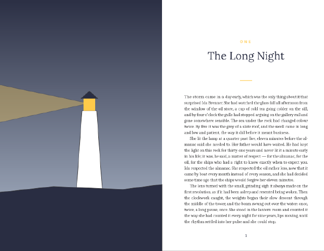

<!-- Generated by tools/gallery.mjs from showcase.yaml and build.json; do not edit. -->
# Lantern Keeper Novel Interior

[Layout](../README.md) › [Magazines & Books](../README.md#magazines--books) · `book` `parent-pages` `page-numbers` `sections` `autoflow` `threaded-frames`

A trade-paperback novel — cover, frontispiece and a chapter that autoflows across pages under two parent pages with running heads and numbered folios.



| | |
|---|---|
| Document | [lantern-keeper-novel.klayout](lantern-keeper-novel.klayout) (65 KB) |
| Contents | 5 pages; 8 stories; 8 paragraph styles |
| Features | `layout.layout.pages`, `layout.text.threaded-frames`, `layout.type.styles`, `layout.layout.pages-guides`, `layout.object.fill-stroke`, `layout.color.swatches` |
| Built by | `kition-layout` @ `e2c4271dc0`: 96 commands in 201 ms |

## About

A 5.5 × 8.5 in book with facing pages. Two parents carry the furniture: B-Body has running heads
(book title verso, chapter recto) and outside folios, C-Opener only a centred drop folio. Both
folios are the current-page-number marker, and a section starting on page 3 numbers the chapter
from 1. The chapter is one story: it starts low on the opener page and `frame.thread {page,
autoflow: true}` threads it through frames on the margins of following pages, adding pages
until it fits. The thumbnail shows the frontispiece and opener spread.

## Checks

- `inspect.pageCount`: `5`
- `inspect.spreads.0.pages.0`: `{"name":"1","parent":null}`
- `inspect.spreads.1.pages.0`: `{"name":"2","parent":null}`
- `inspect.spreads.1.pages.1`: `{"name":"1","parent":"C-Opener"}`
- `inspect.spreads.2.pages`: `{"count":2,"all":{"parent":"B-Body"}}`
- `inspect.spreads.2.pages.1.name`: `"3"`
- `inspect.parents`: `{"count":3,"any":{"label":"B-Body","items":4}}`
- `inspect.stories`: `{"all":{"overset":false},"any":{"frames":{"count":3}}}`
- `inspect.characterStyles`: `{"contains":"Small Caps Lead"}`
- `results.flow`: `{"frames":{"count":3},"overset":false,"pagesAdded":1}`
- `results.fonts`: `{"all":{"missing":false,"styleMissing":false}}`
- diagnostics: none (the kit's check finds nothing wrong)
- the saved document opens again; the thumbnail matches `thumb.png` within the `render` tolerance

## Steps

<details><summary>96 commands (from <a href="showcase.yaml">showcase.yaml</a>)</summary>

```yaml
- command: layout.documentSetup
  params:
    pages: 4
    facingPages: true
    bleed: 9
- command: layout.marginsAndColumns
  params:
    margins:
      top: 54
      bottom: 64
      inside: 54
      outside: 40
- command: swatch.create
  params:
    name: Midnight
    color:
      c: 88
      m: 75
      y: 40
      k: 50
- command: swatch.create
  params:
    name: Lamplight
    color:
      c: 0
      m: 22
      y: 75
      k: 0
- command: swatch.create
  params:
    name: Fog
    color:
      c: 20
      m: 10
      y: 8
      k: 0
- command: style.paragraph.create
  params:
    name: Body
    para:
      align: leftJustified
      firstLineIndent: 14
      hyphenate: true
    chars:
      fontFamily: Caladea
      fontStyle: Regular
      size: 10.5
      leading:
        kind: points
        value: 14.5
- command: style.paragraph.create
  params:
    name: Body First
    basedOn: Body
    para:
      firstLineIndent: 0
- command: style.paragraph.create
  params:
    name: Running Head
    para:
      align: center
    chars:
      fontFamily: Inter
      fontStyle: Medium
      size: 7
      tracking: 220
      capitalization: allCaps
      fill: Midnight
- command: style.paragraph.create
  params:
    name: Folio
    chars:
      fontFamily: Caladea
      fontStyle: Regular
      size: 9
      fill: Midnight
- command: style.paragraph.create
  params:
    name: Chapter Number
    para:
      align: center
      spaceAfter: 10
    chars:
      fontFamily: Inter
      fontStyle: SemiBold
      size: 9
      tracking: 400
      capitalization: allCaps
      fill: Lamplight
- command: style.paragraph.create
  params:
    name: Chapter Title
    para:
      align: center
    chars:
      fontFamily: Lora
      fontStyle: Regular
      size: 26
      leading:
        kind: points
        value: 30
      fill: Midnight
- command: style.character.create
  params:
    name: Small Caps Lead
    chars:
      capitalization: smallCaps
      tracking: 60
- command: layout.parents.new
  params:
    prefix: B
    name: Body
  as: parentB
- command: frame.create
  params:
    spread: B
    rect:
      - 40
      - 28
      - 342
      - 40
    text: The Lantern Keeper
  as: headL
- command: text.select
  params:
    story: $headL.story
    anchor: 0
    focus: 1
- command: style.paragraph.apply
  params:
    name: Running Head
- command: frame.create
  params:
    spread: B
    rect:
      - 450
      - 28
      - 752
      - 40
    text: One  ·  The Long Night
  as: headR
- command: text.select
  params:
    story: $headR.story
    anchor: 0
    focus: 1
- command: style.paragraph.apply
  params:
    name: Running Head
- command: frame.create
  params:
    spread: B
    rect:
      - 40
      - 570
      - 200
      - 584
    text: 
  as: folioL
- command: text.select
  params:
    story: $folioL.story
    anchor: 0
    focus: 1
- command: style.paragraph.apply
  params:
    name: Folio
- command: frame.create
  params:
    spread: B
    rect:
      - 592
      - 570
      - 752
      - 584
    text: 
  as: folioR
- command: text.select
  params:
    story: $folioR.story
    anchor: 0
    focus: 1
- command: style.paragraph.apply
  params:
    name: Folio
- command: type.alignRight
  params: {}
- command: text.exitToFrame
  params: {}
- command: layout.parents.new
  params:
    prefix: C
    name: Opener
  as: parentC
- command: frame.create
  params:
    spread: C
    rect:
      - 450
      - 570
      - 752
      - 584
    text: 
  as: dropFolio
- command: text.select
  params:
    story: $dropFolio.story
    anchor: 0
    focus: 1
- command: style.paragraph.apply
  params:
    name: Folio
- command: type.alignCenter
  params: {}
- command: text.exitToFrame
  params: {}
- command: layout.pages.applyParent
  params:
    pages:
      - 1
      - 2
    parent: null
- command: layout.pages.applyParent
  params:
    pages:
      - 3
    parent: C
- command: layout.pages.applyParent
  params:
    pages:
      - 4
    parent: B
- command: layout.section
  params:
    page: 3
    startNumber: 1
    style: arabic
- command: frame.create
  params:
    spread: 0
    rect:
      - -9
      - -9
      - 405
      - 621
    content: graphic
  as: coverBg
- command: object.fill
  params:
    ids:
      - $coverBg.id
    swatch: Midnight
- command: frame.create
  params:
    spread: 0
    shape: ellipse
    rect:
      - 98
      - 150
      - 298
      - 350
    content: graphic
  as: glow
- command: object.fill
  params:
    ids:
      - $glow.id
    swatch: Lamplight
- command: object.opacity
  params:
    ids:
      - $glow.id
    opacity: 0.25
- command: frame.create
  params:
    spread: 0
    shape: ellipse
    rect:
      - 148
      - 200
      - 248
      - 300
    content: graphic
  as: glow2
- command: object.fill
  params:
    ids:
      - $glow2.id
    swatch: Lamplight
- command: object.opacity
  params:
    ids:
      - $glow2.id
    opacity: 0.45
- command: frame.create
  params:
    spread: 0
    rect:
      - 176
      - 222
      - 220
      - 282
    content: graphic
  as: lamp
- command: object.fill
  params:
    ids:
      - $lamp.id
    swatch: Lamplight
- command: object.cornerOptions
  params:
    ids:
      - $lamp.id
    shape: rounded
    size: 6
- command: path.create
  params:
    spread: 0
    closed: true
    anchors:
      - p:
          - 170
          - 222
      - p:
          - 198
          - 196
      - p:
          - 226
          - 222
  as: roof
- command: object.fill
  params:
    ids:
      - $roof.id
    swatch: Fog
- command: frame.create
  params:
    spread: 0
    rect:
      - 36
      - 380
      - 360
      - 560
    text: |-
      The Lantern Keeper
      A novel
      Elin Varga
  as: coverText
- command: text.select
  params:
    story: $coverText.story
    anchor: 0
    focus: 1
- command: type.para
  params:
    attrs:
      align: center
      spaceAfter: 8
- command: text.select
  params:
    story: $coverText.story
    anchor: 0
    focus: 18
- command: type.char
  params:
    attrs:
      fontFamily: Lora
      fontStyle: Bold
      size: 34
      leading:
        kind: points
        value: 36
      fill: "[Paper]"
- command: text.select
  params:
    story: $coverText.story
    anchor: 19
    focus: 37
- command: type.para
  params:
    attrs:
      align: center
      spaceAfter: 60
- command: type.char
  params:
    attrs:
      fontFamily: Caladea
      fontStyle: Italic
      size: 14
      fill: Fog
- command: find.find
  params:
    find: Elin Varga
    story: $coverText.story
    scope: story
  as: author
- command: text.select
  params:
    story: $coverText.story
    anchor: $author.0.start
    focus: $author.0.end
- command: type.para
  params:
    attrs:
      align: center
- command: type.char
  params:
    attrs:
      fontFamily: Inter
      fontStyle: SemiBold
      size: 10
      tracking: 400
      capitalization: allCaps
      fill: Lamplight
- command: text.exitToFrame
  params: {}
- command: frame.create
  params:
    spread: 1
    rect:
      - -9
      - -9
      - 396
      - 621
    content: graphic
  as: sky
- command: object.gradient
  params:
    ids:
      - $sky.id
    kind: linear
    angle: 90
    stops:
      - location: 0
        color:
          c: 30
          m: 15
          y: 10
          k: 0
      - location: 100
        color:
          c: 88
          m: 75
          y: 40
          k: 50
- command: path.create
  params:
    spread: 1
    closed: true
    anchors:
      - p:
          - 218
          - 252
      - p:
          - -9
          - 205
      - p:
          - -9
          - 300
  as: beam
- command: object.fill
  params:
    ids:
      - $beam.id
    swatch: Lamplight
- command: object.opacity
  params:
    ids:
      - $beam.id
    opacity: 0.35
- command: path.create
  params:
    spread: 1
    closed: true
    anchors:
      - p:
          - 200
          - 270
      - p:
          - 236
          - 270
      - p:
          - 250
          - 470
      - p:
          - 186
          - 470
  as: tower
- command: object.fill
  params:
    ids:
      - $tower.id
    swatch: "[Paper]"
- command: frame.create
  params:
    spread: 1
    rect:
      - 204
      - 238
      - 232
      - 270
    content: graphic
  as: lantern
- command: object.fill
  params:
    ids:
      - $lantern.id
    swatch: Lamplight
- command: path.create
  params:
    spread: 1
    closed: true
    anchors:
      - p:
          - 198
          - 240
      - p:
          - 218
          - 222
      - p:
          - 238
          - 240
  as: cap
- command: object.fill
  params:
    ids:
      - $cap.id
    swatch: Midnight
- command: path.create
  params:
    spread: 1
    closed: true
    anchors:
      - p:
          - -9
          - 470
      - p:
          - 130
          - 455
      - p:
          - 300
          - 462
      - p:
          - 396
          - 450
      - p:
          - 396
          - 621
      - p:
          - -9
          - 621
  as: rocks
- command: object.fill
  params:
    ids:
      - $rocks.id
    swatch: Midnight
- command: frame.create
  params:
    spread: 1
    rect:
      - 450
      - 96
      - 752
      - 200
    text: |-
      One
      The Long Night
  as: chapterHead
- command: text.select
  params:
    story: $chapterHead.story
    anchor: 0
    focus: 1
- command: style.paragraph.apply
  params:
    name: Chapter Number
- command: text.select
  params:
    story: $chapterHead.story
    anchor: 5
    focus: 6
- command: style.paragraph.apply
  params:
    name: Chapter Title
- command: text.exitToFrame
  params: {}
- command: path.create
  params:
    spread: 1
    anchors:
      - p:
          - 586
          - 196
      - p:
          - 616
          - 196
  as: ornament
- command: object.stroke
  params:
    ids:
      - $ornament.id
    swatch: Lamplight
    weight: 1.5
- command: frame.create
  params:
    spread: 1
    rect:
      - 450
      - 230
      - 752
      - 548
    text: |-
      The storm came in a day early, which was the only thing about it that surprised Ida Brenner. She had watched the glass fall all afternoon from the window of the oil store, a cup of cold tea going colder on the sill, and by four o'clock the gulls had stopped arguing on the gallery rail and gone somewhere sensible. The sea under the rock had changed colour twice. By five it was the grey of a slate roof, and the swell came in long and low and patient, the way it did before it meant business.
      She lit the lamp at a quarter past five, eleven minutes before the almanac said she needed to. Her father would have waited. He had kept the light on this rock for thirty-one years and never lit it a minute early in his life; it was, he said, a matter of respect — for the almanac, for the oil, for the ships who had a right to know exactly when to expect you. Ida respected the almanac. She respected the oil rather less, now that it came by boat every month instead of every season, and she had decided some time ago that the ships would forgive her eleven minutes.
      The lens turned with the small, grinding sigh it always made on the first revolution, as if it had been asleep and resented being woken. Then the clockwork caught, the weights began their slow descent through the middle of the tower, and the beam swung out over the water: once, twice, a long pause, once. She stood in the lantern room and counted it the way she had counted it every night for nine years, lips moving, until the rhythm settled into her pulse and she could stop.
      Below, the keeper's cottage was dark. The second keeper's post had been empty since the spring, when Tomas Hale had taken the supply boat back to the mainland with his sea chest and a letter from the board that he would not let her read. She had applied for a replacement in April and again in July. The board had written back both times to say that her application was receiving their attention. She imagined it sitting on a desk somewhere in the city, receiving attention, the way a stone on a beach receives the tide.
      So it was one keeper on the rock, which was against regulations, and one keeper on the night of the first great storm of the autumn, which was against sense. Ida made a fresh pot of tea, put on her father's oilskin over her own, and climbed the hundred and twelve steps again with the pot in one hand and the storm lantern in the other.
      By eight the wind had found its voice. It came round the gallery in a long rising note that she felt in her teeth more than heard, and every few minutes a sea would break against the west face of the rock hard enough to shiver the tea in her cup. The glass streamed. The beam went out into a world of flying water and came back to her as a pale reflected glow, as if the night itself were lit from inside.
      It was a little after nine when she saw the other light.
      At first she took it for a trick of the spray — a scrap of her own beam thrown back by a wave top. But it came again in the same place, low on the water to the south-west, and it did not move with her beam. It moved on its own: a small yellow point that rose and vanished, rose and vanished, with the patience of something being carried on a very large sea.
      Ida put down her cup. There was nothing on the almanac for tonight, no vessel expected, no fishing boat fool enough to be out. She took the glass from its hook and braced her elbows on the rail and waited for the beam to come round.
      Once, twice, a long pause, once.
      In the long pause she saw it clearly: a lantern, swinging at the masthead of a boat far too small to be where it was.
      She did not decide to go down. Afterwards she could remember the cup on the sill, the glass back on its hook, and then the cold iron of the stair rail sliding under her palm, flight after flight, as if her legs had made the decision and simply not consulted her. The storm lantern swung from her other hand and threw her shadow up the curved wall ahead of her, huge and hurrying.
      At the door of the oil store she stopped long enough to pull the rope coil off its peg and sling it over her shoulder. Then she put her weight against the outer door, felt the wind take it out of her hands, and stepped out onto the rock into a noise like the whole sea being poured through a narrow gate.
  as: chapter
- command: story.get
  params:
    frame: $chapter.id
  as: chapterText
- command: text.select
  params:
    story: $chapter.story
    anchor: 0
    focus: $chapterText.length
- command: style.paragraph.apply
  params:
    name: Body
- command: text.select
  params:
    story: $chapter.story
    anchor: 0
    focus: 1
- command: style.paragraph.apply
  params:
    name: Body First
- command: text.select
  params:
    story: $chapter.story
    anchor: 0
    focus: 21
- command: style.character.apply
  params:
    name: Small Caps Lead
- command: text.exitToFrame
  params: {}
- command: frame.thread
  params:
    from: $chapter.id
    page: 4
    autoflow: true
  as: flow
- command: story.get
  params:
    frame: $chapter.id
  as: chapterAfter
- command: font.list
  params: {}
  as: fonts
```

</details>
